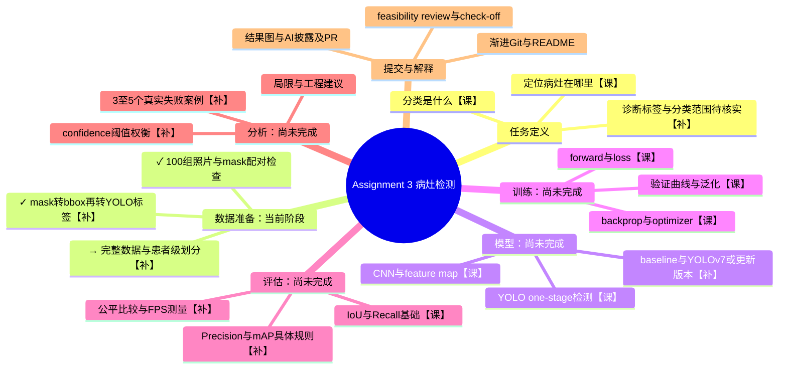

# Assignment 3：项目与学习思维导图

最后更新：2026-10-12。用途：解释整个项目、定位当前进度、把代码与课堂知识对应起来。
本文记录的是实际完成状态，不把计划当成结果，也不把 AI 解释过等同于学生已经掌握。

## 图例与总目标

- ✓：已执行并有检查证据；→：当前下一步；○：尚未完成。
- 【课】：已在课堂录音转写中找到对应内容；不表示已掌握，也不表示一定考。
- 【补】：作业需要补充的具体方法，尚未在已核对录音中确认讲解。
- 【工具】：运行/协作工具，不是本项目的算法目标。

目标不是“在 A100 上跑起来”，而是建立可复现的皮肤病灶检测实验：
根据图像预测病灶位置，并核实和完成说明中的分类要求；用独立数据证明效果、分析漏检与误检。
现在的 `0 = lesion` 只是定位标注流程验证，不代表良性/恶性分类已经解决。

外围工具：Windows / PyCharm / GitHub / SSH / Slurm / A100。环境检查已完成；GPU 矩阵运算成功不等于模型训练成功。
工具问题另列，不让它们盖过数据、学习、评估这条主线。

## 实验流程与每一步的产物

| 阶段 | 要回答的问题 | 应产生的结果 | 实际进度 |
| --- | --- | --- | --- |
| 1. 任务与标签 | 我预测位置、类别，还是像素？类别标签可靠么？ | 明确任务、类别映射和来源 | 检测方向已选；诊断/分类范围未落实 |
| 2. 数据检查与转换 | 图片和答案对不对？mask如何变成框？ | 数据审计、YOLO标签、对照图 | 本地官方验证集100组检查并转换；6张预览；5项测试通过 |
| 3. 正式划分 | 新患者上能否泛化？有没有泄漏？ | 固定train/val/test清单与患者互斥检查 | 下一步；patient ID元数据未确认 |
| 4. Baseline | 简单或默认方法能做到什么？ | 可复现参考结果 | 尚未选定并训练；未改动的默认配置可作为候选，不冒充有效病灶检测结果 |
| 5. 正式YOLO训练 | 怎么学习适合病灶的特征与框？ | 权重、loss/验证曲线、完整实验配置 | 未训练；版本与规模待确定 |
| 6. 独立测试 | 框准不准，漏多少，误报多少，快不快？ | mAP50、mAP50:95、Precision、Recall、IoU、FPS；适合任务的分类指标 | 无性能结果；baseline和正式模型要用同一测试协议 |
| 7. 阈值与失败分析 | 低阈值带来哪些得失？模型哪里不可靠？ | 验证集阈值曲线、锁定工作点、3–5个真实失败案例 | 未执行；不可把预览中的毛发直接称为模型失败 |
| 8. 交付 | 他人能复现吗？我能解释每块代码吗？ | README/结果图、必要check-off、PDF及PR、AI使用披露 | 工程骨架和渐进commits已有；最终报告/PR未完成 |

验证集用于选配置、选阈值；最终测试集在方案确定后用于报告，不能拿来反复调参。
image ID不等于patient ID；“官方划分”本身也不能作为本项目已验证患者独立的证据。
学校共享目录已找到训练照片/mask和测试照片，但 `_x2` 的含义、完整数据质量、诊断与患者元数据以及可评估的测试标签仍需检查。

## 课堂知识怎样对应这个项目

录音编号以下按本地文件名编号，不是已核对的教学周次。原始VTT在 `C:/Users/cyzwo/Downloads/`，只读取，不修改。
先查阅了 ChatGPT 聊天《课程知识点总结》《深度学习课程总结》《总结下一节课录音》《新课内容概览》《列出课程内容》，再核对相关原始转写片段。
自动转写有错字；这里只按上下文归纳，不把转写的简化说法当作严格算法定义。

| 课堂内容/证据位置 | 用在项目的哪里 | 你应能解释什么 |
| --- | --- | --- |
| `transcript (1).vtt` 约01:26–01:35：K-fold/小样本划分；旧聊天也讨论过完整ML pipeline | 数据划分与可靠性 | 为什么不能仅凭一次幸运划分判断效果；本项目患者级互斥是进一步要求，不意味着必须做K-fold |
| `transcript (3).vtt` 00:03–00:05回顾MLP、forward、梯度下降；00:53附近讨论backprop考试要求 | 训练流程 | forward产生预测；loss衡量偏差；backprop求梯度；optimizer根据梯度更新权重，四件事不同 |
| `transcript (3).vtt` 01:13:32–01:15:17：augmentation与generalisation | 数据增强 | 变换应保留任务语义；检测图像翻转/旋转时框必须同步变换，这是本项目的具体补充 |
| `transcript (3).vtt` 01:19–01:24：SGD、momentum、Adam、learning rate | 训练参数与曲线 | learning rate控制更新步长；optimizer选择不保证全局最优，也不免除学习率调参 |
| `transcript (3).vtt` 01:27:33–01:32:03：train/val/test、overfitting、IoU/Recall、visualisation | 独立评估和失败分析 | train好而val变差是过拟合信号；loss不能代替最终指标；既看数字也看图；课堂IoU例子是mask，本项目主要是bbox |
| `transcript (4).vtt` 约00:18–00:41：卷积、kernel、feature maps、padding/stride、receptive field | 模型特征提取 | 图像局部特征怎样形成更复杂的特征；为什么网络输出不只是在复制原图 |
| `transcript (5).vtt` 00:17–00:24：dropout、BN/LN等；00:39附近：train/eval行为 | 训练与推理模式 | 有些层在训练和评估时行为不同；具体采用哪些层以最终YOLO代码为准，不人为假定都有dropout |
| `transcript (5).vtt` 01:38–01:46：检测、one/two-stage、Fast/Faster R-CNN、anchors；01:46:39–01:52:45：YOLO输出与v2 anchors | 解释为什么选YOLO | detection与classification不同；one-stage直接预测框和类别；anchor是框模板，且不同YOLO版本机制可能不同，不能把v2结构套到所有新版本 |

### 已学但不强行加入这次YOLO项目

旧聊天里还学过 Fourier/FFT、PCA/Eigenfaces、AE/VAE、GAN/StyleGAN、t-SNE/UMAP、Transformer/ViT、Mamba/GFNet。
这些仍有复习价值，但目前不是本项目的必要实现分支。不会为了“用上所有课堂内容”额外训练生成模型或加入降维图。
CNN的特征学习可以与PCA的特征提取比较；但当前mask转框不是PCA、不是神经网络特征学习。

### 期末关联：有依据的提示

`transcript (3).vtt` 00:52:56–00:53:16，老师回应考试问题：预计不需手算backprop，但应能解释它及背后的原理。
因此优先练习“预测→loss→梯度→参数更新”的因果解释，不把这句话扩展为所有考试都不考计算。
任务区分、CNN/feature map、overfitting、数据划分和one-stage/two-stage可与作业一起复习；这是学习建议，不是确认出题或分值。
尚未获得2026最终考试蓝图，不能给出这些模块的准确期末占比，也不能把旧聊天里的星级当作官方权重。

## 对着现有代码：这一块到底在做什么

| 文件/入口 | 输入→操作→输出 | 所属阶段/状态 |
| --- | --- | --- |
| `dataset.py:17` `mask_to_bbox` | 二值mask→非零像素x/y范围→最小轴对齐框 | 数据准备；已实现。不预测、不训练；右/下边界+1保证像素面积正确 |
| `dataset.py:34` `bbox_to_yolo` | 像素框+图像尺寸→中心/宽/高归一化→4个比例 | 数据准备；已实现。类别0另写入TXT，0不是置信度或良恶性 |
| `dataset.py:44` `preview` | 原图+人工mask+导出框→三幅对照→PNG | 标注可视化；已实现。展示ground truth转换，不是模型效果 |
| `dataset.py:64` `inspect_pairs` | 图像/mask目录→检查ID、尺寸、二值性、非空→标签、CSV、summary、预览 | 数据审计；已实现。不创建split，也不验证patient independence |
| `test_dataset.py` | 构造可核对的小样本/异常配对→断言→通过或失败 | 实现验证；5项已通过。不等于临床有效性或模型分数 |
| `modules.py` | 计划封装模型及可复用评估组件 | 目前仅说明占位，没有模型实现 |
| `train.py` | 计划读取固定划分→训练/验证→保存权重、曲线，并按锁定协议测试 | 目前仅说明占位，没有训练实现 |
| `predict.py` | 计划加载已训权重+新图→框/类别/分数→预测图 | 目前仅说明占位，没有推理实现 |
| `check_a100.sh` | 提交环境检查→验证GPU和PyTorch→日志 | 外围工具；已执行。不包含YOLO训练 |

## 当前阶段：你现在需要能说清楚的五件事

1. **输入是什么？** 皮肤镜RGB照片；人工mask用于提供监督标注，不是日后预测新图时必须输入的答案。
2. **为什么转mask？** 原数据是像素级答案，我们选的是框级检测任务，需转换标注格式。
3. **框怎样算？** 找病灶像素的横纵坐标范围，再换成归一化中心、宽、高；矩形会包含背景并丢失轮廓信息。
4. **这一阶段证明了什么？** 已检查的100组标签转换流程能运行，有数值测试和6张对照图；还没证明模型会检测。
5. **下一步为什么不能随便开始训练？** 先确认完整数据、诊断类别与patient ID，避免训练错误任务或报告有泄漏的测试结果。

建议的简短讲述：

> 我在准备监督学习的标签。ISIC提供照片和人工分割mask，我把mask转换成YOLO需要的框标注，并检查配对、尺寸和坐标。现在展示的是正确答案的转换，不是模型预测。接下来先核实完整数据和患者独立划分，再训练baseline与正式YOLO，在同一独立测试集上比较指标，并分析阈值和失败案例。

临床阈值分析的边界：检测“病灶”不等于诊断“恶性”。没有适合的诊断标签、定义和验证，不能把病灶检测Recall宣称为癌症敏感度，也不能声称能决定是否活检。

## 后续更新约定

### 可编辑的 Whimsical 思维导图

[打开项目与学习导图](https://whimsical.com/yizhang-workspace/comp3710-assignment-3-XntqPjQwb5Mgcy26koVb9q)。该图存放在作者的 Private 文件夹，未开启公开分享；链接不代表其他读者具备访问权限。

橙色分支标示当前完整数据审计准备阶段；本地100组标注转换流程已通过检查。一级分支覆盖任务、数据、划分、模型、训练、评估、阈值/失败分析及交付；外围工具单列。分支末端的圆形数字用于展开隐藏的子节点。课堂依据和代码映射保留在本文，后续同步维护同一张可编辑导图，而非反复新建。

维护定位：board `XntqPj`；根节点 `KGbcLr`；数据准备 `FzMpXd`；完整数据与划分 `P98QYq`。节点ID只用于编辑定位，不表示任何进展或访问授权。

每次出现新操作、问题、方案变化或阶段完成，都同步更新本图与相应代码说明：

1. 更新节点状态，区分计划、已执行和已验证；写出新产物及证据位置。
2. 新概念先标【补】；只有核对课堂来源才改标【课】。
3. 讲解采用“目的→输入→关键操作→输出→怎样判断做对了”，并指出代码入口。
4. 问题挂在所属分支，记录现象、原因、处理和对结果的影响；工具错误放外围工具，不当作算法知识。
5. 保留变化记录并按真实里程碑commit，不为数量制造虚假进展。修改函数后刷新本表的行号。

### 变化记录

- 2026-10-12：学生终端已登录 `login0`；准备 `audit_school_data.sh` 提交CPU-only完整审计，尚未提交或确认分区接受此资源请求。代理不能自动接管学生已登录的终端。输入数据不改动；报告和日志忽略Git。
- 2026-10-12：学生确认看懂当前预览并认可答案转换；不是对全部数据的逐张人工检查。新增 `audit_data.py`（只读输入审计与CSV表头清单，不生成划分）、5项审计测试；共10项测试通过，本地100组验证数据实际审计通过。当前进入完整数据审计准备；新的SSH连接需登录认证，学校训练数据仍未审计，patient/diagnosis问题未解决。
- 2026-10-12：建立首版。明确当前是数据审计/标注转换，非训练；新增课堂来源与代码映射。
- 2026-10-12：在 Whimsical 建立原生可编辑导图；突出当前数据准备阶段，保留【课】/【补】标记、每步产物、代码入口及未解决问题。未因此新增训练或模型评估结果。
- 已解决外围问题：Slurm检查脚本的显式内存请求不匹配课程分区配置；对照Demo2配置调整后，A100检查job652217完成。没有改变算法或训练结果。
- 尚未解决的数据问题：学校 `_x2` 目录含义、patient/diagnosis元数据和最终测试标签。后续先检查，不猜测或伪造这些信息。

相关文档：[本阶段演示讲解](DEMO_GUIDE.md)、[运行工具记录](A100_GUIDE.md)、[项目README](README.md)。
