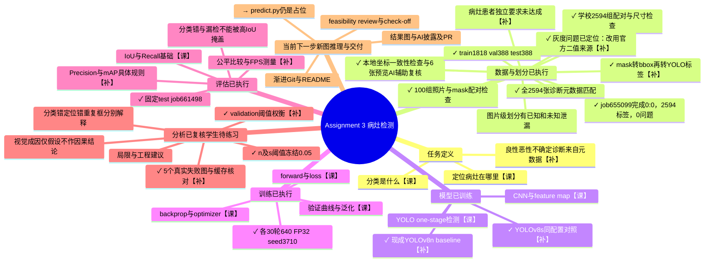

# Assignment 3：项目与学习思维导图

最后更新：2026-10-15。用途：解释整个项目、定位当前进度、把代码与课堂知识对应起来。

## 当前状态（以本段和下方更新后的图为准）

✓ 数据与mask转框2594组；✓ 固定图片级划分与数据装配；✓ n/s各30轮A100训练；✓ 验证集阈值扫描并冻结n/.05；✓ 同一test评估；✓ 5张真实失败图生成、下载及AI辅助视觉复核。新增 [FAILURE_ANALYSIS.md](FAILURE_ANALYSIS.md) 分开记录数值证据、可见特征、尚未验证的原因假设和demo讲述。

本阶段知识：定位正确不等于分类正确；高分不等于正确/患病概率；图片警报不等于合格定位检测；一个GT最多匹配一个TP；NMS比较预测框之间的IoU，而检测评估比较预测框与GT。第5张“小像素框恶性漏检”实际是定位良好但类别错，不得讲成没有找到病灶。

→ 下一阶段：完成predict.py新图推理展示，解释加载权重→预处理→预测→阈值/NMS→画框；然后整理最终README/图表/AI披露、PDF及PR。predict.py目前仍是占位。学生尚需自己练习5例的解释；AI复核不等于学生已掌握。已暴露的test不再用于调参。

局限不变：图片级而非病灶/患者独立，已知及未知泄漏；恶性检测Recall38/77=0.4935；不能以定位IoU高声称临床安全。原始权重/数据/生成图均不提交。本地PROJECT_MAP已更新；在线Whimsical此阶段尚未同步，不把旧在线状态当作最新进度。

## 历史阶段快照（下列“当前/下一步”均指当时状态）

最新决定与执行：老师回复允许按lesion_id分组，但学生随后明确选择全部2594张做图片级划分、不按病灶去重。已运行split_images.py，seed3710，train1818/val388/test388；按良恶性分层，每个held-out类计数取floor(15%×类数量)，其余入train。不确定仅1张，保留第三类且只入train。新类别0良性/1恶性/2不确定，不能混用旧0=lesion定位标签。图片ID交叉0；已知病灶train-val交叉3、train-test交叉2、val-test交叉0。故并非病灶/患者独立评估，成绩可能偏高、偏离老师指导有评分风险。程序未读取图片内容或训练；33项测试通过。当前下一步是学校运行时数据装配与baseline小规模检查；尚无正式训练成绩。下面元数据调查和待决策段落保留历史语境。
本文记录的是实际完成状态，不把计划当成结果，也不把 AI 解释过等同于学生已经掌握。

当前证据：job655099 COMPLETED，11分07秒，退出码0:0；下载摘要及2594份标签已核对，CSV唯一ID2594、标签格式/归一化范围/CSV一致性错误0。六张预览的框与mask范围一致；最小框占0.39096%，最大框占100%，整图框由mask触及四边产生，并非自动判错。仅完成抽样标注复核，不是全部人工审查或模型预测。下一步患者/诊断元数据，尚未创建划分或训练；下方历史记录中的“待执行”是当时状态。

## 图例与总目标

最新实际完成：test661498 58秒/0:0，结果下载并核对；n/s mAP50 0.7042/0.6945，两模型恶性定位分类TP38/77，n图片恶性警报41/77且良性误报36/311。n恶性包含漏检/错类的IoU0.4416，不得用只匹配TP的0.8384冒充整体达标。A100batch1 API FPS78.33/77.49，不能称手机速度或显著优势。冻结方案未变。当前下一步failure_cases.py已选5个具体test错误，全套63测试通过；学校对照图尚待生成，视觉成因待核实。RESULTS.md记录指标定义。预测展示、最终README/PR尚未完成；不能因已跑test就宣称作业完成。

当前决策：val阈值扫描661469已完成27秒/0:0并下载；用户确认主要模型n/.05，s/.05对照，之后不按test调参。n/.05比.01相同48恶性警报、良性误报30而非43，47定位+分类正确TP；不同指标分开。下一步test评估入口已准备，学校尚未执行：标准mAP、固定.05检测P/R、图片警报、包含漏检0的IoU统计、A100预热同步batch1速度。输入两best.pt和固定test，输出summary/缓存预测/官方曲线。随后3–5失败案例、predict.py展示、README汇总/PR仍待完成。test指标未产生、不宣称IoU达标或临床安全。

当前下一步：两个30轮模型已实际完成并下载核对；s job661355 29分10秒/0:0，训练配置与n除输出路径相同，data.yaml哈希相同，两者测试未用。单次val比较n总体更好，s恶性Recall仅小幅上升而Precision下降，不宣称显著优势。新增threshold_metrics.py/scan_thresholds.py/threshold_a100.sh，54项本地测试通过，学校扫描待执行。输入两个best.pt与388张val，输出14阈值统计、缓存预测、trade-off图；不重新训练、不读test。明确分开检测TP（类别正确+IoU>=.5）与图片恶性警报（有预测即警报）；后者不是活检次数，置信度不是患癌概率。NMS IoU、匹配IoU、模型置信度、mask二值阈值用途不同。操作及定义见THRESHOLD_GUIDE.md。

当前阶段：YOLOv8n正式baseline已真实完成，job661165的配置、完成记录、曲线和权重已下载复核；val mAP50=0.774/mAP50:95=0.554，恶性R0.532，测试集未用。训练/验证损失总体下降，但尚不能断言收敛。下一步YOLOv8s同30轮/640/batch16/workers1/seed3710/FP32/增强配置对比已准备，学校尚未提交。预训练各自原始COCO权重、同一划分，保存baseline旧结果；不预设更大模型胜出。新增【补】容量/泛化/计算成本；操作入口submit_comparison.sh和COMPARISON_GUIDE.md。验证阈值分析、最终test、IoU/FPS和正式失败案例仍未完成。

最新进度2026-10-15：job661037两轮A100训练真实完成，2分57秒/0:0；结果已下载并检查配置、曲线、验证答案/预测图、权重。val388张，P0.511/R0.741/mAP50 0.576/mAP50:95 0.378；测试未用。ISIC_0015127框大致找到但恶性判良性且置信度约0.8：定位正确不等于分类正确，高置信度不保证正确。只有2轮不能判定收敛/过拟合。当前正式baseline脚本已完成，42项本地测试通过，学校尚未提交：YOLOv8n预训练重新开始30轮/640/batch16/workers1/seed3710，最后10轮关闭Mosaic，测试仍保留。SHA检查禁止误用短跑权重。输出新任务目录、旧证据不覆盖。不是病灶/患者独立实验；不确定类1样本只训练不可评估。

2026-10-15 当前进度：学生安装日志确认Ultralytics8.3.221导入成功，torch2.14.0+cu130/torchvision0.29.0+cu130未改。新增modules.py现成YOLO适配器、train.py两epoch烟雾测试及提交脚本，39项本地测试通过。当前等待学校提交/运行，不是模型训练成功。预训练是通用特征起点；epoch遍历训练集一次；batch每次处理图片数。两轮imgsz320/batch8只查管线，验证集参与检查、测试集不使用。下一步取得GPU真实运行日志、权重与损失曲线，再决定正式baseline。继续披露图片级划分风险。

最新学校执行证据：assemble_yolo.py已成功链接2594张图片并生成data.yaml。学校torch=2.14.0+cu130，Ultralytics未安装。当前下一步setup_yolo_env.sh准备独立.venv-yolo依赖层，继承原torch环境，固定现有torch/torchvision/numpy不升级；先检查torchvision能导入，再安装固定Ultralytics8.3.221。安装及真实兼容性尚待学校执行。虚拟环境是【工具】，模型算法尚未运行；GPU可用性需Slurm分配后核对，不在login节点训练。

当前下一步（2026-10-14）：`assemble_yolo.py`已完成，4项新增测试通过，全套37项；学校实际装配尚未执行。输入图片级划分manifest/标签；检查学校路径、类别/坐标、计数、图片ID重叠；输出images/{train,val,test}符号链接、labels/{train,val,test}诊断标签、data.yaml、assembly.json。照片不复制，源数据不改，目录不覆盖。下一步先上传小型划分包并运行学校装配，不是训练。暂不检查用户提及的GitHub失败邮件。

2026-10-13 新证据与待决策：学校ISIC2018根目录有界扫描6197条目、未触发条目上限、无目录错误，在深度3内未发现候选元数据；整个课程根目录的先前扫描被20000上限截断，不能据此断言无元数据。已从官方集合63（https://api.isic-archive.com/collections/63/metadata/）下载当前元数据到Git忽略的data/reference。CSV为2594行、2594唯一isic_id，与已导出标签ID集合完全一致；diagnosis_1为Benign 2074、Malignant 519、Indeterminate 1。patient_id仅390行非空，对应350个已知患者，2204行缺失；lesion_id缺失1496行。已知患者子集诊断为Benign 319、Malignant 71。不能将空patient_id当作不同患者、用image_id替代患者，或把lesion分组声称为patient独立。尚未批准缩小数据范围、重映射类别或创建划分。下一步需用户决定：先请老师确认缺失患者信息的处理方式，或开展明确披露范围限制的已知患者子集实验。源CSV只读、不打印患者标识、不提交到Git。当前下载SHA256为4d7d982a56c265d5440f3f85560690bbf3e3ec91b890c62873acc2315e61e0af，仅标识本次下载快照，不是官方预先发布的校验值。

当前操作（2026-10-13）：新增 `inventory_metadata.py` 做课程目录的有界只读元数据发现；只读取CSV/TSV第一行，JSON/ZIP/表格只列文件名，不打印患者行、不读取图片、不跟随符号链接、不创建划分。5项合成测试通过，全套29项通过。学校扫描尚未执行；如果触发深度/文件数限制，不能据此断言无元数据。发现候选表后仍需按image_id核对覆盖率，区分lesion_id与patient_id，再核实诊断定义。

- ✓：已执行并有检查证据；→：当前下一步；○：尚未完成。
- 【课】：已在课堂录音转写中找到对应内容；不表示已掌握，也不表示一定考。
- 【补】：作业需要补充的具体方法，尚未在已核对录音中确认讲解。
- 【工具】：运行/协作工具，不是本项目的算法目标。

目标不是“在 A100 上跑起来”，而是建立可复现的皮肤病灶检测实验：
根据图像预测病灶位置，并核实和完成说明中的分类要求；用独立数据证明效果、分析漏检与误检。
现在的 `0 = lesion` 只是定位标注流程验证，不代表良性/恶性分类已经解决。

外围工具：Windows / PyCharm / GitHub / SSH / Slurm / A100。环境检查已完成；GPU 矩阵运算成功不等于模型训练成功。
工具问题另列，不让它们盖过数据、学习、评估这条主线。

## 实验流程与每一步的产物

下面阶段表是早期规划快照；实际完成状态以上方当前状态与更新后的图为准，不将历史的“未训练/无性能结果”解释成今天的状态。最终README整理时会合并这些历史快照，避免对读者造成混淆。

| 阶段 | 要回答的问题 | 应产生的结果 | 实际进度 |
| --- | --- | --- | --- |
| 1. 任务与标签 | 我预测位置、类别，还是像素？类别标签可靠么？ | 明确任务、类别映射和来源 | 检测方向已选；诊断/分类范围未落实 |
| 2. 数据检查与转换 | 图片和答案对不对？mask如何变成框？ | 数据审计、YOLO标签、对照图 | 本地100组已转换；学校2594组配对和尺寸通过，但全部mask未通过严格像素值规则；共10项本地测试通过 |
| 3. 正式划分 | 新患者上能否泛化？有没有泄漏？ | 固定train/val/test清单与患者互斥检查 | 下一步；patient ID元数据未确认 |
| 4. Baseline | 简单或默认方法能做到什么？ | 可复现参考结果 | 尚未选定并训练；未改动的默认配置可作为候选，不冒充有效病灶检测结果 |
| 5. 正式YOLO训练 | 怎么学习适合病灶的特征与框？ | 权重、loss/验证曲线、完整实验配置 | 未训练；版本与规模待确定 |
| 6. 独立测试 | 框准不准，漏多少，误报多少，快不快？ | mAP50、mAP50:95、Precision、Recall、IoU、FPS；适合任务的分类指标 | 无性能结果；baseline和正式模型要用同一测试协议 |
| 7. 阈值与失败分析 | 低阈值带来哪些得失？模型哪里不可靠？ | 验证集阈值曲线、锁定工作点、3–5个真实失败案例 | 未执行；不可把预览中的毛发直接称为模型失败 |
| 8. 交付 | 他人能复现吗？我能解释每块代码吗？ | README/结果图、必要check-off、PDF及PR、AI使用披露 | 工程骨架和渐进commits已有；最终报告/PR未完成 |

验证集用于选配置、选阈值；最终测试集在方案确定后用于报告，不能拿来反复调参。
image ID不等于patient ID；“官方划分”本身也不能作为本项目已验证患者独立的证据。
学校共享目录已找到训练照片/mask和测试照片，但 `_x2` 的含义、完整数据质量、诊断与患者元数据以及可评估的测试标签仍需检查。

## 课堂知识怎样对应这个项目

录音编号以下按本地文件名编号，不是已核对的教学周次。原始VTT在 `C:/Users/cyzwo/Downloads/`，只读取，不修改。
先查阅了 ChatGPT 聊天《课程知识点总结》《深度学习课程总结》《总结下一节课录音》《新课内容概览》《列出课程内容》，再核对相关原始转写片段。
自动转写有错字；这里只按上下文归纳，不把转写的简化说法当作严格算法定义。

| 课堂内容/证据位置 | 用在项目的哪里 | 你应能解释什么 |
| --- | --- | --- |
| `transcript (1).vtt` 约01:26–01:35：K-fold/小样本划分；旧聊天也讨论过完整ML pipeline | 数据划分与可靠性 | 为什么不能仅凭一次幸运划分判断效果；本项目患者级互斥是进一步要求，不意味着必须做K-fold |
| `transcript (3).vtt` 00:03–00:05回顾MLP、forward、梯度下降；00:53附近讨论backprop考试要求 | 训练流程 | forward产生预测；loss衡量偏差；backprop求梯度；optimizer根据梯度更新权重，四件事不同 |
| `transcript (3).vtt` 01:13:32–01:15:17：augmentation与generalisation | 数据增强 | 变换应保留任务语义；检测图像翻转/旋转时框必须同步变换，这是本项目的具体补充 |
| `transcript (3).vtt` 01:19–01:24：SGD、momentum、Adam、learning rate | 训练参数与曲线 | learning rate控制更新步长；optimizer选择不保证全局最优，也不免除学习率调参 |
| `transcript (3).vtt` 01:27:33–01:32:03：train/val/test、overfitting、IoU/Recall、visualisation | 独立评估和失败分析 | train好而val变差是过拟合信号；loss不能代替最终指标；既看数字也看图；课堂IoU例子是mask，本项目主要是bbox |
| `transcript (4).vtt` 约00:18–00:41：卷积、kernel、feature maps、padding/stride、receptive field | 模型特征提取 | 图像局部特征怎样形成更复杂的特征；为什么网络输出不只是在复制原图 |
| `transcript (5).vtt` 00:17–00:24：dropout、BN/LN等；00:39附近：train/eval行为 | 训练与推理模式 | 有些层在训练和评估时行为不同；具体采用哪些层以最终YOLO代码为准，不人为假定都有dropout |
| `transcript (5).vtt` 01:38–01:46：检测、one/two-stage、Fast/Faster R-CNN、anchors；01:46:39–01:52:45：YOLO输出与v2 anchors | 解释为什么选YOLO | detection与classification不同；one-stage直接预测框和类别；anchor是框模板，且不同YOLO版本机制可能不同，不能把v2结构套到所有新版本 |

### 已学但不强行加入这次YOLO项目

旧聊天里还学过 Fourier/FFT、PCA/Eigenfaces、AE/VAE、GAN/StyleGAN、t-SNE/UMAP、Transformer/ViT、Mamba/GFNet。
这些仍有复习价值，但目前不是本项目的必要实现分支。不会为了“用上所有课堂内容”额外训练生成模型或加入降维图。
CNN的特征学习可以与PCA的特征提取比较；但当前mask转框不是PCA、不是神经网络特征学习。

### 期末关联：有依据的提示

`transcript (3).vtt` 00:52:56–00:53:16，老师回应考试问题：预计不需手算backprop，但应能解释它及背后的原理。
因此优先练习“预测→loss→梯度→参数更新”的因果解释，不把这句话扩展为所有考试都不考计算。
任务区分、CNN/feature map、overfitting、数据划分和one-stage/two-stage可与作业一起复习；这是学习建议，不是确认出题或分值。
尚未获得2026最终考试蓝图，不能给出这些模块的准确期末占比，也不能把旧聊天里的星级当作官方权重。

## 对着现有代码：这一块到底在做什么

| 文件/入口 | 输入→操作→输出 | 所属阶段/状态 |
| --- | --- | --- |
| `dataset.py:17` `mask_to_bbox` | 二值mask→非零像素x/y范围→最小轴对齐框 | 数据准备；已实现。不预测、不训练；右/下边界+1保证像素面积正确 |
| `dataset.py:34` `bbox_to_yolo` | 像素框+图像尺寸→中心/宽/高归一化→4个比例 | 数据准备；已实现。类别0另写入TXT，0不是置信度或良恶性 |
| `dataset.py:44` `preview` | 原图+人工mask+导出框→三幅对照→PNG | 标注可视化；已实现。展示ground truth转换，不是模型效果 |
| `dataset.py:64` `inspect_pairs` | 图像/mask目录→检查ID、尺寸、二值性、非空→标签、CSV、summary、预览 | 数据审计；已实现。不创建split，也不验证patient independence |
| `test_dataset.py` | 构造可核对的小样本/异常配对→断言→通过或失败 | 实现验证；5项已通过。不等于临床有效性或模型分数 |
| `modules.py` | 计划封装模型及可复用评估组件 | 目前仅说明占位，没有模型实现 |
| `train.py` | 计划读取固定划分→训练/验证→保存权重、曲线，并按锁定协议测试 | 目前仅说明占位，没有训练实现 |
| `predict.py` | 计划加载已训权重+新图→框/类别/分数→预测图 | 目前仅说明占位，没有推理实现 |
| `check_a100.sh` | 提交环境检查→验证GPU和PyTorch→日志 | 外围工具；已执行。不包含YOLO训练 |
| `audit_data.py` | 只读照片/mask→检查完整性和CSV表头→JSON报告 | 学校2594组已检查，像素值异常待诊断；不生成划分 |
| `audit_school_data.sh` | CPU任务提交→调用审计工具→日志/报告 | job653933执行完毕，规则检查未通过；不训练、不申请GPU |
| `diagnose_masks.py` | 少量原始灰度mask→候选像素阈值1/128/255→对照图和统计 | 学校3张已执行并由AI辅助浏览；阈值未获采纳；不导出训练标签 |
| `check_mask_reference.py` | 同ID官方原始mask→最近邻匹配学校尺寸→与候选框比较 | 3张样本已核对；框一致性不等于模型性能；共16项测试通过 |
| `prepare_official_labels.py` | 校验官方ZIP与编号/尺寸→最近邻mask→严格框/归一化→全量通过才导出 | 8项新测试通过，共24项；学校全量未运行，不生成划分 |
| `submit_official_labels.sh` / `prepare_official_labels.sh` | 自动激活环境和校验小ZIP→提交CPU工作任务→按job编号隔离输出 | 语法检查通过；学校提交待执行，不申请GPU |

## 当前阶段：你现在需要能说清楚的五件事

1. **输入是什么？** 皮肤镜RGB照片；人工mask用于提供监督标注，不是日后预测新图时必须输入的答案。
2. **为什么转mask？** 原数据是像素级答案，我们选的是框级检测任务，需转换标注格式。
3. **框怎样算？** 找病灶像素的横纵坐标范围，再换成归一化中心、宽、高；矩形会包含背景并丢失轮廓信息。
4. **这一阶段证明了什么？** 已检查的100组标签转换流程能运行，有数值测试和6张对照图；还没证明模型会检测。
5. **下一步为什么不能随便开始训练？** 先确认完整数据、诊断类别与patient ID，避免训练错误任务或报告有泄漏的测试结果。

建议的简短讲述：

> 我在准备监督学习的标签。ISIC提供照片和人工分割mask，我把mask转换成YOLO需要的框标注，并检查配对、尺寸和坐标。现在展示的是正确答案的转换，不是模型预测。接下来先核实完整数据和患者独立划分，再训练baseline与正式YOLO，在同一独立测试集上比较指标，并分析阈值和失败案例。

临床阈值分析的边界：检测“病灶”不等于诊断“恶性”。没有适合的诊断标签、定义和验证，不能把病灶检测Recall宣称为癌症敏感度，也不能声称能决定是否活检。

## 后续更新约定

### 可编辑的 Whimsical 思维导图

[打开项目与学习导图](https://whimsical.com/yizhang-workspace/comp3710-assignment-3-XntqPjQwb5Mgcy26koVb9q)。该图存放在作者的 Private 文件夹，未开启公开分享；链接不代表其他读者具备访问权限。

橙色分支标示当前学校mask像素值诊断阶段；本地100组标注转换流程已通过检查。一级分支覆盖任务、数据、划分、模型、训练、评估、阈值/失败分析及交付；外围工具单列。分支末端的圆形数字用于展开隐藏的子节点。课堂依据和代码映射保留在本文，后续同步维护同一张可编辑导图，而非反复新建。

维护定位：board `XntqPj`；根节点 `KGbcLr`；数据准备 `FzMpXd`；完整数据与划分 `P98QYq`。节点ID只用于编辑定位，不表示任何进展或访问授权。

每次出现新操作、问题、方案变化或阶段完成，都同步更新本图与相应代码说明：

1. 更新节点状态，区分计划、已执行和已验证；写出新产物及证据位置。
2. 新概念先标【补】；只有核对课堂来源才改标【课】。
3. 讲解采用“目的→输入→关键操作→输出→怎样判断做对了”，并指出代码入口。
4. 问题挂在所属分支，记录现象、原因、处理和对结果的影响；工具错误放外围工具，不当作算法知识。
5. 保留变化记录并按真实里程碑commit，不为数量制造虚假进展。修改函数后刷新本表的行号。

### 变化记录

- 2026-10-15：5张冻结test失败图已生成并下载，AI辅助视觉复核及缓存记录数值核对完成；新增FAILURE_ANALYSIS.md。案例5是恶性类别漏检而非没有定位，案例3区分警报和定位检测，案例4区分NMS IoU与GT匹配IoU。未重新推理、训练或调阈值；下一步predict.py展示与最终文档交付。旧阶段快照明确标为历史，在线Whimsical尚未同步。

- 2026-10-13：学生终端确认官方mask ZIP校验通过，并成功提交CPU正式标注准备job655099。只确认下载校验/提交，不表示任务已完成或2594份标签已生成；等待sacct最终状态及输出摘要。SSH断开不会取消已提交的Slurm任务，不重复提交。
- 2026-10-12：新增官方二值mask全量准备工具及CPU提交入口；增加8项测试，共24项通过；真实官方ZIP缓存SHA256和2594个mask成员核对通过，两份Shell脚本语法检查通过。对源图/mask只读；先全量验证再导出标签，失败保留摘要且无训练标签；尺寸先检查观察到的2倍关系和1像素舍入容差，使用最近邻，丢失病灶报错。预览显示mask时也改用最近邻，避免缩略图制造灰度。启动入口自动激活torch，解决新SSH会话Python不可见的问题。当前是程序准备完成，不是学校全量成功；尚未提交新任务，也未创建划分或训练。
- 2026-10-12：学校3张阈值诊断图和报告已生成并经SCP取回本地；AI辅助视觉检查见主要病灶区域保持，灰度中间像素占0.99835%、0.54580%、1.00803%。1/128/255阈值框边界最多相差4像素，128仍为候选；学生视觉复核待确认。下载官方26MB训练mask压缩包并执行 `check_mask_reference.py`：同ID原mask均为0/255、1022×767，学校样本511×384。官方mask最近邻匹配尺寸后的框与128候选框IoU为0.997653/0.973333/0.990000，最大边界差4像素；这是标注一致性，不是模型成绩。新增2项测试通过（共16项）。下一步拟从官方二值mask最近邻生成完整数据标签并审计；该全量操作尚未执行，学校原预处理算法仍未知，患者/类别/划分仍未完成。
- 2026-10-12：学生执行3张学校mask像素诊断，ISIC_0000000/0000001/0000003均为L/uint8、范围0至255，分别230/215/245种灰度值。确认当前文件是多灰度mask，不是16位编码；非二值的成因仍待查。新增 `diagnose_masks.py` 比较1/128/255阈值并生成候选对照图，4项新测试通过（共14项）；本地二值验证数据仅用于排版/输出验证。学校对照图尚未执行/审阅，128不是正式规则。原始mask和严格转换函数未改动；新增【补】像素阈值二值化，区分它与模型置信度阈值。
- 2026-10-12：学校CPU审计job653933已实际运行，节点a100-8，耗时3分51秒，FAILED/1:0（学生终端日志证据）。2594张照片/2594张mask全部唯一配对且尺寸匹配；2594项均因当前程序的0/1/255像素规则被拒绝，尚不能确定非端点灰度的成因。没有删除数据、自动阈值化或放宽规则。下一步少量抽样检查原始模式/dtype/像素值，再核实是否经过重采样；patient/diagnosis信息未解决，审计根目录未发现候选CSV。
- 2026-10-12：外围问题澄清：SSH曾断线回到Windows PowerShell，导致sbatch无法识别；重新登录学校终端后提交成功。之后的Connection reset发生在已结束的审计日志查看期间，不是mask检查失败的原因。只复制命令代码块，不复制终端提示符、欢迎语或日志；后续用摘要避免打印2594条同类异常。
- 2026-10-12：学生终端已登录 `login0`；准备 `audit_school_data.sh` 提交CPU-only完整审计，尚未提交或确认分区接受此资源请求。代理不能自动接管学生已登录的终端。输入数据不改动；报告和日志忽略Git。
- 2026-10-12：学生确认看懂当前预览并认可答案转换；不是对全部数据的逐张人工检查。新增 `audit_data.py`（只读输入审计与CSV表头清单，不生成划分）、5项审计测试；共10项测试通过，本地100组验证数据实际审计通过。当前进入完整数据审计准备；新的SSH连接需登录认证，学校训练数据仍未审计，patient/diagnosis问题未解决。
- 2026-10-12：建立首版。明确当前是数据审计/标注转换，非训练；新增课堂来源与代码映射。
- 2026-10-12：在 Whimsical 建立原生可编辑导图；突出当前数据准备阶段，保留【课】/【补】标记、每步产物、代码入口及未解决问题。未因此新增训练或模型评估结果。
- 已解决外围问题：Slurm检查脚本的显式内存请求不匹配课程分区配置；对照Demo2配置调整后，A100检查job652217完成。没有改变算法或训练结果。
- 尚未解决的数据问题：学校 `_x2` 目录含义、patient/diagnosis元数据和最终测试标签。后续先检查，不猜测或伪造这些信息。

相关文档：[本阶段演示讲解](DEMO_GUIDE.md)、[运行工具记录](A100_GUIDE.md)、[项目README](README.md)。
