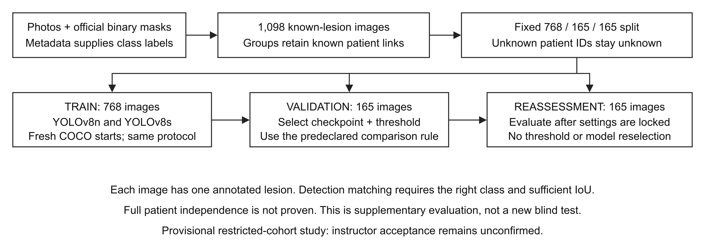

# Lesion detection and classification with YOLOv8

COMP3710 Assignment 3, Project 3 | s4905914 | Updated 18 October 2026

The main experiment compares YOLOv8n, the predeclared primary, with YOLOv8s on an ISIC2018 Task 1 cohort with known lesion IDs. It includes fresh 60-epoch training, validation selection, locked supplementary reassessment, resource measurements and five failure examples. A later exploration adds training images with missing IDs and compares n/s on the same validation images. Its results are reported separately.

On supplementary reassessment, n has mAP50:95 0.3619 and detects 10/41 malignant lesions at confidence 0.50; s has mAP50:95 0.3527 and detects 6/41 at 0.80. n generates malignant alerts on 16/124 benign images, exceeding the 10% budget that was satisfied on validation. Neither model demonstrates adequate malignant screening sensitivity. n remains the primary by the original protocol, and neither its threshold nor the model policy was changed after reassessment.

Course acceptance of the restricted cohort and third-party component packaging remains unconfirmed. Personal practical check-off has not been verified. These are experimental results, not a claim that all assessment requirements have been accepted or that the prototype is clinically safe.

## Data and scope

The source consists of 2,594 school-provided dermoscopic photographs. Bounding boxes are the smallest axis-aligned rectangles around the corresponding official binary masks, resized to photo dimensions with nearest-neighbour interpolation. The verified coordinates are reused in this restart. Class labels come from official metadata matched by image ID, not from the masks. The school source photos and masks were not altered. The official dataset and metadata sources are listed in References [1,2].

The full metadata contains 2,074 Benign, 519 Malignant and one Indeterminate image. Only 1,098 have a recorded lesion_id; these form the main study, excluding the other 1,496 from all its phases. The later exploration adds 1,495 binary-labelled missing-ID images to training only. Indeterminate is excluded, not relabelled. The outputs are Benign=0 and Malignant=1. Each image has one annotated lesion; multi-lesion performance is not established.

| Split | Benign / Malignant | Images |
| --- | --- | --- |
| Train | 576 / 192 | 768 |
| Validation | 124 / 41 | 165 |
| Supplementary reassessment | 124 / 41 | 165 |



Groups are connected components of all recorded lesion/patient links before cohort filtering. With seed 3710, recorded lesion and patient IDs do not cross splits. There are 1,083 distinct recorded lesions and 1,043 assignment groups; groups are not fabricated patient IDs. The cohort still has 708 images without patient_id. Full patient independence is therefore unproven.

<!-- pagebreak -->

## One-page feasibility review

The following is the pre-training written plan prepared on 17 October. It is retained as a dated planning record. Its statements about unmeasured runtime refer to that stage; actual results appear later. A written review does not establish that tutor check-off was completed.

### Purpose and scope
This classroom prototype compares YOLOv8n (predeclared primary/baseline) with YOLOv8s for locating a dermoscopic lesion and classifying it as benign or malignant. The question is how much malignant detection recall can be retained while limiting benign-image alerts. Each image has one annotated lesion; this dataset does not establish performance in a multiple-lesion clinical scene. Alerts are workload proxies, not biopsy counts, and confidence scores are not cancer probabilities.

### Data and model choice
The candidate cohort contains all 1,098 images with recorded lesion IDs from 2,594 ISIC2018 Task 1 images: 824 benign and 274 malignant. Whole groups connected by known lesion/patient IDs give train/validation/supplementary-reassessment sizes of 768/165/165. The other 1,496 images are excluded. Some 708 selected images lack patient IDs, so full patient independence is unproven. Instructor acceptance of this restricted cohort is pending. Boxes come from verified official binary masks; class labels come from matched metadata. Both detectors start from their own original COCO weights. Convolutional feature extraction, multiscale fusion, box/class losses and NMS connect the implementation to course concepts. Ultralytics supplies the network and trainer; this is integration and evaluation, not an original YOLO implementation.

### Five testable acceptance criteria
1. Preserve the declared cohort and class counts, with zero overlapping recorded lesion/patient IDs; decode all selected images and verify dimensions and label coordinates before training.
2. Run n and s on the same split with 60 epochs, 640-pixel input, batch 16, FP32, AdamW and flips only. Retain original-weight, data, configuration and checkpoint hashes.
3. Report classwise AP, precision, recall, TP/FP/FN and localization IoU with explicit denominators. Check the course IoU target of 0.8 once its aggregation rule is clarified; do not claim it has already been met.
4. Select the threshold on validation only: maximize malignant detection recall subject to at most 12 benign alerts among 124 benign images. This 10% budget is a classroom comparison rule, not a clinical standard. If no threshold qualifies, report no feasible operating point.
5. Complete the A100 batch-16/640 preflight without nonfinite values or out-of-memory failure; record peak GPU memory, hardware, latency/FPS scope and training time. Use a planning cap of four GPU-hours for the two formal runs; the actual runtime remains unmeasured.

### Evidence, risks and next decision
Local verification includes 40 unit tests, two one-epoch synthetic model pipelines, preprocessing equivalence checks and exact COCO initialization audits. Synthetic scores are not lesion-performance evidence. The main risks are missing grouping IDs, restricted-cohort selection bias, weak malignant classification and validation overuse. The earlier test was inspected; repartitioning cannot make the new reassessment blind. After instructor clarification and real-input/GPU checks, lock the protocol, train both models, select operating points using validation, then conduct one locked supplementary reassessment and document 3-5 failures. If the cohort is rejected, revise grouping before training. If resources or numerical checks fail, stop and revise both models' shared protocol before rerunning; do not silently change one model's budget.

### Course and authorship notes
YOLOv8 is in the normal-difficulty option. Component packaging and the IoU denominator still need clarification. This draft does not certify a completed practical consultation. Codex assisted with code, audits and drafting; the student must review, correct and own the submitted explanation. Sources: supplied assessment draft, sections 2.3, 3 and 4; pinned Ultralytics 8.3.221; course Ed threads #136 and #147.

<!-- pagebreak -->

## Model and implementation

YOLOv8 is a one-stage detector. A convolutional backbone extracts spatial features; the neck combines information across scales; the detection head predicts box distances and class scores at three resolutions. In the pinned implementation, Conv blocks combine convolution, normalization and activation, C2f blocks combine feature branches, and SPPF pools features at multiple effective scales. Box and class prediction branches are separate. These are upstream PyTorch implementations, not original components written for this assignment [3]. YOLOv7 provides background on real-time detection and the accuracy-speed trade-off [4]; the models trained here are YOLOv8n and YOLOv8s.

The loss combines CIoU box regression, distribution focal loss (DFL) for box distances, and binary-cross-entropy class loss. DFL is a localization component, so a lower dfl_loss alone is not evidence of better malignant classification. The score is not a calibrated malignancy probability. After inference, single-label class-aware NMS removes some overlapping same-class boxes; it does not enforce one prediction per image.

`modules.py` constructs the actual two-class DetectionModel and loads trained models. `dataset.py` supplies the loader used by `train.py`. `train.py` performs fitting and evaluation, saves provenance and checkpoints, and records losses and metrics. `predict.py` loads a saved checkpoint with its validation selection lock and saves JSON plus a prediction overlay. Helpers implement grouping, audits, preprocessing, scoring and reporting. The course's acceptance of integrating Conv/C2f/SPPF/Detect from Ultralytics rather than including local implementations remains unresolved.

### Fixed training protocol

| Setting | YOLOv8n | YOLOv8s |
| --- | --- | --- |
| Initial weights | Original COCO n | Original COCO s |
| Library | Ultralytics 8.3.221 | Same |
| Epochs / completed optimizer calls | 60 / 2,880 | 60 / 2,880 |
| Image size / batch / nominal batch | 640 / 16 / 16 | Same |
| Seed / arithmetic | 3710 / FP32 | Same |
| Optimizer | AdamW | Same |
| Initial LR / weight decay | 0.001 / 0.0005 | Same |
| Warm-up / LR schedule | 3 epochs / linear | Same |
| Augmentation | Horizontal/vertical flips, p=0.5 each | Same |
| Mosaic / MixUp / oversampling | Off / off / none | Same |
| Early stopping / resumed training | Disabled / no | Same |
| Selected epoch by macro mAP50:95 | 32 | 42 |

The whole backbone, neck and prediction branches remain trainable; the fixed DFL integral coordinates do not. The first optimizer call has zero LR and the final epoch uses LR 0.0000265 under the pinned upstream schedule. Each recorded optimizer call is checked against that schedule. Equal batch and nominal batch avoid differing gradient-accumulation budgets.

Initialization is not identical across sizes: n transfers 319/355 state entries and s 349/355. Counts include buffers. n's classification hidden width changes from 80 to 64, whereas s retains width 128 and replaces the final outputs. Both transfer backbone, neck and box-regression state. This difference belongs in the comparison; the experiment cannot attribute outcomes solely to parameter count.

<!-- pagebreak -->

## Evaluation and selection rules

Evaluation uses one aspect-preserving letterbox resize to 640, followed by padding; it does not stretch images. The custom validation loader and ordinary predictor were checked for identical input pixels on synthetic shapes. Scores use a 0.001 floor, single-label class-aware NMS at IoU 0.7 and at most 300 boxes. This differs from default multi-label validation, so AP should not be mixed with results from a different validation policy.

The best checkpoint maximizes validation macro mAP50:95 over 60 epochs. Upstream training scores are rounded to five decimal places; the later epoch wins exact ties. Validation uses EMA weights. Upstream saves EMA in FP16 and reloads to FP32. The selected training-time score and the subsequently reloaded-checkpoint score need not be numerically identical. Internal training validation uses batch 32; standalone evaluation requests batch 16. Those are execution differences, not a controlled explanation for score discrepancies.

A TP needs the correct class, confidence strictly above the operating threshold, and IoU >= 0.5. Each GT matches at most one prediction, choosing the highest-confidence eligible candidate. Every remaining prediction is FP for its predicted class. An unmatched GT is FN. A wrong-class or badly located box can therefore contribute both FP and FN. An image-level malignant alert requires any retained malignant box, without an IoU condition. These alerts are not actual biopsy counts.

AP50 and AP50:95 use the low-score sweep. Macro mAP weights the two classes equally. The operating threshold instead maximizes malignant detection recall subject to malignant alerts on at most 10% of benign validation images: at most 12 of 124. Ties use precision, fewer benign alerts, then higher threshold. The grid, fixed before training, is 0.01, 0.02, 0.05, 0.10, 0.15, 0.20, 0.30, 0.40, 0.50, 0.60, 0.70, 0.80, 0.90 and 0.95. This is a classroom budget, not a clinically established standard.


Markers are the 14 evaluated thresholds; connecting lines do not imply that intermediate thresholds were selected. n selected 0.50 and s selected 0.80. At the shared threshold 0.50, s detects 22 malignant validation cases but alerts on 28 benign cases, exceeding the budget. At 0.70 it has 14 malignant TP and 14 benign alerts, still exceeding the budget. The grid was not refined after seeing these results.


Classification loss on validation uses a logarithmic axis to show early spikes and later detail. All logged scalar values are finite; the cause of early spikes was not isolated. Completing 60 epochs does not prove convergence, and selecting an earlier best checkpoint does not by itself prove overfitting.

<!-- pagebreak -->

## Main-study quantitative results

Validation and supplementary reassessment each contain 124 benign and 41 malignant images, but they are different image sets. Reassessment used the already selected best checkpoints and thresholds once per model. No reassessment threshold sweep, checkpoint search or model replacement was performed.

| AP measure | n validation / reassessment | s validation / reassessment |
| --- | --- | --- |
| Macro mAP50 | 0.5874 / 0.5432 | 0.5975 / 0.5291 |
| Macro mAP50:95 | 0.4055 / 0.3619 | 0.3926 / 0.3527 |
| Benign AP50 | 0.8157 / 0.7883 | 0.7898 / 0.7722 |
| Benign AP50:95 | 0.5598 / 0.5540 | 0.5436 / 0.5434 |
| Malignant AP50 | 0.3591 / 0.2980 | 0.4052 / 0.2860 |
| Malignant AP50:95 | 0.2511 / 0.1698 | 0.2416 / 0.1621 |

### Locked operating points on supplementary reassessment

| Measure | YOLOv8n | YOLOv8s |
| --- | --- | --- |
| Confidence | 0.5 | 0.8 |
| Malignant TP / FP / FN | 10 / 20 / 31 | 6 / 5 / 35 |
| Malignant precision | 33.33% | 54.55% |
| Malignant detection recall | 10/41 (24.39%) | 6/41 (14.63%) |
| Benign TP / FP / FN | 93 / 33 / 31 | 61 / 10 / 63 |
| Benign precision / recall | 73.81% / 75.00% | 85.92% / 49.19% |
| Malignant image alerts | 14/41 (34.15%) | 8/41 (19.51%) |
| Benign image false alerts | 16/124 (12.90%) | 3/124 (2.42%) |

n's validation malignant detection recall was 13/41 (31.71%) with 11/124 benign alerts; s's was 11/41 (26.83%) with 7/124 benign alerts. On reassessment these detection counts fall to 10 and 6. n's 16 benign false alerts exceed the validation budget, while s's three remain below it. The budget was a selection constraint on validation, not a guarantee for another sample. The locks were retained despite this result.

Of the 41 malignant reassessment images, both models detect five, n alone detects five, s alone detects one, and both miss 30. n has higher AP and recall here; s has higher operating-point precision and fewer false alerts. One seed and small class counts do not establish a general or statistically significant winner. Comparing these values with the old image-level pilot would confound changes in data, grouping and evaluation protocol.

### Localization on supplementary reassessment

| Mean IoU at locked operating points | YOLOv8n | YOLOv8s |
| --- | --- | --- |
| Benign: all GT, correct class | 0.6512 (N=124) | 0.4282 (N=124) |
| Benign: all GT, ignore class | 0.7474 (N=124) | 0.4489 (N=124) |
| Benign: matched TP only | 0.8523 (N=93) | 0.8704 (N=61) |
| Malignant: all GT, correct class | 0.2272 (N=41) | 0.1321 (N=41) |
| Malignant: all GT, ignore class | 0.6388 (N=41) | 0.3524 (N=41) |
| Malignant: matched TP only | 0.7792 (N=10) | 0.7875 (N=6) |

All-GT means use the best retained box under the stated class condition, with missing predictions scored zero. TP-only excludes misses and has a different denominator. Even malignant TP-only means are below 0.8 for both models here; no reported malignant mean establishes the course localization target. The teaching team's intended aggregation rule remains unconfirmed.

<!-- pagebreak -->

## Exploratory expansion: design and results

After the main study was completed, the training set was expanded to investigate the effect of using more of the available data. The original 768 training images were retained and all 1,495 eligible binary-labelled images with missing lesion IDs were added. The sole Indeterminate image remained excluded. Validation and reassessment membership and labels were unchanged; only validation was scored in the new runs. These results do not replace the main study.

The added images also lack patient IDs. Recorded links are still checked, and no exact decoded-image duplicates cross the splits. Unrecorded lesion or patient links may nevertheless connect training and evaluation images. Missing IDs were not fabricated, and deduplication is not proof of independence.

| Design feature | Main study | Expanded exploration |
| --- | --- | --- |
| Training images (Benign / Malignant) | 768 (576 / 192) | 2,263 (1,826 / 437) |
| Validation images (Benign / Malignant) | 165 (124 / 41) | Same images and labels |
| Epochs / optimizer calls, each model | 60 / 2,880 | 60 / 8,520 |
| Missing-lesion training images | 0 | 1,495 |

Expanded n and s both started from their respective original COCO weights. They used the same 60 epochs, seed 3710, FP32, 640-pixel input, batch and nominal batch 16, AdamW, learning-rate schedule and flips-only augmentation. Each completed 8,520 optimizer calls; all original image file hashes and per-call learning rates match between these two runs. Best EMA selection still maximizes validation macro mAP50:95.

Relative to restricted n, expanded n raises malignant AP50 from 0.3591 to 0.5311 on the same validation images. At confidence 0.05 its malignant TP increases from 25 to 33, but benign false-alert images also increase from 38 to 55. Training-set size, class balance and optimizer-call budget changed together, so this is not an isolated causal effect of sample count.

| Expanded-model validation AP | YOLOv8n | YOLOv8s |
| --- | --- | --- |
| Macro mAP50 | 0.6353 | 0.6437 |
| Macro mAP50:95 | 0.4370 | 0.4540 |
| Benign AP50 | 0.7396 | 0.8041 |
| Benign AP50:95 | 0.5302 | 0.5805 |
| Malignant AP50 | 0.5311 | 0.4833 |
| Malignant AP50:95 | 0.3437 | 0.3276 |

s improves the macro average while its malignant AP50 and AP50:95 are lower. Macro improvement therefore does not establish improvement in the malignant class.

Training-call time was 13.06 / 17.82 minutes for n/s, with peak allocated CUDA memory 4.17 / 9.60 GiB and selected EMA epochs 29 / 41. The models have 3,011,238 / 11,136,374 parameters. Jobs 669929 and 670000 ran on separate A100 nodes; these times are descriptive, not a controlled speed comparison.

<!-- pagebreak -->

## Expanded n/s: common operating thresholds

Before training s, the comparison specified common confidence thresholds 0.05 and 0.50 as the primary points, plus 0.70 as an additional reference because expanded n had already selected it. Strict joint improvement required more malignant TP and fewer benign-image false alerts. The 14-point grid was retained without refinement. Both models use the same class-aware NMS at 0.7 and correct-class IoU >= 0.5 matching. Confidence is not a calibrated cancer probability.

| Confidence and measure | YOLOv8n | YOLOv8s |
| --- | --- | --- |
| 0.05: Malignant TP / FP / FN | 33 / 85 / 8 | 20 / 31 / 21 |
| 0.05: Malignant recall / precision | 80.49% / 27.97% | 48.78% / 39.22% |
| 0.05: Benign images with malignant alert | 55/124 (44.35%) | 26/124 (20.97%) |
| 0.50: Malignant TP / FP / FN | 24 / 31 / 17 | 16 / 13 / 25 |
| 0.50: Malignant recall / precision | 58.54% / 43.64% | 39.02% / 55.17% |
| 0.50: Benign images with malignant alert | 28/124 (22.58%) | 10/124 (8.06%) |
| 0.70: Malignant TP / FP / FN | 12 / 5 / 29 | 13 / 4 / 28 |
| 0.70: Malignant recall / precision | 29.27% / 70.59% | 31.71% / 76.47% |
| 0.70: Benign images with malignant alert | 5/124 (4.03%) | 3/124 (2.42%) |

At both primary thresholds, s reduces benign false alerts but also reduces malignant recall. At 0.70 it detects one more malignant image and falsely alerts on two fewer benign images. This is the only grid point meeting the strict joint-improvement rule. Pairing the images shows 11 malignant detections in common, one detected only by n, two only by s, and 27 missed by both. The five n false alerts and three s false alerts occur on different benign images. This small net difference is not uniform improvement across cases or evidence of stable superiority.

Malignant FP counts are prediction-box counts, whereas benign false alerts count images. They have different denominators. For example, n has 85 malignant FP boxes at 0.05 but 55 benign images with malignant alerts. An alert itself does not require adequate localization.

### Same false-alert budget, separately selected thresholds

| Measure | Expanded n | Expanded s |
| --- | --- | --- |
| Existing validation-selected confidence | 0.70 | 0.50 |
| Malignant detections / recall | 12/41 (29.27%) | 16/41 (39.02%) |
| Benign images with malignant alert | 5/124 (4.03%) | 10/124 (8.06%) |

Both selected points satisfy the original validation budget of at most 12 benign false-alert images. s has greater recall within this constraint, but also more false alerts. This supports s at 0.50 as an exploratory development candidate; it is a different-threshold comparison, not simultaneous improvement at a common threshold. The report keeps the original known-lesion n at 0.50 as its primary experiment.

<!-- pagebreak -->

## Expanded n/s: complete threshold grid

All 14 declared points are shown, including those unfavorable to s. Malignant TP has denominator 41; benign false-alert images have denominator 124. These are validation results, not new test results.

| Confidence | n M TP | s M TP | n B alerts | s B alerts |
| --- | --- | --- | --- | --- |
| 0.01 | 35 | 24 | 62 | 32 |
| 0.02 | 34 | 23 | 58 | 30 |
| 0.05 | 33 | 20 | 55 | 26 |
| 0.10 | 30 | 20 | 54 | 26 |
| 0.15 | 30 | 20 | 53 | 24 |
| 0.20 | 30 | 20 | 52 | 24 |
| 0.30 | 28 | 20 | 46 | 23 |
| 0.40 | 27 | 17 | 42 | 19 |
| 0.50 | 24 | 16 | 28 | 10 |
| 0.60 | 20 | 14 | 15 | 6 |
| 0.70 | 12 | 13 | 5 | 3 |
| 0.80 | 4 | 6 | 0 | 1 |
| 0.90 | 0 | 1 | 0 | 0 |
| 0.95 | 0 | 0 | 0 | 0 |


Markers are evaluated points; connecting lines do not validate intermediate thresholds. All 28 operating points were independently replayed from saved predictions. AP uses the pinned Ultralytics implementation and was not independently recomputed.

Only one seed and 41 malignant validation images were used. Validation has been reused during development and missing identity links may inflate results. The architecture and initialization-transfer differences remain. No expanded model was evaluated on supplementary reassessment, and no original checkpoint or threshold lock was changed.

<!-- pagebreak -->

## Main-study resource measurements and scope

Training ran on an A100 host in job 669143. Locked reassessment and a separately declared resource test ran on NVIDIA A100-PCIE-40GB in job 669815. The latter used validation images only, without labels for selection, with FP32, 640-pixel input and serial batch-one calls. Ten warm-up calls preceded three passes over all 165 validation paths, giving 495 timed calls per model. CUDA synchronization bracketed each wall-time measurement.

| Measurement | YOLOv8n | YOLOv8s |
| --- | --- | --- |
| Training parameters | 3,011,238 | 11,136,374 |
| Training-call elapsed time | 8.05 min | 9.55 min |
| Peak training PyTorch CUDA allocation | 4.17 GiB | 6.12 GiB |
| Library inference-stage mean | 6.82 ms | 5.75 ms |
| File-to-prediction wall mean | 54.89 ms | 47.61 ms |
| File-to-prediction median / p95 | 41.85 / 97.86 ms | 35.60 / 81.95 ms |
| Serial file-to-prediction throughput | 18.22 images/s | 21.00 images/s |
| Peak inference PyTorch CUDA allocation | 35.03 MiB | 78.57 MiB |

The wall measurement includes file reading and decoding, preprocessing, device transfer, model execution, NMS, filtering at the locked threshold and copying retained predictions to CPU. It excludes model startup, warm-up, drawing overlays, saving output and application UI. The library inference stage excludes the surrounding pipeline. Throughput is 1,000 divided by mean wall milliseconds for this serial workload, not reciprocal median latency or batched peak FPS.

Models were timed sequentially in n-then-s order, and repeated paths may benefit from operating-system or network file caches. GPU clocks, kernel execution and order effects were not independently controlled. s happened to have lower measured latency here; that is an observation of this run, not proof that a larger model is generally faster. Neither the library-stage timing nor the full measured call represents mobile-device or complete clinic-application speed. Peak allocated tensor memory is not total GPU memory usage.

### Verification

The initial preparation passed 40 unit tests, complete synthetic n/s pipelines, an exact initialization-transfer audit and a real-input audit. All 1,098 photos were decoded and matched to school-side SHA-256 values; dimensions, orientation and label coordinates were checked. No exact decoded-image duplicates crossed splits. That check does not prove missing patient identities are independent.

The completed validation audit independently reproduced all 28 declared threshold points with a NumPy matcher. The supplementary audit reproduced both locked operating points, including TP/FP/FN, image alerts and IoU means, from saved predictions. It checked image membership and GT coordinates, configuration, manifests, checkpoint and selection-lock hashes. AP remains the fixed Ultralytics implementation's output; it was not independently recomputed.

All training/evaluation source files needed by reassessment matched the completed training records. The local transfer packager was revised separately, outside that import path. Checkpoint and threshold files were not changed. The resource audit checked all 495 wall observations per model and recomputed the reported means and serial throughput. These checks support software and record consistency; they do not validate every diagnosis label or turn development evidence into a blinded clinical study.

<!-- pagebreak -->

## Five main-study supplementary failure cases

Cases are selected by the lowest image ID satisfying each stated failure category, without reusing an image. They illustrate mechanisms in the saved output and are not a random sample. Dashed outlines show GT; solid outlines show every prediction retained at the model's locked threshold. B and M mean predicted Benign and Malignant. The photos retain their original aspect ratios. Visible artefacts are not treated as causal explanations without a controlled experiment.

### Case 1: Localized benign prediction on malignant GT

ISIC_0012989; GT: Malignant.


The GT is malignant. n retains a benign prediction with confidence 0.737 and IoU 0.676, so localization alone does not produce a malignant TP. It contributes a benign FP and a malignant FN. s retains no prediction at 0.80; its low-score cache contains a localized malignant candidate at 0.427. That candidate is excluded by the already selected threshold. This does not establish why the models assigned different scores.

### Case 2: Malignant false alert on benign GT

ISIC_0013114; GT: Benign.


The GT is benign. n predicts Malignant with confidence 0.758 and IoU 0.857. It is a malignant FP and a benign FN despite good spatial overlap. s retains no box at 0.80, avoiding the malignant alert but still leaving the benign GT undetected. It is therefore inaccurate to describe s as a correct benign detection on this image.

<!-- pagebreak -->

### Case 3: Malignant alert with insufficient localization

ISIC_0014072; GT: Malignant.


The GT is malignant. n retains a malignant box with confidence 0.610 and IoU 0.436; s retains one at confidence 0.876 and IoU 0.220. Both trigger image alerts, but both boxes fail the IoU 0.5 matching rule and each produces a malignant FP and FN. The larger confidence of the s box does not imply better localization.

### Case 4: Additional same-class prediction after a TP

ISIC_0013000; GT: Benign.


The GT is benign. n retains two benign boxes at confidence 0.635/0.546 and GT IoU 0.623/0.627. The first eligible, higher-confidence box is the TP; the other is FP because one GT can match only once. Their pairwise IoU is 0.663, below the NMS threshold 0.7, so their survival is consistent with that NMS setting. Lowering NMS might remove this duplicate, but could affect other cases; no such change was selected from reassessment. s retains no box at 0.80.

<!-- pagebreak -->

### Case 5: No retained box; low-score malignant candidate exists

ISIC_0013198; GT: Malignant.


The GT is malignant and neither model retains a prediction at its operating point. The post-NMS cache contains a localized malignant candidate at score 0.00531 for n and 0.01192 for s. These outputs are below 0.50/0.80. This supports a score-filtering description of the miss, not a claim that the image was never localized internally. Lowering thresholds for this particular case after seeing the supplementary result would violate the fixed evaluation protocol.

## Engineering recommendation

Retain the known-lesion main-study n checkpoint at confidence 0.50 for the coursework prototype, with its original s comparator at 0.80. This preserves the declared experiment and its completed reassessment; it is not a claim that n has the best score across all later runs. Both recorded lesion and patient links are isolated in the main cohort, although complete patient independence and course acceptance remain unconfirmed.

Within the expanded-data exploration, s at 0.50 is the development candidate under the same 10% validation false-alert budget: it detects 16/41 malignant images with 10/124 benign alerts, compared with expanded n at 0.70 detecting 12/41 with 5/124 alerts. This recommendation follows inspection of the exploratory results; it was not the original primary-model declaration. Unknown identity links and repeated validation use prevent promoting it as an independently validated replacement. The exact checkpoints, configurations and existing locks are recorded in `coursework_model_decision.json`.

The main limitation remains malignant detection under the false-alert constraint. Expanded s reduces false alerts but loses recall at the primary shared thresholds; its small advantage at 0.70 is insufficient to establish stable superiority. Stop additional performance-driven tuning for this revision and finish the report review, course clarifications, check-off and submission preparation. Do not retune on reassessment cases. A benign output or absent alert cannot rule out malignancy.

For a future, separately declared study, prioritize trustworthy grouping/diagnostic provenance and a new evaluation plan. On development data, compare one factor at a time: a fixed augmentation schedule with a longer update budget; then class-balanced sampling with measured actual sampling frequencies. A localization-plus-classification design could be investigated because well-located wrong-class boxes exist, but its value is unproven and it must retain a qualifying YOLO detector or obtain course approval. A controlled artefact-removal or crop experiment is needed before attributing errors to hair, rulers or lesion size. None of these future experiments is claimed as completed here.

<!-- pagebreak -->

## Reproducibility and use

The main training/validation run is `outputs/provisional_20261017_669143`; the locked supplementary/resource run is `outputs/reassessment_20261017_669815`. Expanded n/s runs are `outputs/expanded_training_20261017_669929` and `outputs/expanded_s_20261018_670000`. Raw outputs and weights are excluded from Git. Aggregate JSON files and figures are included; `expanded_evidence_provenance.json` records the copied exploration evidence. This README is the prose source for the PDF prepared for submission; `RUNBOOK.md` preserves historical commands.

### Environment and inputs

The school run used Python 3.13.16, PyTorch 2.8.0, torchvision 0.23.0 and Ultralytics 8.3.221. `requirements.txt` pins the ML packages and `requirements-linux-a100.lock.txt` records the tested Linux environment. The report exporter uses a separate environment defined by `requirements-report.txt`. The precise configuration is `experiment_provisional.json`; `experiment.json` remains the original disabled draft.

Restore the audited manifests and labels under `data/known_lesion_v1`, the recorded source snapshots and unchanged school images. A plain Git checkout intentionally omits data and trained weights. The local preparation transfer utility includes manifests, labels and provenance but not photographs, masks or weights. It validates package integrity, not scientific correctness. Use `prepare_dataset.py` with `sources.json` and `PROTOCOL.json` if rebuilding labels into a new directory; it verifies input hashes and refuses to overwrite existing outputs.

In a separate Python 3.13 environment, install the fixed packages, fetch the recorded original weights, and run checks. Use an allocated GPU for real training, not a login node:

```bash
python -m pip install -r recognition/YOLO_s4905914/requirements.txt \
  -c recognition/YOLO_s4905914/requirements-linux-a100.lock.txt
python recognition/YOLO_s4905914/fetch_weights.py --output weights/original_coco
python -m unittest discover -s recognition/YOLO_s4905914 -p 'test_*.py' -v
python recognition/YOLO_s4905914/train.py plan \
  --config recognition/YOLO_s4905914/experiment_provisional.json \
  --prepared data/known_lesion_v1
```

`dataset.py` stages symlinks to the declared original photographs and copied labels without modifying source images. The direct fit/evaluate commands are documented in `RUNBOOK.md`; use `experiment_provisional.json` for this study. Original school launchers record the historical jobs and expect that project's existing evidence paths. For a fresh machine, perform input and GPU checks and use the documented direct commands within a new GPU allocation rather than assuming those historical paths exist.

### Saved-model example

With the completed checkpoint and validation lock restored, the following creates JSON and an image overlay. The input path is a user-supplied dermoscopic photograph; output scores are not cancer probabilities.

```bash
python recognition/YOLO_s4905914/predict.py \
  --config recognition/YOLO_s4905914/experiment_provisional.json \
  --checkpoint outputs/provisional_20261017_669143/train_n/fit/weights/best.pt \
  --lock outputs/provisional_20261017_669143/val_n/selection_lock.json \
  --image /path/to/image.jpg --output outputs/new_prediction --device 0
```

To audit archived main-study results without inference, use `compare_validation.py` and `analyse_reassessment.py`. Expanded-study sources, fixed configurations and commands are under `studies/expanded_training_20261017/` at the project root; `compare_ns.py` replays all 28 saved operating points. `build_final_report.py` and `report_expanded.py` assemble this README from the copied evidence; `export_readme_pdf.py` exports its prose, tables and figures with source hashes. Platform execution can affect numerical reproducibility despite the fixed seed.

<!-- pagebreak -->

## Limitations and course status

The most important limitation is identity information. Rechecking the official CSV and all 26 API pages found 2,594 matched images but still 1,496 missing lesion IDs and 2,204 missing patient IDs. Task 3 grouping IDs do not intersect this Task 1 set; checked 2019/2020 metadata filled no missing lesion links. Other sources may exist. The main cohort isolates recorded lesion/patient links but cannot prove full patient independence. Restriction may change the case mix. Adding unknown-ID images in the exploration also removes any complete lesion-independence assurance; exact-image deduplication cannot restore it.

The prior image-level pilot and its test failures were inspected. Of the new validation images, 120 were in the old training set, 22 in old validation and 23 in old test. Of the new reassessment images, 122 were in old training, 22 in old validation and 21 in old test. Both new models started from original COCO weights rather than old fitted checkpoints, but this cannot remove the researcher's historical exposure. This is retrospective supplementary evaluation, not a restored blind test. It is now fully exposed and must not be reused to choose further models or thresholds while retaining an independent-evaluation claim.

Only one training seed and 41 malignant images per evaluation split were used. Diagnostic classes were taken from metadata and were not independently clinically adjudicated. There is no evidence here isolating imbalance, insufficient training, augmentation or visible artefacts as the cause of errors. There is no mobile-device test, calibrated malignancy probability, real referral/biopsy count or clinical safety demonstration. The course's intended IoU aggregation and classification performance criterion remain unresolved; the results do not demonstrate the stated malignant localization target under the reported means.

YOLOv8 meets the listed version option and Normal difficulty band. The report discloses rather than resolves the pending acceptance of the known-lesion cohort and imported model components. Personal feasibility check-off and the exact submission deadline must be confirmed in the course system. This local report and code have not been submitted through a new course PR or Turnitin. The student must review the final report before submission. Subsequent teacher feedback may require changes; no retrospective approval is assumed.

## Artificial Intelligence Usage Disclosure

OpenAI ChatGPT/Codex assisted with planning, metadata and grouping checks, mask-box provenance checks, training/evaluation integration, diagnostic scripts, tests, resource measurement, figures, report drafting and concept explanations. The YOLO architecture, layers, losses, trainer and AP implementation are supplied by Ultralytics 8.3.221; they are not student-authored network components. No other AI tool usage is inferred.

Verification included fixed-source inspection, hash checks, actual preprocessing tensor comparisons, original-weight transfer checks, 40 unit tests, synthetic end-to-end n/s runs, real-photo integrity audits, independent operating-point matching and inspection of the rendered report. AP itself was not independently implemented or recomputed. These checks do not prove every clinical label or all scientific claims correct. The student remains responsible for reading, correcting and explaining all submitted code and results; this assistance must not be represented as entirely unaided work.

## References

1. ISIC. [Official challenge datasets and ground-truth downloads](https://challenge.isic-archive.com/data/). Task 1 photographs/masks are the source of the lesion images and box geometry used here.
2. ISIC Archive. [Collection 63](https://api.isic-archive.com/collections/63/). Official image metadata and locally preserved CSV/API responses supply diagnosis and recorded identity fields. The audit and its coverage limits are documented in `ID_RECHECK_zh.txt`.
3. Ultralytics. [Version 8.3.221 source](https://github.com/ultralytics/ultralytics/tree/v8.3.221), particularly nn/tasks.py, nn/modules, models/yolo/detect, utils/loss.py and utils/metrics.py. Upstream code is attributed under its AGPL-3.0 terms. `MODEL_COMPONENTS_zh.txt` at the project root records the component and initialization audit.
4. Wang, C.-Y., Bochkovskiy, A., and Liao, H.-Y. M. (2022). [YOLOv7: Trainable bag-of-freebies sets new state-of-the-art for real-time object detectors](https://arxiv.org/abs/2207.02696). Background reference for real-time object detection; the present runs use YOLOv8.
5. COMP3710/COMP7710 assessment specification supplied by the student, filename `COMP3710_Report_2026_draft_v2.3.pdf`, cover marked DRAFT / Version 2.2. Project 3 and submission requirements are on pages 6-7 and 11-16. Previously checked Ed guidance is recorded in `COURSE_REQUIREMENTS_AUDIT_zh.txt`; later official course clarifications take precedence.
