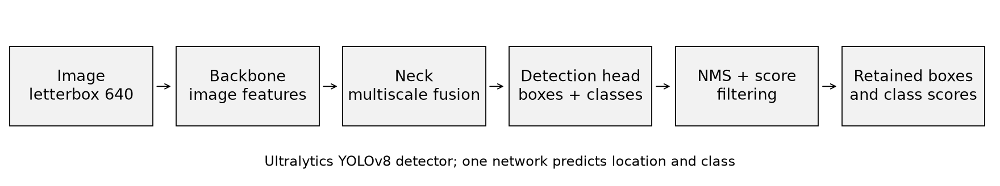
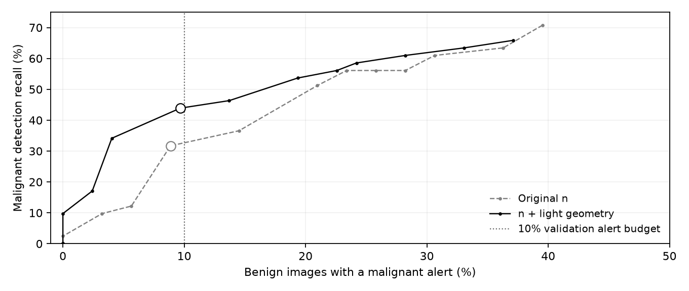
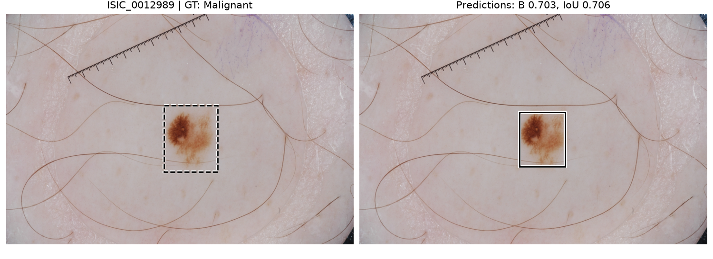
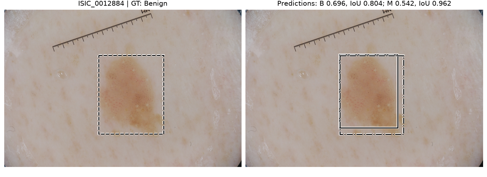
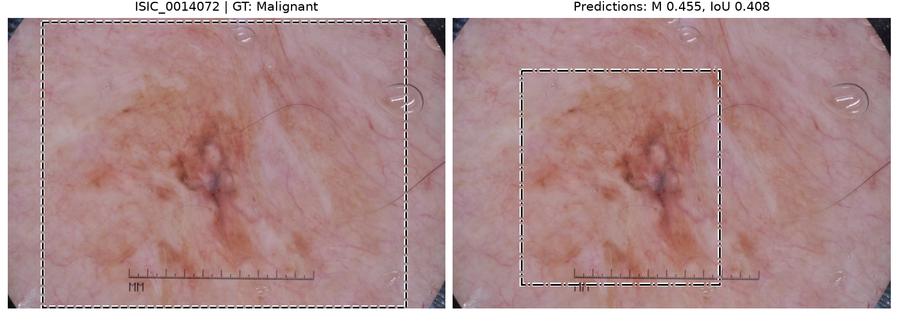

# Lesion detection and classification with YOLOv8

## 1. Aim and main findings

This project asks whether a YOLO detector can find more malignant skin lesions while keeping false alerts on benign images low. I compared pretrained YOLOv8n and YOLOv8s, then tested a small set of changes using validation data. The final choice is YOLOv8n with light geometry augmentation, seed 3710 and confidence > 0.40.

On validation, the final model detected 18/41 malignant lesions, with false alerts on 12/124 benign images. On a separate retrospective reassessment set, it detected 13/41, with 13/124 benign false alerts. Image classification accuracy was 72.73% and macro F1 was 0.6558. Correctly detected lesions had mean IoU 0.8428, but the correct-class all-GT mean was 0.6040. Localization among successful detections was stronger than malignant recognition across the full set.

I restarted the experiments because the original image-level split did not ensure lesion independence. The new models were trained from the original COCO pretrained weights, rather than checkpoints from the first attempt. However, I had already reviewed the earlier test results and failure cases, which may have influenced later experimental choices. I therefore report the later evaluation as a retrospective reassessment, not a new blind test. The final checkpoint and confidence threshold were fixed before reassessment and were not changed afterwards.

### Data and scope

The source is the 2,594-image ISIC 2018 Task 1 training set [1,2]. Each image has one annotated lesion. Official binary masks were resized to the school photo dimensions with nearest-neighbour interpolation, then converted to the smallest axis-aligned bounding boxes.

Following the teacher advice reported in the project, the final study uses only the 1,098 images with known lesion IDs: 824 benign and 274 malignant. The other 1,496 images are excluded from the final study, including one indeterminate diagnosis. Classes are Benign=0 and Malignant=1.

| Split | Benign / Malignant | Images |
| --- | --- | --- |
| Training | 576 / 192 | 768 |
| Validation | 124 / 41 | 165 |
| Retrospective reassessment | 124 / 41 | 165 |

Images connected by any recorded lesion or patient ID, including indirect links, were kept in one split. No recorded ID crosses sets. The subset contains 1,083 lesions and 1,043 splitting groups; a group is not a patient ID. Patient IDs are missing for 708 images, so full patient independence cannot be established. Image deduplication cannot resolve these missing links.

<!-- pagebreak -->

## 2. feasibility review

This plan was written on 17 October and revised on 21 October. Its experimental aims are retained; approval status was updated on 28 October. My tutor has recorded the feasibility check-off, and the known-lesion-only scope and imported Ultralytics components have been accepted.

### Purpose and scope
For a project manager considering a dermoscopy prototype, this study will compare YOLOv8n as the main baseline with YOLOv8s. The aim is to assess malignant detection recall while limiting alerts on benign images. Each image contains one annotated lesion, so multiple-lesion scenes are outside the study. Image alerts are a proxy for workload, not actual biopsy counts, and confidence is not a cancer probability.

### Data and model choice
The planned main dataset contains the 1,098 images with lesion IDs from ISIC2018 Task 1: 824 benign and 274 malignant. Images connected by recorded lesion or patient IDs will stay in one split, giving 768 training, 165 validation and 165 supplementary reassessment images. The remaining 1,496 images are excluded. The selected subset still has 708 missing patient IDs, so full patient independence cannot be established. The teacher has accepted this restricted subset. Boxes come from official binary masks and classes from matched metadata. Both models use their own original COCO weights. The design applies convolutional features, multiscale fusion, box/class losses and NMS. Ultralytics provides the network and trainer.

### Five testable acceptance criteria
1. Check every selected image, box and class label; verify split counts and no overlap of recorded lesion or patient IDs.
2. Train n/s on the same split for 60 epochs with input size 640, batch 16, FP32, AdamW and flips only. Keep hashes of weights, data, configuration and checkpoints.
3. Report classwise AP, precision, recall, TP/FP/FN and IoU with explicit matching and denominators. Confirm how the course's IoU target of 0.8 is averaged before claiming it is met.
4. Select thresholds on validation to maximise malignant detection recall with at most 12 alerts among 124 benign images. This 10% limit is an experimental rule, not a clinical standard. Report if no threshold qualifies.
5. Run an A100 preflight at batch 16 and input size 640 without nonfinite values or memory errors. Record peak memory, training time and the scope of latency/FPS measurements. The original budget is four GPU-hours for both main runs; runtime was not yet measured when this plan was written.

### Evidence, risks and next decision
At the planning stage, checks included 40 unit tests, one-epoch synthetic n/s runs, preprocessing comparisons and original COCO weight checks. Synthetic results do not establish lesion accuracy. Risks include missing IDs, subset bias, weak malignant classification and repeated validation use. Earlier test images had been viewed; regrouping would not create a blind test. The planned sequence was tutor clarification and real-input/GPU checks, then a fixed n/s training protocol, validation threshold selection, one supplementary evaluation and 3-5 failure examples. If the subset was rejected, the split would need revision before training. If resource or numerical checks failed, both models' shared protocol would need review before rerunning.

### Course and authorship notes
YOLOv8 is the Normal-difficulty option. The imported-component approach is accepted. Section 8 explains the IoU definitions and the teacher guidance. Codex assisted with code, checks and drafting; I remain responsible for reviewing and explaining the work. Sources: assessment Sections 2.3, 3 and 4; Ultralytics 8.3.221; Ed threads #136 and #147.

<!-- pagebreak -->

## 3. Model and training method

YOLOv8 predicts boxes and class scores in one network. Its convolutional backbone extracts features, the neck combines information at different scales, and separate box and class branches make predictions. The implementation uses Ultralytics Conv, C2f, SPPF and Detect components [3]. These are imported components.



Figure 1. Simplified processing pipeline. The final model uses a 640-pixel letterboxed input, class-aware NMS at 0.70 and confidence > 0.40.

Training uses CIoU box loss, distribution focal loss (DFL) and binary cross-entropy classification loss. The backbone, neck and prediction branches were trained; DFL integration coordinates remained fixed. Confidence is a model score, not a calibrated cancer probability.

| Setting | Original n/s and geometry reference |
| --- | --- |
| Initialization | Each model starts from its original COCO weights |
| Epochs / batch / input | 60 / 16 / 640; FP32; seed 3710 |
| Optimizer | AdamW; initial LR 0.001; weight decay 0.0005 |
| Schedule | 3 warm-up epochs; linear decay; no early stopping |
| Baseline augmentation | Horizontal and vertical flips, probability 0.5 each |
| Geometry change | Adds rotation +/-15 degrees, translation 0.05 and scale 0.15 |
| Other augmentation | Mosaic, MixUp, colour augmentation and oversampling off |
| Checkpoint | Highest validation macro mAP50:95 using EMA weights |

Each 60-epoch run completed 2,880 optimizer calls, with nominal batch size also set to 16. Original n/s selected epochs 32/42; the final geometry model selected epoch 50. Checkpoint ties use scores rounded to five decimals, then the later epoch. EMA weights are saved in FP16 and reloaded in FP32 by Ultralytics. Training validation uses batch 32; later evaluation requests batch 16.

The n/s comparison includes differences in initialization as well as capacity: n loads 319/355 pretrained state entries and s loads 349/355. Their two-class heads are partly reinitialized. The geometry trial also changes a combined augmentation preset, so it does not isolate rotation, translation and scaling individually.

<!-- pagebreak -->

## 4. Evaluation and model selection

All reported operating-point results use the same letterboxing, single-label class-aware NMS at 0.70 and at most 300 boxes. Validation and prediction preprocessing were checked for identical input pixels. The AP score floor is 0.001; the final operational filter is confidence > 0.40.

### Detection, image classification and alerts

A detection TP needs the correct class and IoU >= 0.5. Predictions are processed in descending confidence, and each GT can be matched once. Extra or unmatched boxes are FP; unmatched GTs are FN. Precision = TP/(TP+FP), recall = TP/(TP+FN), and F1 = 2TP/(2TP+FP+FN). These counts include duplicate predictions.

Image classification uses the class of the highest-confidence retained box, without a GT-based choice or an IoU requirement. No retained box is an abstention: incorrect for accuracy and a FN for its true class. Macro F1 averages class F1 values, and balanced accuracy averages class recalls. A malignant image alert instead requires any retained malignant box, regardless of location or the primary class. Alerts are not biopsy counts.

### AP and the literature

The YOLOv7 paper reports COCO AP at multiple overlap thresholds together with FPS [4, Section 5.1 and Table 2]. I therefore retain AP50, AP50:95 and resource measurements, with per-class AP to expose unequal performance. AP50:95 averages ten IoU cutoffs from 0.50 to 0.95; mAP gives the two classes equal weight. AP does not describe recall at one chosen confidence threshold.

AP comes from pinned Ultralytics 8.3.221: upstream matching and 101-point interpolated trapezoidal integration [3]. The project changes default multi-label validation to single-label NMS. This is not an exact reproduction of official COCO evaluation [6], which uses its own matching/accumulation and standard maxDets=100. Fixed-point counts use our separate confidence-ordered matcher, not the library max-F1 summary. AP was not independently recomputed.

The ISIC 2018 paper uses thresholded pixel-mask Jaccard for Task 1 and balanced accuracy for seven-class Task 3 [5, Sections 2.1 and 2.3]. This supports examining class imbalance, but those tasks and scores are not directly comparable with our binary box detector. Our box-IoU averages are defined separately in Section 8.

### Locked selection rules

The predefined validation threshold grid was 0.01, 0.02, 0.05, 0.10, 0.15, 0.20, 0.30, 0.40, 0.50, 0.60, 0.70, 0.80, 0.90 and 0.95. Within each run, I maximized malignant detection recall while allowing alerts on at most 12/124 benign images. Ties favour precision, fewer alerts, then a higher threshold. The 10% alert budget is an experimental comparison rule, not a course or clinical requirement.

Candidate improvement and confirmation rules were recorded before each trial series. Classification additions and the literature-based interpretation were added after development, without selecting a checkpoint or threshold again. Earlier test exposure remains disclosed; reassessment results did not select the final model.

<!-- pagebreak -->

## 5. Validation experiments and final choice

All rows below use the same 768 training and 165 validation images. Each starts from COCO weights and uses its validation-selected threshold. Original n was the baseline chosen before training. B means benign and M means malignant.

| Model | Conf. | M TP / 41 | B alerts / 124 | M all-GT IoU |
| --- | --- | --- | --- | --- |
| Original n | 0.50 | 13 | 11 | 0.2870 |
| Original s | 0.80 | 11 | 7 | 0.2118 |
| n, cls weight 1.0 | 0.80 | 14 | 8 | 0.3057 |
| n, 120 epochs | 0.90 | 9 | 1 | 0.1762 |
| n, light geometry | 0.40 | 18 | 12 | 0.3757 |
| Geometry n, input 896 | 0.50 | 9 | 3 | 0.1837 |
| Geometry n, positive weight 2 | 0.70 | 17 | 7 | 0.3527 |
| Geometry s | 0.50 | 10 | 11 | 0.2092 |

The initial trials doubled the classification-loss coefficient for both classes, used light geometry, or extended training to 120 epochs. The longer run also changes the LR decay and checkpoint-selection opportunities. Geometry produced the best selected result: 18 malignant TP versus 13 for original n, with 12 versus 11 benign alerts. Candidate ranking used malignant recall, then correct-class all-GT IoU, malignant AP50:95 and fewer alerts.

The improvement met the predeclared trigger of at least three additional malignant TP and higher malignant all-GT IoU. At a second seed (3711), geometry n again passed: 15 TP and 7 benign alerts versus 12 TP and 8 alerts for original n. Their selected thresholds were 0.50 and 0.80. This checks training consistency on the same images, not independent patients; the original seed-3710 checkpoint was retained.

The follow-up series tested input size 896, doubled malignant-positive BCE weighting, and s capacity with the same geometry preset. Replacement required at least three extra malignant TP, higher malignant all-GT IoU, a benign-IoU decrease of no more than 0.03, and the same alert budget. None qualified. At the common cutoff 0.40, positive weighting increased malignant TP from 18 to 23 but benign alerts from 12 to 24. It improved malignant AP50 from 0.4646 to 0.5052, but did not meet the operating-point rule.

A separate GT-free single-box class-score ratio policy also failed its planned rule (17 malignant TP, 12 benign alerts). Earlier expanded-data n/s runs are exploratory only and excluded after the known-lesion-only decision. Their complete results and all threshold grids remain in `EXPERIMENT_DETAILS.md` and the saved JSON summaries.

I retained geometry n at confidence > 0.40. One seed does not rank all architectures reliably, and repeated validation selection can be optimistic. The earlier grouped bootstrap for the initial 12.2-point recall gain gave a conditional 95% interval of -2.9 to 27.8 points; it did not correct for selection or unknown patient links.

<!-- pagebreak -->

## Training and threshold evidence


Figure 2. Original n/s training histories; validation classification loss uses a log scale.



Figure 3. Validation recall versus benign-image false-alert rate. Points are the tested thresholds; outlined points are selected operating points.  The geometry policy reaches more malignant TP within the 10% alert budget.

At a common confidence of 0.50, geometry n has 14 malignant TP and 5 benign alerts, versus 13 and 11 for original n. At 0.05 both have 25 TP, with 35 versus 38 benign alerts. This shows why comparing both a common cutoff and a common alert budget is useful. Lowering confidence does not provide a free improvement in recall.

The full 14-point tables are preserved in the supporting record.

<!-- pagebreak -->

## 6. Fixed retrospective detection results

The two original baselines and final geometry n were evaluated on the same 165 reassessment images (124 B, 41 M). Each keeps its own validation-selected threshold. This compares fixed operating policies; it does not isolate augmentation or model size at a common cutoff.

| Measure | Original n | Original s | Final geometry n |
| --- | --- | --- | --- |
| Confidence | 0.50 | 0.80 | 0.40 |
| mAP50 / mAP50:95 | 0.5432 / 0.3619 | 0.5291 / 0.3527 | 0.6312 / 0.4290 |
| B AP50 / AP50:95 | 0.7883 / 0.5540 | 0.7722 / 0.5434 | 0.8392 / 0.5863 |
| M AP50 / AP50:95 | 0.2980 / 0.1698 | 0.2860 / 0.1621 | 0.4233 / 0.2717 |
| Benign TP / FP / FN | 93 / 33 / 31 | 61 / 10 / 63 | 104 / 24 / 20 |
| Malignant TP / FP / FN | 10 / 20 / 31 | 6 / 5 / 35 | 13 / 16 / 28 |
| Benign precision / recall | 73.81% / 75.00% | 85.92% / 49.19% | 81.25% / 83.87% |
| Malignant precision / recall | 33.33% / 24.39% | 54.55% / 14.63% | 44.83% / 31.71% |
| B / M detection F1 | 0.7440 / 0.2817 | 0.6256 / 0.2308 | 0.8254 / 0.3714 |
| B images with M alert / 124 | 16 | 3 | 13 |
| M images with M alert / 41 | 14 | 8 | 15 |

Final geometry n detects 13 malignant lesions compared with 10 for original n, and raises benign alerts on 13 images compared with 16. Both detect seven malignant lesions, geometry alone detects six, original n alone detects three, and both miss 25. The improvement is descriptive for this sample, not proof of population-level superiority.

Malignant detection remains the main weakness: final recall is 31.71%, versus 83.87% for benign lesions. The benign alert rate is 10.48%, slightly above the validation budget. A budget met on validation is not guaranteed on another set. AP is calculated over ranked scores above the low-score floor, not at confidence 0.40.


<!-- pagebreak -->

## 7. Image classification results

These results use the highest-confidence retained box for one image label. All boxes still count in the detection evaluation. The confusion matrix includes images with no retained prediction, so abstentions are not silently removed.

| Ground truth | Predicted benign | Predicted malignant | No prediction |
| --- | --- | --- | --- |
| Benign | 105 | 10 | 9 |
| Malignant | 16 | 15 | 10 |

| Class | Precision | Recall | F1 |
| --- | --- | --- | --- |
| Benign | 86.78% | 84.68% | 0.8571 |
| Malignant | 60.00% | 36.59% | 0.4545 |

Accuracy is 120/165 (72.73%), macro F1 is 0.6558, and balanced accuracy is 60.63%. Coverage is 146/165 (88.48%). Accuracy restricted to covered images is 82.19%; this excludes abstentions and is not the headline result.

Always assigning benign would achieve 75.15% accuracy on this class mix, but zero malignant recall. Our accuracy is below that reference, while malignant classification recall is 36.59%. Accuracy alone therefore gives an incomplete view. Class recall reports the correct fraction within each true class; macro F1 gives the two classes equal weight and includes false class assignments.

The final model correctly classifies 15 malignant images, but two boxes have IoU below 0.5, leaving 13 malignant detection TP. Conversely, three benign images have a correct benign primary box plus an extra malignant alert. This explains 13 benign alerts versus 10 malignant primary-class decisions on benign images.

Validation accuracy was 71.52%, macro F1 0.6663 and malignant classification recall 39.02%. Its malignant detection count was 18 rather than 16 because two images had a valid malignant box but a higher-confidence benign primary box. Classification, detection and image alerts answer different questions; none substitutes for the others.

The added classification metrics describe the already locked policies. They were not used to select a more favourable checkpoint after seeing reassessment results.

<!-- pagebreak -->

## 8. Localization IoU and the course target

IoU is intersection area divided by union area for two boxes. The following project-defined averages describe different parts of the output. Per-class results use the GT diagnosis. Overall values pool individual lesion values rather than averaging the two class means equally.

For all-GT means, I take the best retained-box IoU for each GT, with or without a correct-class requirement. No eligible prediction contributes zero. A correct-class box below IoU 0.5 still contributes its actual overlap, even though it is a detection FN. Best-box selection uses GT and does not penalize duplicates; it is a diagnostic, not an operational box-selection method.

TP-only IoU averages the boxes matched by the detector, excluding unmatched GTs. Primary-box IoU uses the highest-confidence retained box, chosen without GT. It is zero for no prediction; the correct-class variant also assigns zero to a wrong primary class.

| Final model IoU | Overall | Benign | Malignant |
| --- | --- | --- | --- |
| Best correct-class box, all GT | 0.6040 (N=165) | 0.7150 (N=124) | 0.2680 (N=41) |
| Best box ignoring class, all GT | 0.7305 (N=165) | 0.7726 (N=124) | 0.6034 (N=41) |
| Matched correct-class TP only | 0.8428 (N=117) | 0.8470 (N=104) | 0.8100 (N=13) |
| Primary box, ignore class | 0.7256 (N=165) | 0.7662 (N=124) | 0.6028 (N=41) |
| Primary box, correct class | 0.5906 (N=165) | 0.6973 (N=124) | 0.2680 (N=41) |

Successful detections have mean IoU above 0.8 overall and in each class. However, TP-only excludes 48 unmatched GTs, including 28 malignant lesions. It also does not imply every TP exceeds 0.8. Correct-class all-GT IoU is 0.6040 overall, 0.7150 for benign and 0.2680 for malignant.

On validation, correct-class all-GT means were 0.6238 overall, 0.7058 benign and 0.3757 malignant. The lower correct-class values compared with class-agnostic values identify recognition failures within the observed outputs; they do not prove why the network made those errors.

The teacher requested overall and per-class IoU and kept 0.8 as a requirement, with an exception for reasonable trials and sound best-effort analysis. The later reply asks us to justify metrics through evidence rather than prescribing one denominator. I therefore report the conditional localization success and the cohort-level shortfall together. This supports neither an unqualified target-achievement claim nor a guarantee of the overall grade.

<!-- pagebreak -->

## 9. Failure cases from the final model

These three cases use the frozen geometry-n predictions at confidence > 0.40. Each is the lowest available image ID in its predefined error category; they are illustrative, not a random sample. Left panels show GT; right panels show retained predictions: solid lines for benign (B), dash-dot for malignant (M). Image proportions are preserved.



Figure 4. ISIC_0012989: malignant GT, predicted benign at confidence 0.703 and IoU 0.706. The location passes the 0.5 criterion, but the wrong class produces a malignant FN and benign FP.



Figure 5. ISIC_0012884: benign GT, with a benign box at confidence 0.696/IoU 0.804 and a malignant box at 0.542/0.962. The benign box is TP and the malignant box is FP. The primary image label is correct, yet an alert is still raised. Class-aware NMS does not suppress a box solely because it overlaps a different predicted class.

<!-- pagebreak -->

## Failure analysis and limitations



Figure 6. ISIC_0014072: the malignant prediction has confidence 0.455 but IoU 0.408. It is a correct image-class decision and an alert, but fails detection matching, producing a malignant FP and FN.

Across all 28 malignant detection FN, 16 have a retained benign box with IoU >= 0.5, ten have no retained box, and two have other class/location failures. Class discrimination is therefore a major observed weakness, but not the only failure mode. Hair, rulers, reflections, low contrast and lesion size were not controlled interventions and are not claimed as causes.

The validation diagnosis is consistent with this pattern: 17 of 23 malignant FN had a localized benign prediction and six had no retained prediction. At confidence 0.40, the raw-score audit found no sufficiently localized malignant candidate above threshold for those 23 cases. At the two checked score floors, none was lost solely through the subsequent NMS stage. These are output diagnostics, not evidence that NMS can never affect performance.

Only 41 malignant images appear in each evaluation set, so one case changes recall by 2.44 percentage points. Repeated validation use can overfit model choices, while historical reassessment exposure prevents a clean estimate of performance on unseen cases. Missing patient links and selecting only known-lesion-ID images introduce further uncertainty and possible subset bias.

Metadata diagnoses were not independently adjudicated. The trials do not establish a single explanation for the errors or show that model performance has reached its ceiling. There was no probability calibration, external patient-independent test, real referral/biopsy measurement or mobile-device evaluation.

<!-- pagebreak -->

## 10. Resources and engineering recommendation

| Measurement | Original n | Original s | Final geometry n |
| --- | --- | --- | --- |
| Parameters | 3,011,238 | 11,136,374 | 3,011,238 |
| Training-call time | 8.05 min | 9.55 min | 8.56 min |
| Peak training CUDA allocation | 4.17 GiB | 6.12 GiB | 4.17 GiB |
| A100 model-stage mean | 6.82 ms | 5.75 ms | 6.51 ms |
| A100 file-to-prediction mean | 54.89 ms | 47.61 ms | 66.06 ms |
| A100 serial throughput | 18.22 images/s | 21.00 images/s | 15.14 images/s |

Training used A100 GPUs; time includes training and internal validation but excludes queueing, setup and separate evaluation. Nodes differed. CUDA allocation is PyTorch tensor allocation, not total device memory use.

All speed tests used FP32, 640-pixel inputs, one image per call, ten warm-ups and 495 timed calls (three passes over the same 165 validation images). CUDA synchronization included completed GPU work. Model-stage time covers the forward pass; file-to-prediction time also includes reading/decoding, preprocessing, transfers, NMS, threshold filtering and copying results to CPU. Startup, drawing, saving and UI are excluded. Final geometry n was measured on 28 October on A100-5 with its unchanged confidence > 0.40; original n/s timings are from an earlier session. Node load and repeated-read caching were not controlled across sessions, so speed differences cannot be attributed to geometry augmentation. A100 throughput is not phone performance.

### Recommendation

For this coursework prototype, I retain geometry n and confidence > 0.40. It passed the planned validation and second-seed rules, and none of the bounded follow-ups met the replacement rule. The final reassessment shows a modest improvement over the original n policy, but malignant recall remains too limited to support reliable screening claims.

I would not keep lowering the threshold without considering benign alerts. Positive weighting already showed the trade-off: more malignant detections at a common cutoff also brought more false alerts. Further unrestricted tuning on the same 41 malignant validation images would weaken the comparison.

A next study could compare a YOLO localizer followed by a separate classifier, but it would need a new, predefined evaluation plan and confirmation that the design meets the course requirements. Better patient linkage and independently held-out groups should take priority before making stronger generalization claims. The current experiments support this next question; they have not tested the two-stage approach.

<!-- pagebreak -->

## 11. Reproducing and using the project

The main files are `modules.py` (model construction/loading), `dataset.py` (data loading), `train.py` (training/evaluation/checkpoints), `predict.py` (saved-model inference) and this README. Supporting scripts preserve the grouping checks, experiment settings and metric audits.

School training used Python 3.13.16, PyTorch 2.8.0, torchvision 0.23.0 and Ultralytics 8.3.221. `requirements.txt` pins the ML dependencies; `requirements-linux-a100.lock.txt` records the tested Linux environment. The final local CPU evaluation used Python 3.13.13 with the same core package versions. PDF dependencies are separate in `requirements-report.txt`. Fixed seeds do not guarantee identical results across platforms.

Follow `REPRODUCING.md` for the complete setup, input checks and training commands. The separate review-input archive contains fixed manifests, labels, source snapshots and the three saved model/lock pairs. Course reviewers can request it from me at s4905914@student.uq.edu.au; its filename and SHA-256 are recorded in the guide. Photographs come from the course dataset. Data and weights stay outside Git.

```bash
python recognition/YOLO_s4905914/restore_study_sources.py \
  --destination ../comp3710-reproduction
cd ../comp3710-reproduction
python -m pip install -r recognition/YOLO_s4905914/requirements.txt
```

After verifying and extracting the review inputs into the restored workspace, replace the example image path below. Outputs are `prediction.json` (boxes, classes, scores and primary label) and `prediction.jpg` (overlay). The command uses the recorded final checkpoint and locked threshold. For retraining, the guide distinguishes the original n/s config from the final geometry study code; the disabled `experiment.json` is not a training config.

```bash
REPORT_CONFIG=studies/known_lesion_optimization_20261021/n_geometry.json
REPORT_RUN=outputs/known_lesion_optimization_20261021_681452/n_geometry
python recognition/YOLO_s4905914/predict.py \
  --config "$REPORT_CONFIG" --checkpoint "$REPORT_RUN/train_n/fit/weights/best.pt" \
  --lock "$REPORT_RUN/val_n/selection_lock.json" \
  --image /path/to/image.jpg --output outputs/demo --device cpu
```

`known_optimization_decision_20261021.json` records the exact config, checkpoint and lock. The figures in Section 9 show example inputs and corresponding saved outputs. Existing audits included 47 tests and independent replay of TP/FP/FN, classification metrics and IoU from cached predictions. These checks validate calculation consistency, not diagnostic correctness. AP remains the library calculation.

Export the current README with `python recognition/YOLO_s4905914/export_readme_pdf.py --output output/pdf/COMP3710_Project3_Report.pdf`. `build_final_report.py` regenerates README from the included summaries and report builder; use it only when intentionally replacing the Markdown source. Neither command retrains a model. `REPRODUCTION_CHECKS_20261028.json` records the fresh-workspace checks for the updated guide.

### Artificial Intelligence Usage Disclosure

OpenAI ChatGPT/Codex assisted with planning, metadata/grouping audits, label conversion, training and evaluation scripts, debugging, tests, plots, report drafting and explanations. YOLO layers, losses and training machinery come from Ultralytics and are attributed [3]. Checks included inspecting source code, comparing hashes and preprocessing, synthetic and real-data runs, independent metric replay and PDF review. These checks cannot prove every diagnosis or claim; I am responsible for reviewing and explaining the submitted work.

<!-- pagebreak -->

## 12. References and supporting records

1. ISIC. [Challenge datasets and original ground-truth downloads](https://challenge.isic-archive.com/data/). Source of Task 1 photos and masks.

2. ISIC Archive. [Collection 63](https://api.isic-archive.com/collections/63/). Metadata matched by image ID; missing identity fields are documented in the data audit.

3. Ultralytics. [Version 8.3.221](https://github.com/ultralytics/ultralytics/tree/v8.3.221), especially nn/modules, utils/loss.py, utils/metrics.py and the detection validator. Source is attributed under AGPL-3.0. The model uses this implementation rather than a student-built network.

4. Wang, C.-Y., Bochkovskiy, A., and Liao, H.-Y. M. (2022). [YOLOv7: Trainable bag-of-freebies sets new state-of-the-art for real-time object detectors](https://arxiv.org/abs/2207.02696). Section 5.1 and Table 2; detector evaluation context, not the architecture implemented here.

5. Codella, N., et al. (2019). [Skin Lesion Analysis Toward Melanoma Detection 2018: A Challenge Hosted by ISIC](https://arxiv.org/abs/1902.03368). Version 2, Sections 2.1 and 2.3; segmentation and classification evaluation context.

6. COCO authors. [Official COCO evaluator](https://github.com/cocodataset/cocoapi/blob/master/PythonAPI/pycocotools/cocoeval.py). Reference for evaluation conventions; not the code used to obtain this report's AP.

7. COMP3710/COMP7710 final assessment specification, Version 2.5, accessed on Learn.UQ on 28 October 2026. Project 3: pages 6-7; feasibility, submission and marking requirements: Sections 3-6. The project-specific teacher clarifications are preserved below.

### Supporting records

The full earlier tables, expanded-data study, all threshold points and original baseline examples remain in `EXPERIMENT_DETAILS.md`. The concise report keeps the evidence needed for the final model decision and required evaluation. No excluded experiment was deleted from its source records.

`validation_results_669143.json` and `reassessment_results_669815.json` contain the original n/s summaries. `known_optimization_results_20261021.json` and `followup_results_20261022.json` contain the validation trials. `course_metrics_20261022.json` contains the later classification and localization additions; its historical pending field is not a current status flag. Final results are in `final_candidate_reassessment_20261022.json`. The final A100 timing summary and 495 raw observations are in `final_candidate_benchmark_20261028.json` and `final_candidate_benchmark_measurements_20261028.json`; `final_candidate_benchmark_verification_20261028.json` records the independent checks.

`teacher_response_20261022.txt` and `teacher_response_20261023.txt` preserve the supplied teacher replies. The latter was transcribed from the student's screenshot, not independently fetched from Ed. `evaluation_sources_20261023.json` records the paper locations and pinned-source checks. The shorter report changes presentation only; model, threshold and evaluation records are unchanged.

The feasibility check-off and imported-component approach are confirmed. The remaining submission steps are an upstream GitHub PR and the README PDF through Turnitin by the deadline. After submission, I must address the teaching team's PR feedback within the announced response window. Historical plans retain their original status fields; they do not override these current confirmations.
