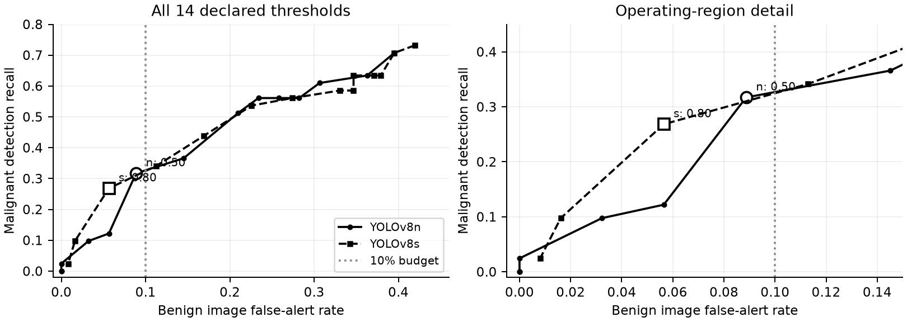
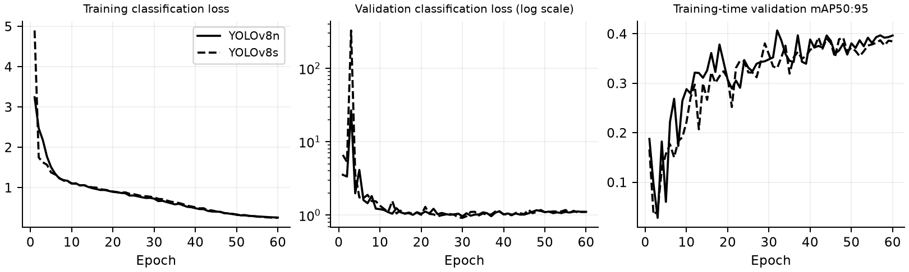
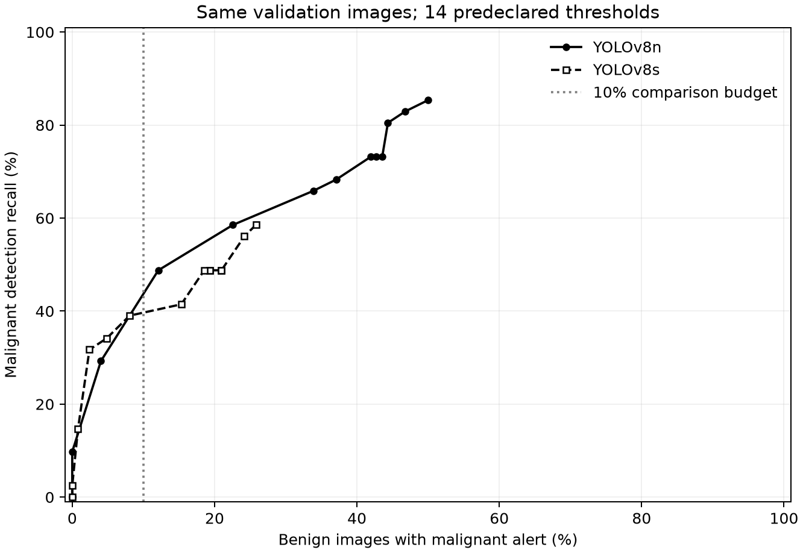
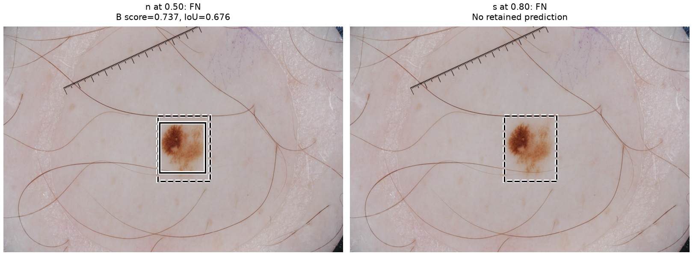
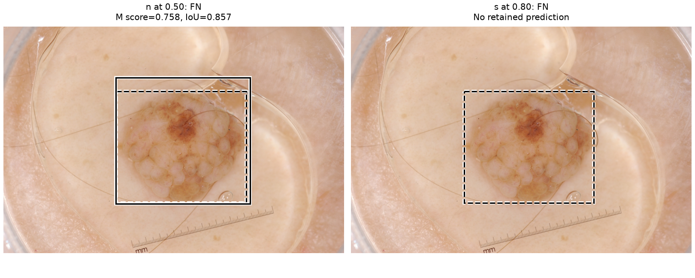
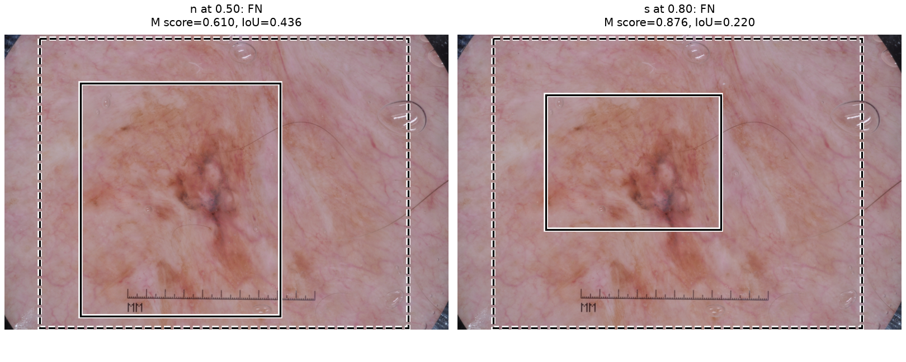
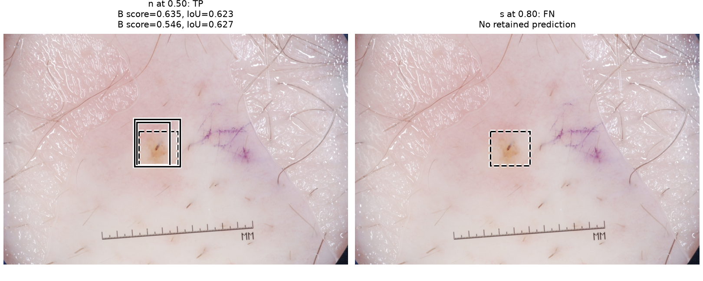
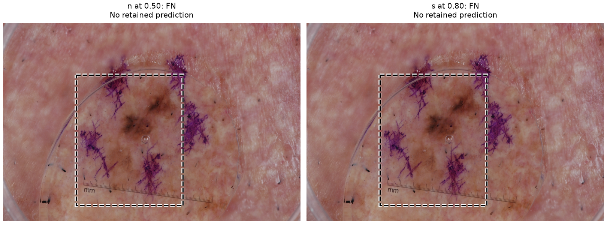
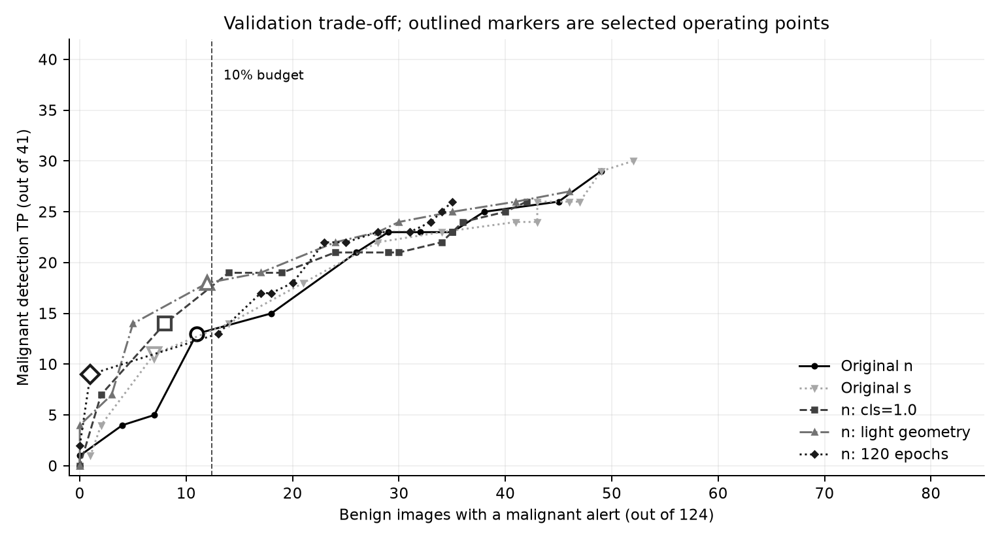

# Lesion detection and classification with YOLOv8

COMP3710 Assignment 3, Project 3 | s4905914 | Report updated 22 October 2026

This project compares YOLOv8n and YOLOv8s for finding skin lesions and classifying them as benign or malignant. The main question is whether either model can detect more malignant lesions while keeping false alerts on benign images low. YOLOv8n was chosen as the main baseline before training. The main experiment uses images with known lesion IDs; a later experiment adds more training images and is reported separately.

Both original models completed 60 training epochs, but malignant detection remained weak. In their supplementary evaluation, n detected 10/41 malignant lesions at confidence 0.50, while s detected 6/41 at 0.80. These baseline results motivated the later validation-only trials reported below.

The final choice is YOLOv8n with light geometry at confidence 0.40, selected using only the known-lesion training and validation sets. It detects 18/41 malignant validation lesions with 12/124 benign alerts. The fixed retrospective evaluation detects 13/41 with 13/124 benign alerts, Accuracy 72.73% and macro F1 0.6558. Its all-GT correct-class IoU is 0.6040 overall, 0.7150 for benign and 0.2680 for malignant. The final sections give the full definitions and results. No model or threshold changed after this evaluation. The expanded-data experiment remains historical exploration and is excluded from the final choice.

Zhao's reply supplied on 22 October requires overall and per-class IoU, Accuracy, and additional classification metrics for imbalance. The 0.8 IoU requirement includes an evidence-supported best-effort provision. The final sections add these metrics and the follow-up analysis. Imported Ultralytics components and personal tutor check-off still need confirmation. These experiments do not establish clinical suitability.

In the second-seed validation check, the geometry candidate detected 15/41 malignant lesions versus 12/41 for the repeated baseline, with 7 versus 8 benign alerts. It met the prespecified confirmation rule. The current choice is n with light geometry at confidence 0.40, using its seed-3710 checkpoint. This comparison reuses validation images and is not new test evidence.

## Data and scope

The dataset contains 2,594 school-provided dermoscopic photographs. Each bounding box is the smallest rectangle aligned with the image axes that encloses the lesion in its official binary mask. The masks were resized to the photo dimensions using nearest-neighbour interpolation before creating the boxes. Class labels came from official metadata matched by image ID. The checked boxes were reused for this restart; the original school photos and masks were unchanged [1,2].

The metadata lists 2,074 benign, 519 malignant and one indeterminate image. The main experiment uses the 1,098 images with a recorded lesion_id and excludes the other 1,496. The later experiment adds 1,495 of those images to training because they have benign or malignant labels. The indeterminate image is excluded rather than assigned a diagnosis. The model classes are Benign=0 and Malignant=1. Every image has one annotated lesion, so this study does not test scenes with multiple lesions.

| Split | Benign / Malignant | Images |
| --- | --- | --- |
| Train | 576 / 192 | 768 |
| Validation | 124 / 41 | 165 |
| Supplementary reassessment | 124 / 41 | 165 |

Before selecting the subset, images linked by any recorded lesion or patient ID were grouped together, including indirect links through other images. The groups were then split using seed 3710. No recorded lesion or patient ID appears in more than one set. The subset contains 1,083 recorded lesions and 1,043 groups for splitting; a group is not a new patient ID. There are still 708 images without patient_id, so complete patient independence cannot be confirmed.

<!-- pagebreak -->

## One-page feasibility review

This section restates the plan written on 17 October, with simpler wording added on 21 October. It describes what was planned before training; the measured results appear later. The original plan is kept in `FEASIBILITY_REVIEW.md`.

### Purpose and scope
For a project manager considering a dermoscopy prototype, this study will compare YOLOv8n as the main baseline with YOLOv8s. The aim is to assess malignant detection recall while limiting alerts on benign images. Each image contains one annotated lesion, so multiple-lesion scenes are outside the study. Image alerts are a proxy for workload, not actual biopsy counts, and confidence is not a cancer probability.

### Data and model choice
The planned main dataset contains the 1,098 images with lesion IDs from ISIC2018 Task 1: 824 benign and 274 malignant. Images connected by recorded lesion or patient IDs will stay in one split, giving 768 training, 165 validation and 165 supplementary reassessment images. The remaining 1,496 images are excluded. The selected subset still has 708 missing patient IDs, so full patient independence cannot be established. Tutor acceptance of the subset is pending. Boxes come from official binary masks and classes from matched metadata. Both models use their own original COCO weights. The design applies convolutional features, multiscale fusion, box/class losses and NMS. Ultralytics provides the network and trainer.

### Five testable acceptance criteria
1. Check every selected image, box and class label; verify split counts and no overlap of recorded lesion or patient IDs.
2. Train n/s on the same split for 60 epochs with input size 640, batch 16, FP32, AdamW and flips only. Keep hashes of weights, data, configuration and checkpoints.
3. Report classwise AP, precision, recall, TP/FP/FN and IoU with explicit matching and denominators. Confirm how the course's IoU target of 0.8 is averaged before claiming it is met.
4. Select thresholds on validation to maximise malignant detection recall with at most 12 alerts among 124 benign images. This 10% limit is an experimental rule, not a clinical standard. Report if no threshold qualifies.
5. Run an A100 preflight at batch 16 and input size 640 without nonfinite values or memory errors. Record peak memory, training time and the scope of latency/FPS measurements. The original budget is four GPU-hours for both main runs; runtime was not yet measured when this plan was written.

### Evidence, risks and next decision
At the planning stage, checks included 40 unit tests, one-epoch synthetic n/s runs, preprocessing comparisons and original COCO weight checks. Synthetic results do not establish lesion accuracy. Risks include missing IDs, subset bias, weak malignant classification and repeated validation use. Earlier test images had been viewed; regrouping would not create a blind test. The planned sequence was tutor clarification and real-input/GPU checks, then a fixed n/s training protocol, validation threshold selection, one supplementary evaluation and 3-5 failure examples. If the subset was rejected, the split would need revision before training. If resource or numerical checks failed, both models' shared protocol would need review before rerunning.

### Course and authorship notes
YOLOv8 is the Normal-difficulty option. Imported components and the IoU averaging rule need clarification. This review does not establish completed check-off. Codex assisted with code, checks and drafting; the student must review and explain the submitted work. Sources: assessment draft sections 2.3, 3 and 4; Ultralytics 8.3.221; previously checked Ed threads #136 and #147.

<!-- pagebreak -->

## Model and implementation

YOLOv8 predicts lesion boxes and classes in one network [3]. Its backbone uses convolutions to learn image features. The neck combines features at different scales, and the detection head predicts boxes and class scores at three resolutions. Conv blocks combine convolution, normalization and activation; C2f combines feature branches; SPPF pools features over different areas. Box and class predictions use separate branches. These components come from Ultralytics. The YOLOv7 paper provides background on speed and accuracy in object detection [4], while the actual models here are YOLOv8n and YOLOv8s.

Training uses CIoU for box regression, distribution focal loss (DFL) for box distances, and binary cross-entropy for classification. DFL measures part of the localization error, so a falling dfl_loss does not by itself show better classification. Prediction confidence is not a calibrated probability of cancer. Non-maximum suppression (NMS) removes some overlapping boxes of the same predicted class. It can still leave more than one box in an image.

`modules.py` builds the two-class model and loads saved models. `dataset.py` provides the data loader used by `train.py`, which trains and evaluates the model, saves checkpoints and records losses and metrics. `predict.py` loads a checkpoint and its saved validation threshold, then writes predictions and an overlay image. Helper scripts handle grouping, checking and reporting. The network layers come from Ultralytics rather than student-written implementations; whether this meets the course component requirement still needs confirmation.

### Fixed training protocol

| Setting | YOLOv8n | YOLOv8s |
| --- | --- | --- |
| Initial weights | Original COCO n | Original COCO s |
| Library | Ultralytics 8.3.221 | Same |
| Epochs / completed optimizer calls | 60 / 2,880 | 60 / 2,880 |
| Image size / batch / nominal batch | 640 / 16 / 16 | Same |
| Seed / arithmetic | 3710 / FP32 | Same |
| Optimizer | AdamW | Same |
| Initial LR / weight decay | 0.001 / 0.0005 | Same |
| Warm-up / LR schedule | 3 epochs / linear | Same |
| Augmentation | Horizontal/vertical flips, p=0.5 each | Same |
| Mosaic / MixUp / oversampling | Off / off / none | Same |
| Early stopping / resumed training | Disabled / no | Same |
| Selected epoch by macro mAP50:95 | 32 | 42 |

The backbone, neck and prediction branches were trained; the fixed DFL integration coordinates were not. Under the library learning-rate schedule, the first optimizer call uses zero learning rate and the final epoch uses 0.0000265. Recorded calls were checked against this schedule. Setting both batch size and nominal batch size to 16 avoids a difference in gradient accumulation between the models.

The two sizes do not load exactly the same proportion of their pretrained state: n loads 319/355 entries and s loads 349/355, including buffers. Changing to two classes reduces n's classification hidden width from 80 to 64; s keeps width 128 and replaces the final outputs. Both load the backbone, neck and box-regression state. Their comparison therefore includes initialization differences as well as model size.

<!-- pagebreak -->

## Evaluation and selection rules

Images are resized to fit a 640-pixel square while keeping their aspect ratio, then padded (letterboxing). Synthetic images were used to check that the validation loader and predictor produce identical input pixels. Evaluation keeps scores above 0.001, uses one predicted class per box and class-aware NMS at IoU 0.7, with at most 300 boxes. This differs from default multi-label validation, so AP values from the two policies should not be mixed.

The checkpoint is selected by the highest validation macro mAP50:95 over 60 epochs. Scores are rounded to five decimal places, with a later epoch chosen when they tie. Validation uses EMA weights, saved in FP16 and reloaded in FP32 by Ultralytics. Training validation uses batch 32; the later evaluation requests batch 16. These execution details are recorded for reproducibility, but their effects on score differences were not isolated.

A TP requires the correct class, confidence strictly above the selected threshold and IoU >= 0.5. Each GT matches the highest-confidence eligible prediction once. Unmatched predictions count as FP for their predicted class; unmatched GTs count as FN. A wrong-class or poorly localized box can therefore contribute both FP and FN. An image-level malignant alert requires any retained malignant prediction, regardless of IoU. Alert counts and detection recall are reported separately.

AP50 and AP50:95 are calculated from the low-score sweep; macro mAP weights both classes equally. The operating threshold maximises malignant detection recall while allowing alerts on at most 12 of 124 benign validation images (10%). Ties favour higher precision, fewer benign alerts, then a higher threshold. The grid was fixed before training: 0.01, 0.02, 0.05, 0.10, 0.15, 0.20, 0.30, 0.40, 0.50, 0.60, 0.70, 0.80, 0.90 and 0.95. This alert limit is an experimental comparison rule, not a course passing threshold or a clinical standard.



Each marker is one of the 14 tested thresholds; the joining lines do not represent extra tests. The rule selected 0.50 for n and 0.80 for s. At 0.50, s detects 22 malignant validation cases but alerts on 28 benign cases. At 0.70, it has 14 malignant TP and 14 benign alerts. Both exceed the limit of 12. No extra thresholds were added after viewing the results.



Validation classification loss is plotted on a logarithmic scale so both early spikes and later changes are visible. All recorded values are finite. The cause of the spikes was not tested. Completing 60 epochs does not establish convergence, and an earlier best checkpoint alone does not establish overfitting.

<!-- pagebreak -->

## Original n/s experiment: results

Validation and reassessment each contain 124 benign and 41 malignant images, with different membership. Each model was evaluated once on reassessment using its fixed checkpoint and threshold. Earlier exposure to some images means this is not a fresh blind test.

| AP measure | n validation / reassessment | s validation / reassessment |
| --- | --- | --- |
| Macro mAP50 | 0.5874 / 0.5432 | 0.5975 / 0.5291 |
| Macro mAP50:95 | 0.4055 / 0.3619 | 0.3926 / 0.3527 |
| Benign AP50 | 0.8157 / 0.7883 | 0.7898 / 0.7722 |
| Benign AP50:95 | 0.5598 / 0.5540 | 0.5436 / 0.5434 |
| Malignant AP50 | 0.3591 / 0.2980 | 0.4052 / 0.2860 |
| Malignant AP50:95 | 0.2511 / 0.1698 | 0.2416 / 0.1621 |

### Locked operating points on supplementary reassessment

| Measure | YOLOv8n | YOLOv8s |
| --- | --- | --- |
| Confidence | 0.5 | 0.8 |
| Malignant TP / FP / FN | 10 / 20 / 31 | 6 / 5 / 35 |
| Malignant precision | 33.33% | 54.55% |
| Malignant detection recall | 10/41 (24.39%) | 6/41 (14.63%) |
| Benign TP / FP / FN | 93 / 33 / 31 | 61 / 10 / 63 |
| Benign precision / recall | 73.81% / 75.00% | 85.92% / 49.19% |
| Malignant image alerts | 14/41 (34.15%) | 8/41 (19.51%) |
| Benign image false alerts | 16/124 (12.90%) | 3/124 (2.42%) |

On validation, n detects 13/41 malignant lesions (31.71%) with 11/124 benign alerts; s detects 11/41 (26.83%) with 7/124 alerts. Reassessment detection counts fall to 10 and 6. n's 16 benign alerts exceed the validation limit, while s produces three. The thresholds were kept fixed.

Both models detect five malignant reassessment cases, only n detects five, only s detects one, and both miss 30. n has higher AP and recall; s has higher precision and fewer alerts. One seed and small samples do not establish a reliable winner. Scores from the old image-level experiment are not directly comparable because its splits and evaluation settings differed.

### Localization on supplementary reassessment

| Mean IoU at locked operating points | YOLOv8n | YOLOv8s |
| --- | --- | --- |
| Benign: all GT, correct class | 0.6512 (N=124) | 0.4282 (N=124) |
| Benign: all GT, ignore class | 0.7474 (N=124) | 0.4489 (N=124) |
| Benign: matched TP only | 0.8523 (N=93) | 0.8704 (N=61) |
| Malignant: all GT, correct class | 0.2272 (N=41) | 0.1321 (N=41) |
| Malignant: all GT, ignore class | 0.6388 (N=41) | 0.3524 (N=41) |
| Malignant: matched TP only | 0.7792 (N=10) | 0.7875 (N=6) |

All-GT means use the best retained box under the stated class rule, with missing predictions scored zero. TP-only means exclude misses. Both malignant TP-only means are below 0.8, and the all-GT means are lower. The teacher's later reply requires overall and per-class reporting without specifying the treatment of missed or wrong-class predictions. The final sections provide pooled overall IoU alongside these definitions and discuss the best-effort provision.

<!-- pagebreak -->

## Additional experiment: expanded training data

After completing the main experiment, the training set was expanded to test whether more data would help. The original 768 training images were kept and 1,495 images with benign/malignant labels but missing lesion IDs were added. The indeterminate image remained excluded. Validation and reassessment images and labels were unchanged. The new models were evaluated on validation only, and the main experiment was kept as originally reported.

The added images also lack patient IDs. Checks found no recorded links or exact decoded-image duplicates crossing the splits, but unknown lesion or patient links may still connect them. No IDs were invented, and image deduplication does not establish independence.

| Design feature | Main study | Expanded exploration |
| --- | --- | --- |
| Training images (Benign / Malignant) | 768 (576 / 192) | 2,263 (1,826 / 437) |
| Validation images (Benign / Malignant) | 165 (124 / 41) | Same images and labels |
| Epochs / optimizer calls, each model | 60 / 2,880 | 60 / 8,520 |
| Missing-lesion training images | 0 | 1,495 |

Expanded n and s started from their respective original COCO weights. Both used 60 epochs, seed 3710, FP32, 640-pixel input, batch and nominal batch 16, AdamW, the same learning-rate schedule and flips only. Each completed 8,520 optimizer calls. Image hashes and per-call learning rates matched between the runs. Checkpoints were selected by validation macro mAP50:95 using EMA weights.

Compared with main-study n, expanded n increased malignant AP50 from 0.3591 to 0.5311 on the same validation images. At confidence 0.05, malignant TP rose from 25 to 33, alongside an increase in benign false-alert images from 38 to 55. The larger training set also changed class balance and increased optimizer calls, so the result cannot be attributed to sample count alone.

| Expanded-model validation AP | YOLOv8n | YOLOv8s |
| --- | --- | --- |
| Macro mAP50 | 0.6353 | 0.6437 |
| Macro mAP50:95 | 0.4370 | 0.4540 |
| Benign AP50 | 0.7396 | 0.8041 |
| Benign AP50:95 | 0.5302 | 0.5805 |
| Malignant AP50 | 0.5311 | 0.4833 |
| Malignant AP50:95 | 0.3437 | 0.3276 |

s has higher macro mAP but lower malignant AP50 and AP50:95. The higher overall average therefore does not show better malignant classification and detection.

Training took 13.06 / 17.82 minutes for n/s, with peak allocated CUDA memory of 4.17 / 9.60 GiB. Selected EMA epochs were 29 / 41, and parameter counts were 3,011,238 / 11,136,374. Jobs 669929 and 670000 ran on separate A100 nodes, so these times are not a controlled speed comparison.

<!-- pagebreak -->

## Expanded n/s: comparison at the same thresholds

Before training expanded s, confidence 0.05 and 0.50 were chosen as the main comparison points. Confidence 0.70 was an additional reference because expanded n had already selected it. Improvement in both measures required more malignant TP and fewer benign false-alert images. The original 14-threshold grid was kept. Both models used class-aware NMS at 0.7 and correct-class IoU >= 0.5 matching.

| Confidence and measure | YOLOv8n | YOLOv8s |
| --- | --- | --- |
| 0.05: Malignant TP / FP / FN | 33 / 85 / 8 | 20 / 31 / 21 |
| 0.05: Malignant recall / precision | 80.49% / 27.97% | 48.78% / 39.22% |
| 0.05: Benign images with malignant alert | 55/124 (44.35%) | 26/124 (20.97%) |
| 0.50: Malignant TP / FP / FN | 24 / 31 / 17 | 16 / 13 / 25 |
| 0.50: Malignant recall / precision | 58.54% / 43.64% | 39.02% / 55.17% |
| 0.50: Benign images with malignant alert | 28/124 (22.58%) | 10/124 (8.06%) |
| 0.70: Malignant TP / FP / FN | 12 / 5 / 29 | 13 / 4 / 28 |
| 0.70: Malignant recall / precision | 29.27% / 70.59% | 31.71% / 76.47% |
| 0.70: Benign images with malignant alert | 5/124 (4.03%) | 3/124 (2.42%) |

At both main thresholds, s produces fewer benign false alerts but also detects fewer malignant lesions. At 0.70, s detects one more malignant lesion and alerts on two fewer benign images; this is the only grid point that improves both counts. At that threshold, both models detect 11 malignant cases, only n detects one, only s detects two, and both miss 27. The five n false alerts and three s false alerts occur on different benign images. The net improvement is small and does not show that s is consistently better across cases.

Malignant FP counts refer to prediction boxes, while benign false alerts count images. For example, n at 0.05 produces 85 malignant FP boxes and alerts on 55 benign images. These quantities should not be treated as interchangeable, and an alert does not require a correctly localized box.

### Thresholds selected under the same false-alert limit

| Measure | Expanded n | Expanded s |
| --- | --- | --- |
| Existing validation-selected confidence | 0.70 | 0.50 |
| Malignant detections / recall | 12/41 (29.27%) | 16/41 (39.02%) |
| Benign images with malignant alert | 5/124 (4.03%) | 10/124 (8.06%) |

Both selected thresholds meet the limit of at most 12 benign false-alert images on validation. s has higher malignant recall within that limit, but also more false alerts. Expanded s at 0.50 was therefore considered a development candidate at that stage. Following the later advice to use only known-lesion-ID images, both expanded models are retained as historical exploratory results and are excluded from the current model choice. It compares separately selected thresholds; it does not show that s improves both measures at the same threshold. Main-study n at 0.50 remains the original baseline.

<!-- pagebreak -->

## Expanded n/s: all threshold results

The table includes all 14 planned thresholds. Malignant TP is out of 41 lesions, and benign alerts are out of 124 images. All results are from validation.

| Confidence | n M TP | s M TP | n B alerts | s B alerts |
| --- | --- | --- | --- | --- |
| 0.01 | 35 | 24 | 62 | 32 |
| 0.02 | 34 | 23 | 58 | 30 |
| 0.05 | 33 | 20 | 55 | 26 |
| 0.10 | 30 | 20 | 54 | 26 |
| 0.15 | 30 | 20 | 53 | 24 |
| 0.20 | 30 | 20 | 52 | 24 |
| 0.30 | 28 | 20 | 46 | 23 |
| 0.40 | 27 | 17 | 42 | 19 |
| 0.50 | 24 | 16 | 28 | 10 |
| 0.60 | 20 | 14 | 15 | 6 |
| 0.70 | 12 | 13 | 5 | 3 |
| 0.80 | 4 | 6 | 0 | 1 |
| 0.90 | 0 | 1 | 0 | 0 |
| 0.95 | 0 | 0 | 0 | 0 |



Markers show the tested thresholds; joining lines do not represent additional tests. All 28 n/s threshold results were independently recalculated from saved predictions. AP was computed by Ultralytics and was not independently recalculated.

Only one seed and 41 malignant validation images were used. Validation had already informed development decisions, and unknown identity links may make results optimistic. Differences in architecture and pretrained-weight loading also remain. Neither expanded model was evaluated on reassessment, and the original models and thresholds were unchanged.

<!-- pagebreak -->

## Original n/s experiment: runtime and memory

Training ran on an A100 in job 669143. Reassessment and speed measurement ran on an A100-PCIE-40GB in job 669815. Speed was measured using validation images, FP32, 640-pixel input and one image at a time. Labels were not used to select a model in this test. Each model had 10 warm-up calls, followed by three passes through 165 images: 495 timed calls. GPU synchronization before and after each call ensured that timing included completed GPU work.

| Measurement | YOLOv8n | YOLOv8s |
| --- | --- | --- |
| Training parameters | 3,011,238 | 11,136,374 |
| Training-call elapsed time | 8.05 min | 9.55 min |
| Peak training PyTorch CUDA allocation | 4.17 GiB | 6.12 GiB |
| Library inference-stage mean | 6.82 ms | 5.75 ms |
| File-to-prediction wall mean | 54.89 ms | 47.61 ms |
| File-to-prediction median / p95 | 41.85 / 97.86 ms | 35.60 / 81.95 ms |
| Serial file-to-prediction throughput | 18.22 images/s | 21.00 images/s |
| Peak inference PyTorch CUDA allocation | 35.03 MiB | 78.57 MiB |

File-to-prediction time includes reading and decoding the image, preprocessing, device transfer, model execution, NMS, threshold filtering and copying predictions back to the CPU. It excludes startup, warm-up, drawing, saving files and the user interface. The library inference time covers only the model stage. Throughput is 1,000 divided by mean elapsed milliseconds for these single-image calls.

n was measured before s, and repeated image reads may have benefited from caching. GPU clocks and execution order were not controlled separately. Although s was faster in this run, this is not enough to conclude that it is generally faster. These A100 measurements do not represent phone performance or a complete clinical application. Allocated tensor memory also differs from total GPU memory usage.

### Verification

The preparation checks included 40 unit tests, complete n/s runs on synthetic data, pretrained-weight checks and real-image checks. All 1,098 photos were decoded, compared with school-side file hashes, and checked for dimensions, orientation and box coordinates. No exact decoded-image duplicates crossed the splits. This cannot rule out shared patients where IDs are missing.

A separate NumPy matcher reproduced all 28 main-study validation threshold results and both fixed reassessment results from saved predictions. It checked TP/FP/FN, image alerts and IoU means, along with image membership, labels, configuration and file hashes. AP values still come from Ultralytics; AP was not independently reimplemented or recalculated.

The training and evaluation source files matched the recorded runs, and the checkpoints and threshold records were unchanged. Changes to the transfer packager were separate from model execution. The resource check also recalculated means and throughput from all 495 timings per model. These checks support the consistency of the code and records; they do not verify every diagnosis or make the study a blind clinical evaluation.

<!-- pagebreak -->

## Five failure examples: original n/s reassessment

For each failure category, the image with the lowest ID was selected, without using an image twice. These examples illustrate errors rather than forming a random sample. Dashed boxes show GT; solid boxes show all predictions above the model's fixed threshold. B and M mean benign and malignant. Image proportions are preserved. Hair, rulers or other visible features are not assumed to cause an error without a controlled test.

### Case 1: Localized benign prediction on malignant GT

ISIC_0012989; GT: Malignant.



The lesion is malignant, but n predicts benign with confidence 0.737 and IoU 0.676. The box overlaps the lesion well enough for the matching rule, but its class is wrong: a benign FP and a malignant FN. s returns no box above 0.80. Its saved lower-score predictions contain a malignant box at 0.427, which the fixed threshold removes. This identifies the output errors, but does not explain why the models gave different scores.

### Case 2: Malignant false alert on benign GT

ISIC_0013114; GT: Benign.



The lesion is benign, but n predicts malignant with confidence 0.758 and IoU 0.857. Good overlap does not fix the wrong class: this is a malignant FP and a benign FN. s returns no box above 0.80. It avoids a malignant alert, but also fails to detect the benign lesion, so it should not be described as a correct benign prediction.

<!-- pagebreak -->

### Case 3: Malignant alert with insufficient localization

ISIC_0014072; GT: Malignant.



Both models predict malignant, but their boxes are inaccurate. n has confidence 0.610 and IoU 0.436; s has confidence 0.876 and IoU 0.220. Both raise an image alert, but neither reaches the IoU 0.5 detection requirement. Each adds a malignant FP and FN. The higher confidence of s does not mean its box is more accurate.

### Case 4: Additional same-class prediction after a TP

ISIC_0013000; GT: Benign.



n predicts two benign boxes for one benign lesion. Their confidences are 0.635/0.546 and GT IoUs are 0.623/0.627. The higher-confidence eligible box matches the GT and counts as TP; the other counts as FP. The boxes overlap each other by IoU 0.663, below the NMS threshold of 0.7, so both remain. Lowering NMS might remove this duplicate but could change other results. It was not adjusted after seeing this case. s returns no box above 0.80.

<!-- pagebreak -->

### Case 5: No retained box; low-score malignant candidate exists

ISIC_0013198; GT: Malignant.



Neither model returns a box above its selected threshold for this malignant lesion. The saved predictions after NMS contain a malignant box overlapping the lesion at score 0.00531 for n and 0.01192 for s. Both fall below 0.50/0.80. The boxes were removed by score filtering, so this case should not be described as having no localized candidate at all. The thresholds were not lowered to rescue this already inspected case.

## Model choice and next steps

The original experiment retains the main-study n model at confidence 0.50 and its s comparison at 0.80. n was the baseline selected before the experiment, and both models have completed evaluation with fixed thresholds. This choice does not claim that n has the highest score among every later run. The main split separates known lesion and patient links, but some patient links are still unknown. This paragraph records the original experiment; the current development decision follows the known-lesion-only comparison at the end of the report.

Before the latest teacher advice, expanded s at 0.50 was considered a development candidate: it detects 16/41 malignant validation lesions with 10/124 benign alerts. That recommendation is now historical because the current scope excludes unknown-lesion-ID training images. The old decision remains in `coursework_model_decision.json`; `known_optimization_decision_20261021.json` records the current decision using only the known-lesion cohort.

The main weakness is malignant detection when false alerts are limited. The final section compares a fixed batch of known-lesion-only ablations, with a prespecified stopping and seed-confirmation rule. No further open-ended search is planned on this validation set. Course questions, personal check-off and submission preparation remain. A benign prediction or no alert cannot rule out malignancy.

The longer training-budget comparison is now reported in the final section. Further work could examine class-balanced sampling with actual sampling rates measured, or a YOLO detector followed by a separate classifier. These ideas remain untested in this study and would need a new evaluation plan; the two-stage approach would also need to meet the course requirements. Better identity and diagnosis records would strengthen that work. Hair removal, cropping and lesion-size effects have not been isolated by these experiments.

<!-- pagebreak -->

## Reproducibility and use

Saved main training and validation results are in `outputs/provisional_20261017_669143`; reassessment and timing results are in `outputs/reassessment_20261017_669815`. Expanded n/s results are in `outputs/expanded_training_20261017_669929` and `outputs/expanded_s_20261018_670000`. Raw outputs and weights are excluded from Git, while summary JSON files and report figures are included. `expanded_evidence_provenance.json` identifies the copied exploration records. The PDF is generated from this README. Earlier commands are kept in `RUNBOOK.md`.

### Restoring the recorded study layout

In the course checkout, experimental sources are stored under this module's `research_sources/` directory. Restore them into a new working directory before using commands that refer to top-level `studies/`. The helper verifies source hashes and copies this module plus the recorded study sources; it does not copy photos, metadata, labels, prediction caches or weights. Run subsequent commands from the restored workspace.

```bash
python recognition/YOLO_s4905914/restore_study_sources.py \
  --destination ../comp3710-reproduction
cd ../comp3710-reproduction
```

### Environment and inputs

The school runs used Python 3.13.16, PyTorch 2.8.0, torchvision 0.23.0 and Ultralytics 8.3.221. `requirements.txt` fixes the ML package versions, and `requirements-linux-a100.lock.txt` records the tested Linux environment. PDF generation uses the separate `requirements-report.txt`. Use `experiment_provisional.json` to reproduce the original main experiment; `experiment.json` is the original disabled draft.

To reproduce the main experiment, restore the image lists and labels in `data/known_lesion_v1`, the recorded metadata snapshots and the unchanged school images. These inputs and trained weights are not included in Git. The local transfer utility packages image lists, labels and source records, but not photos, masks or weights; it checks file integrity. To recreate labels in a new directory, use `prepare_dataset.py` with `sources.json` and `PROTOCOL.json`. It checks source hashes and refuses to overwrite existing output.

In a separate Python 3.13 environment, install the recorded packages, download the original weights and run the checks below. Real training requires an allocated GPU and should not run on a login node:

```bash
python -m pip install -r recognition/YOLO_s4905914/requirements.txt \
  -c recognition/YOLO_s4905914/requirements-linux-a100.lock.txt
python recognition/YOLO_s4905914/fetch_weights.py --output weights/original_coco
python -m unittest discover -s recognition/YOLO_s4905914 -p 'test_*.py' -v
python recognition/YOLO_s4905914/train.py plan \
  --config recognition/YOLO_s4905914/experiment_provisional.json \
  --prepared data/known_lesion_v1
```

`dataset.py` creates links to the original photos and copies the labels, leaving source photos unchanged. Training and evaluation commands are in `RUNBOOK.md`; select `experiment_provisional.json` for this experiment. The current candidate uses `studies/known_lesion_optimization_20261021/n_geometry.json` and the checkpoint/lock recorded in `known_optimization_decision_20261021.json`. Do not pair the original baseline config with the geometry checkpoint. The original school launchers depend on historical paths. On a new machine, check the inputs and GPU first, then use the direct commands in a new GPU allocation.

### Original baseline: saved-model example

After restoring the checkpoint and its validation threshold record, this command saves prediction JSON and an overlay image. Replace the example image path with a dermoscopic photograph. The output confidence is not a cancer probability.

```bash
python recognition/YOLO_s4905914/predict.py \
  --config recognition/YOLO_s4905914/experiment_provisional.json \
  --checkpoint outputs/provisional_20261017_669143/train_n/fit/weights/best.pt \
  --lock outputs/provisional_20261017_669143/val_n/selection_lock.json \
  --image /path/to/image.jpg --output outputs/new_prediction --device 0
```

To check saved main-study results without running inference again, use `compare_validation.py` and `analyse_reassessment.py`. Expanded-study code, configurations and commands are in `studies/expanded_training_20261017/` at the project root; `compare_ns.py` recalculates all 28 saved threshold results. `build_final_report.py` and `report_expanded.py` build this README, and `export_readme_pdf.py` creates the PDF and its file-hash record. A fixed seed does not guarantee identical numerical results on every platform.

<!-- pagebreak -->

## Limitations and course status

Missing identity information is the main data limitation. The official CSV and all 26 API pages matched all 2,594 images, but 1,496 still lacked lesion IDs and 2,204 lacked patient IDs. Task 3 grouping IDs did not match this Task 1 set, and the checked 2019/2020 metadata added no missing lesion links. This does not rule out other sources. The main split keeps known links together, but full patient independence is unproven and using a subset may change the mix of cases. Adding unknown-ID images in the later experiment also means full lesion independence cannot be established. Exact-image deduplication cannot resolve missing identities.

The earlier image-level experiment and its test failures had already been viewed. The current validation set contains 120 images from old training, 22 from old validation and 23 from old test. Reassessment contains 122 from old training, 22 from old validation and 21 from old test. The new models started from original COCO weights, but that does not erase prior knowledge of the images. Reassessment is therefore a retrospective check, not a new blind test. It must not guide further model or threshold choices while being described as independent evaluation.

Each evaluation set has only 41 malignant images. The original and expanded experiments each used one training seed; any seed-confirmation runs for the later optimization are listed separately. Diagnosis labels came from metadata and were not independently checked by clinicians. The comparisons do not establish a single cause of the classification errors. Class imbalance, label definitions and visible image features remain possible factors requiring separate evidence. There was no mobile-device test, probability calibration, measurement of real referrals or biopsies, or clinical safety study. The original reassessment results do not demonstrate the 0.8 target. The supplied teacher reply now requires Accuracy and additional imbalance-sensitive metrics, plus overall and per-class IoU. These are added later with explicit denominators. The treatment of wrong-class or missed predictions was not specified in that reply.

YOLOv8 is allowed by the listed version requirement and falls in the Normal difficulty band. Use of the known-lesion subset follows the teacher advice reported on 21 October; imported model components still need confirmation. The teacher's metric clarification is recorded separately and does not establish full course acceptance. Tutor check-off and the exact deadline also need checking. This code and report have not yet been submitted through a new course PR or Turnitin. The final material needs student review and may need changes after tutor feedback.

## Artificial Intelligence Usage Disclosure

OpenAI ChatGPT/Codex helped with planning, metadata and grouping checks, mask-to-box checks, training and evaluation code, diagnostic scripts, tests, resource measurements, figures, report writing and explanations. The YOLO network, layers, losses, trainer and AP calculation come from Ultralytics 8.3.221. These were not written from scratch for this assignment. This disclosure covers the assistance recorded in this project.

Checks included inspecting the pinned library code, comparing file hashes and preprocessed tensors, checking pretrained-weight loading, running the original 40 unit tests, seven additional metric tests and synthetic n/s pipelines, checking real photos, independently matching saved detections and reviewing the rendered PDF. AP itself was not independently recalculated. These checks cannot prove that every diagnosis or conclusion is correct. The student is responsible for reviewing, correcting and explaining the final work, including the parts prepared with AI assistance.

## References

1. ISIC. [Official challenge datasets and ground-truth downloads](https://challenge.isic-archive.com/data/). Task 1 photographs/masks are the source of the lesion images and box geometry used here.
2. ISIC Archive. [Collection 63](https://api.isic-archive.com/collections/63/). Official image metadata and locally preserved CSV/API responses supply diagnosis and recorded identity fields. The audit and its coverage limits are documented in `ID_RECHECK_zh.txt`.
3. Ultralytics. [Version 8.3.221 source](https://github.com/ultralytics/ultralytics/tree/v8.3.221), particularly nn/tasks.py, nn/modules, models/yolo/detect, utils/loss.py and utils/metrics.py. Upstream code is attributed under its AGPL-3.0 terms. `MODEL_COMPONENTS_zh.txt` at the project root records the component and initialization audit.
4. Wang, C.-Y., Bochkovskiy, A., and Liao, H.-Y. M. (2022). [YOLOv7: Trainable bag-of-freebies sets new state-of-the-art for real-time object detectors](https://arxiv.org/abs/2207.02696). Background reference for real-time object detection; the present runs use YOLOv8.
5. COMP3710/COMP7710 assessment specification supplied by the student, filename `COMP3710_Report_2026_draft_v2.3.pdf`, cover marked DRAFT / Version 2.2. Project 3 and submission requirements are on pages 6-7 and 11-16. Previously checked Ed guidance is recorded in `COURSE_REQUIREMENTS_AUDIT_zh.txt`; later official course clarifications take precedence.

<!-- pagebreak -->

## Known-lesion-only optimization: 21 October

After the earlier experiments, I was advised to use the 1,098 images with known lesion IDs. This advice was reported in the project conversation; it does not confirm full patient independence or the other course requirements. I kept the original 768 training and 165 validation images. The 165 reassessment images were excluded from this optimization. No new reassessment inference was run and its results were not used to select these settings.

The original n model missed 28/41 malignant validation cases at confidence 0.50. Of these, 20 had a box with IoU >= 0.5 but the wrong class, two had a malignant box below IoU 0.5, and six had no prediction above the threshold. This points to classification as an important weakness, but does not establish its cause.

| Variant | Change from original n |
| --- | --- |
| n, cls=1.0 | Classification loss coefficient 0.5 to 1.0; 60 epochs |
| n, light geometry | Rotation +/-15 degrees, translation 0.05, scale 0.15; 60 epochs |
| n, 120 epochs | 120 epochs instead of 60, with the same linear LR rule |

All variants started from original COCO n weights with seed 3710, FP32, 640-pixel input, batch 16 and AdamW. There was no oversampling, Mosaic, mixed-image or colour augmentation. The cls change affects both classes. The geometry experiment tests a combined preset. The longer run also changes LR decay and offers more chances to select a checkpoint, so it is not a pure test of extra updates at an unchanged schedule.

The original 14-threshold grid, class-aware single-label NMS at 0.7, matching IoU >= 0.5 and 10% benign-alert limit were retained. Each model selected its threshold on validation. Candidate ranking used malignant recall, then malignant all-GT correct-class IoU, malignant AP50:95 and fewer benign alerts. A gain needed at least three additional malignant TP and higher all-GT IoU to trigger a second-seed comparison.

| Model | Conf. | M TP / 41 | B alerts / 124 | M all-GT IoU |
| --- | --- | --- | --- | --- |
| Original n | 0.50 | 13 | 11 | 0.2870 |
| Original s | 0.80 | 11 | 7 | 0.2118 |
| n, cls=1.0 | 0.80 | 14 | 8 | 0.3057 |
| n, light geometry | 0.40 | 18 | 12 | 0.3757 |
| n, 120 epochs | 0.90 | 9 | 1 | 0.1762 |

M denotes malignant and B benign. All selected points meet the validation alert budget. The IoU column covers all 41 malignant GTs; missing correct-class predictions contribute zero. Counts refer to image annotations, not unique patients. These are development results on a repeatedly used validation set, not fresh test results.

<!-- pagebreak -->

## Optimization: AP and threshold trade-offs

| Model | M AP50 | M AP50:95 | B AP50:95 | Macro mAP50:95 |
| --- | --- | --- | --- | --- |
| Original n | 0.3591 | 0.2511 | 0.5598 | 0.4055 |
| Original s | 0.4052 | 0.2416 | 0.5436 | 0.3926 |
| n, cls=1.0 | 0.4266 | 0.3040 | 0.5370 | 0.4205 |
| n, light geometry | 0.4646 | 0.3134 | 0.5675 | 0.4405 |
| n, 120 epochs | 0.4729 | 0.3019 | 0.5546 | 0.4283 |

| Model | 0.05: M TP / B alerts | 0.50: M TP / B alerts |
| --- | --- | --- |
| Original n | 25 / 38 | 13 / 11 |
| Original s | 26 / 47 | 22 / 28 |
| n, cls=1.0 | 24 / 36 | 21 / 24 |
| n, light geometry | 25 / 35 | 14 / 5 |
| n, 120 epochs | 24 / 33 | 18 / 20 |

The fixed-threshold table uses the same score cutoff for every model. The preceding table compares separately selected cutoffs under a common alert budget. Both are useful: a different score scale can change results at 0.50 without improving ranking across thresholds.

The 120-epoch run has higher malignant AP50 than original n, but at confidence 0.80 it produces 13 malignant TP and 13 benign alerts, just outside the budget. The next tested cutoff, 0.90, retains nine TP and one benign alert. This result depends on the operating region and the fixed grid; it does not establish that extra training is always harmful.



Each marker is a tested threshold, and the larger outlined marker is its selected point. The vertical line marks 10% of 124 benign images; at most 12 alerts qualify. Connecting lines are visual guides, not additional tested thresholds.

<!-- pagebreak -->

## Optimization: localization, resources and decision

| Model | B all-GT IoU | M TP-only IoU (N) | M TP at IoU >= 0.75 |
| --- | --- | --- | --- |
| Original n | 0.6372 | 0.8571 (13) | 12/41 |
| Original s | 0.4552 | 0.7895 (11) | 7/41 |
| n, cls=1.0 | 0.5137 | 0.8597 (14) | 13/41 |
| n, light geometry | 0.7058 | 0.8558 (18) | 16/41 |
| n, 120 epochs | 0.4381 | 0.8028 (9) | 6/41 |

The stricter IoU comparison keeps each model's already-selected confidence. TP-only means exclude misses and use different denominators, so a high value cannot demonstrate good detection across all malignant cases.

| New n run | Best epoch / budget | Training-call time | Peak allocated GPU memory |
| --- | --- | --- | --- |
| n, cls=1.0 | 51 / 60 | 8.52 min | 4.17 GiB |
| n, light geometry | 50 / 60 | 8.56 min | 4.17 GiB |
| n, 120 epochs | 90 / 120 | 15.44 min | 5.20 GiB |

Times include the model training call, including its validation and finalization, but exclude environment installation, input auditing and the separate final validation command. GPU memory is peak PyTorch allocated memory, not total device use. All new runs used the same pinned Linux packages and an A100; the recorded optimizer calls matched their planned budgets. Nodes differed, so timings are not a controlled comparison of training settings.

The initial comparison ranked n_geometry highest: 18/41 malignant TP and 12/124 benign alerts at confidence 0.40, with malignant all-GT correct-class IoU 0.3757. Original n had 13/41 TP, 11/124 benign alerts and IoU 0.2870 at confidence 0.50. The gain met the same rule at seed 3711. I recommend the seed 3710 n_geometry checkpoint at confidence 0.40 for further coursework development, while preserving the original n/s evaluation as the historical baseline. This is repeated improvement on the same validation images; it is not new independent test evidence.

The earlier prediction example reproduces the original main study. For the current choice, `known_optimization_decision_20261021.json` records the exact config, checkpoint and validation-lock paths to pass to `predict.py`. These paths and their hashes were checked together; the selected confidence is read from the lock.

For the highest-ranked initial candidate, the malignant-recall difference from original n was 12.2 percentage points. A paired bootstrap over 157 known-identity groups gave a conditional 95% interval of -2.9 to 27.8 points (5,000 draws). Models and selected thresholds were held fixed. This interval does not correct for model or threshold selection, and missing patient links may leave additional dependence.

Only train/val manifests were available to the isolated study loader. It rejected reassessment evaluation before opening inputs. Each input audit decoded 933 images, checked dimensions against the original box source and found no cross-split exact duplicate. The original training configs, results and selection locks remain unchanged. The reproducible study, plan, configs, run map and comparison script are in `studies/known_lesion_optimization_20261021/`; the report contains copied summary JSON and figures. No further search is planned within this small validation set.

<!-- pagebreak -->

## Optimization: second-seed confirmation

The initial candidate passed the prespecified improvement rule, so original n and that candidate were each retrained from COCO at seed 3711. Each selected a threshold using the same validation grid and alert budget. The second seed was a consistency check on the same images, not independent validation. Neither run was chosen simply for having the better seed.

| Run / seed | Conf. | M TP / 41 | B alerts / 124 | M all-GT IoU |
| --- | --- | --- | --- | --- |
| Original n / 3710 | 0.50 | 13 | 11 | 0.2870 |
| Candidate / 3710 | 0.40 | 18 | 12 | 0.3757 |
| Original n / 3711 | 0.80 | 12 | 8 | 0.2415 |
| Candidate / 3711 | 0.50 | 15 | 7 | 0.3114 |

At seed 3711, the candidate detects 15/41 malignant lesions versus 12/41 for the matched baseline, with 7 versus 8 benign alerts. Malignant all-GT IoU is 0.3114 versus 0.2415. The gain passes the prespecified confirmation rule on this validation set. This does not establish performance on new patients.

| Run / seed | M AP50 | M AP50:95 | M TP-only IoU (N) |
| --- | --- | --- | --- |
| Original n / 3711 | 0.3972 | 0.2506 | 0.8250 (12) |
| Candidate / 3711 | 0.4544 | 0.2885 | 0.8054 (15) |

These secondary measures do not change the prespecified decision rule. TP-only IoU still excludes missed lesions, while AP uses the low-score sweep rather than just the selected operating point.

| Run / seed | Best epoch / budget | Training-call time | Peak allocated GPU memory |
| --- | --- | --- | --- |
| Original n / 3711 | 51 / 60 | 7.78 min | 4.17 GiB |
| Candidate / 3711 | 54 / 60 | 8.17 min | 4.17 GiB |

Both confirmation runs used the same 60-epoch budget and 2,880 optimizer calls. Timing and memory use the same definitions as the preceding resource table; queueing and environment installation are excluded.

<!-- pagebreak -->

## Course clarification and reporting definitions

The student supplied a reply from Zhao on 22 October. It asks for both overall and per-class localization IoU, and classification accuracy with additional metrics such as F1 or recall for imbalanced data. IoU >= 0.8 remains mandatory, but the reply says that an unmet target will not lose marks if reasonable trials and best effort are supported by sound analysis. This is not a guarantee of the overall grade. The supplied reply is preserved in `teacher_response_20261022.txt`; the original email or Ed thread was not independently fetched.

The reply does not specify how missed lesions or wrong-class predictions enter the IoU average. I therefore report the definitions below together, rather than selecting whichever gives the highest result. The 10% benign-image alert limit is my comparison rule, not a course passing threshold or a clinical requirement.

| Measure | Definition |
| --- | --- |
| Image classification | The class of the highest-confidence retained box. The same fixed score threshold as detection is used. Ties use class ID then box coordinates. GT is not used to choose the box, and no localization test is applied. |
| Accuracy and no prediction | Correct image labels / all images. No retained box is an abstention and counts as incorrect, including on benign images. Coverage is reported separately. |
| Classification F1 and recall | For each class, TP/FP/FN come from one image decision. Abstentions add FN for the true class. F1 = 2TP/(2TP+FP+FN). Macro F1 averages the two class F1 values. |
| Detection F1 and recall | Use all boxes and the original one-to-one, correct-class IoU >= 0.5 matcher. Duplicate or unmatched boxes remain FP. These counts can differ from image classification. |
| Overall IoU | Sum the individual IoUs and divide by their count. All-GT measures use 165 images, with 124 benign and 41 malignant. TP-only measures use the matched TP count. The equal-weight mean of class means is a separate macro statistic. |

The all-GT best-box diagnostics use the greatest GT overlap among retained boxes, either requiring the correct class or ignoring class. If no eligible box exists, the value is zero; a same-class box with IoU below 0.5 still contributes its actual overlap. These are oracle diagnostics and do not penalize extra boxes. TP-only IoU uses matched correct-class predictions and excludes missed GTs. Primary-box IoU instead uses the same GT-free highest-score box as classification, with zero for no prediction; the correct-class version also assigns zero to a wrong-class primary box.

These definitions were added after development to answer the teacher clarification. `course_closeout_plan.json` fixes their implementation and cache hashes. No checkpoint, threshold or comparison budget was selected again using the new metrics. Confidence remains a model score, not a calibrated probability of cancer.

<!-- pagebreak -->

## Added classification metrics: validation

All rows use the same 165 validation images and the operating thresholds already selected in their original studies. This is descriptive reporting on a repeatedly used development set, not an independent comparison or a fresh test.

| Model | Conf. | Accuracy | Macro F1 | M recall |
| --- | --- | --- | --- | --- |
| Original n | 0.50 | 64.85% | 0.6061 | 34.15% |
| Original s | 0.80 | 46.06% | 0.5131 | 26.83% |
| n, cls=1.0 | 0.80 | 53.94% | 0.5727 | 34.15% |
| n, 120 epochs | 0.90 | 43.03% | 0.4880 | 21.95% |
| n, light geometry | 0.40 | 71.52% | 0.6663 | 39.02% |
| n, input 896 | 0.50 | 65.45% | 0.5823 | 21.95% |
| n, malignant positive weight 2 | 0.70 | 56.97% | 0.6214 | 41.46% |
| s, light geometry | 0.50 | 58.18% | 0.5242 | 21.95% |

### Current candidate: n with light geometry, confidence 0.40

| Ground truth | Predicted benign | Predicted malignant | No prediction |
| --- | --- | --- | --- |
| Benign | 102 | 7 | 15 |
| Malignant | 19 | 16 | 6 |

| Class | Precision | Recall | F1 |
| --- | --- | --- | --- |
| Benign | 84.30% | 82.26% | 0.8327 |
| Malignant | 69.57% | 39.02% | 0.5000 |

Accuracy is 118/165 (71.52%), with predictions on 144/165 images (87.27% coverage). Balanced accuracy is 60.64%. Accuracy among only the covered images is 81.94%; it excludes abstentions and is not the headline accuracy. Always predicting benign would achieve 124/165 = 75.15% accuracy and zero malignant recall. This is a class-prior reference, not a detector, and shows why accuracy alone is insufficient.

Malignant classification recall is 16/41, while malignant detection recall is 18/41. Two images have a valid malignant detection but a higher-confidence benign box, so the single image decision is wrong. Benign and malignant detection F1 values are 0.8031 and 0.5070. The 12/124 benign image alerts count any malignant box; only seven benign images have a malignant primary box. These are different definitions, not inconsistent counts.

<!-- pagebreak -->

## Overall and per-class IoU: validation

The current candidate is n with light geometry at confidence 0.40. Each cell shows mean IoU and its denominator. Overall is pooled over observations, not the unweighted average of the two class values.

| IoU definition | Overall | Benign | Malignant |
| --- | --- | --- | --- |
| Best correct-class box, all GT | 0.6238 (N=165) | 0.7058 (N=124) | 0.3757 (N=41) |
| Best box ignoring class, all GT | 0.7409 (N=165) | 0.7385 (N=124) | 0.7482 (N=41) |
| Matched correct-class TP only | 0.8534 (N=120) | 0.8530 (N=102) | 0.8558 (N=18) |
| Highest-score box, ignore class | 0.7393 (N=165) | 0.7364 (N=124) | 0.7482 (N=41) |
| Highest-score box, correct class | 0.6023 (N=165) | 0.6901 (N=124) | 0.3367 (N=41) |

The TP-only means exceed 0.8, but omit 45 unmatched GTs, including 23 malignant lesions. They do not demonstrate that the full pipeline meets the target across all lesions. The all-GT correct-class mean is 0.6238 overall; its class-macro counterpart is 0.5408. The two differ because benign images are more numerous.

### Same all-GT correct-class diagnostic across validation runs

| Model at its selected threshold | Overall / 165 | Benign / 124 | Malignant / 41 |
| --- | --- | --- | --- |
| Original n | 0.5502 | 0.6372 | 0.2870 |
| Original s | 0.3948 | 0.4552 | 0.2118 |
| n, cls=1.0 | 0.4620 | 0.5137 | 0.3057 |
| n, 120 epochs | 0.3730 | 0.4381 | 0.1762 |
| n, light geometry | 0.6238 | 0.7058 | 0.3757 |
| n, input 896 | 0.5451 | 0.6646 | 0.1837 |
| n, malignant positive weight 2 | 0.4884 | 0.5333 | 0.3527 |
| s, light geometry | 0.5070 | 0.6054 | 0.2092 |

These all-GT averages remain paired with detection precision, recall and F1, because best-box IoU alone does not penalize duplicate predictions. No class-agnostic or TP-only value is substituted for the correct-class all-GT metric used in the original selection rule.

<!-- pagebreak -->

## Added metrics: original supplementary reassessment

The following additions reuse the original saved reassessment predictions. No new threshold scan or inference was required. These are the original n and s models, not the later geometry candidate. The 165 images had prior exposure and this evaluation remains retrospective.

| Measure | Original n, confidence 0.50 | Original s, confidence 0.80 |
| --- | --- | --- |
| Image accuracy | 66.06% | 41.82% |
| Classification macro F1 | 0.5867 | 0.4667 |
| Classified images / 165 | 145 | 82 |
| Benign classification recall / F1 | 77.42% / 0.7967 | 49.19% / 0.6256 |
| Malignant classification recall / F1 | 31.71% / 0.3768 | 19.51% / 0.3077 |
| Benign detection F1 | 0.7440 | 0.6256 |
| Malignant detection F1 | 0.2817 | 0.2308 |

### Original n: overall and classwise localization

| IoU definition | Overall | Benign | Malignant |
| --- | --- | --- | --- |
| Best correct-class box, all GT | 0.5459 (N=165) | 0.6512 (N=124) | 0.2272 (N=41) |
| Best box ignoring class, all GT | 0.7204 (N=165) | 0.7474 (N=124) | 0.6388 (N=41) |
| Matched correct-class TP only | 0.8452 (N=103) | 0.8523 (N=93) | 0.7792 (N=10) |

### Original s: overall and classwise localization

| IoU definition | Overall | Benign | Malignant |
| --- | --- | --- | --- |
| Best correct-class box, all GT | 0.3546 (N=165) | 0.4282 (N=124) | 0.1321 (N=41) |
| Best box ignoring class, all GT | 0.4249 (N=165) | 0.4489 (N=124) | 0.3524 (N=41) |
| Matched correct-class TP only | 0.8630 (N=67) | 0.8704 (N=61) | 0.7875 (N=6) |

These are the original baseline results. The later geometry checkpoint has now completed its own fixed retrospective evaluation, reported in the final sections. The earlier ten-cache metrics file is preserved as a historical reporting snapshot; its pending field records the state before that final run.

<!-- pagebreak -->

## Bounded follow-up experiments: 22 October

I tested three further changes against the geometry reference, using the same 768 training and 165 validation images, COCO initialization, 60 epochs, AdamW, FP32, batch 16 and seed 3710. Mosaic, mixed-image augmentation and oversampling remained off. The 896-input run changed only resolution. The loss-weight run doubled only the malignant positive BCE term during training; it kept soft targets, assignment, box loss and DFL unchanged, and used ordinary validation loss. The size comparison changed n to s with the same geometry preset.

| Model | Conf. | M TP / 41 | B alerts / 124 | M all-GT IoU |
| --- | --- | --- | --- | --- |
| n, geometry reference | 0.40 | 18 | 12 | 0.3757 |
| n, input 896 | 0.50 | 9 | 3 | 0.1837 |
| n, positive weight 2 | 0.70 | 17 | 7 | 0.3527 |
| s, geometry | 0.50 | 10 | 11 | 0.2092 |

The planned replacement rule required at least three extra malignant TP, a higher malignant all-GT correct-class IoU, and no more than a 0.03 drop in benign all-GT correct-class IoU, while meeting the same alert budget. None qualified. The next seed-confirmation stage was therefore not triggered, and the prior reference was retained.

| Model | At 0.40: M TP / B alerts | M AP50 / AP50:95 |
| --- | --- | --- |
| n, geometry reference | 18 / 12 | 0.4646 / 0.3134 |
| n, input 896 | 14 / 14 | 0.4057 / 0.2827 |
| n, positive weight 2 | 23 / 24 | 0.5052 / 0.3432 |
| s, geometry | 20 / 25 | 0.3772 / 0.2699 |

Positive weighting improved malignant AP50 from 0.4646 to 0.5052. At confidence 0.40 it also raised malignant TP from 18 to 23, but benign alerts rose from 12 to 24. Under the fixed alert budget its selected threshold was 0.70, yielding 17 malignant TP. Weighting was therefore not uniformly worse; it failed the specific replacement rule. A larger input or larger model likewise did not improve the selected operating point in this run. One seed does not establish a universal ranking.

| Model | Best epoch / 60 | Training-call time | Peak CUDA allocation |
| --- | --- | --- | --- |
| n, geometry reference | 50 | 8.56 min | 4.17 GiB |
| n, input 896 | 54 | 11.84 min | 7.11 GiB |
| n, positive weight 2 | 60 | 8.40 min | 4.17 GiB |
| s, geometry | 55 | 10.08 min | 9.60 GiB |

All runs completed 2,880 optimizer calls on an A100. Time includes the training call and its internal validation, but excludes queueing, installation and the separate evaluation. Nodes differed. These are resource observations, not phone measurements.

<!-- pagebreak -->

## Error evidence, stopping decision and remaining work

For the retained geometry model, the 23 malignant validation FN comprised 17 lesions with a sufficiently localized benign prediction and six images without a retained prediction. Raw-score inspection at confidence 0.40 found no well-localized malignant candidate above the threshold for those 23 lesions. At the diagnostic floor of 0.001, 30 lesions had a retained valid malignant candidate; the other 11 had a localized malignant score above the floor but lost the class argmax to benign. At these two checkpoints, none was lost solely in the subsequent NMS stage. GT was used only to diagnose this chain, not to choose operational predictions. CPU diagnostic TP/FP/FN matched the GPU cache; minor IoU differences are not mixed into the main tables.

A separate GT-free single-box experiment chose the candidate with the largest class score and classified it using M/(B+M). Its plan was recorded before scoring the policy. The selected ratio cutoff of 0.60 gave 17/41 malignant TP and 12/124 benign alerts, failing the improvement rule. The ratio is not a calibrated cancer probability and is not the ordinary confidence threshold. This policy was rejected and did not replace the current detector.

The evidence supports a classification and score-selection weakness, but not a single cause. The loss-weight experiment tested one imbalance intervention and revealed an operating-point trade-off. Extra training also changed learning-rate decay; geometry was tested as a combined preset; size and resolution changes did not isolate diagnosis-label quality. Hair, rulers, reflections, lesion size and metadata label quality were not controlled interventions. They remain possible factors, not established explanations for the failures.

My final development choice remains YOLOv8n with light geometry, seed 3710, confidence 0.40. The earlier second-seed check supported its gain over original n on the same validation images. This bounded series covers training duration, loss weighting, augmentation, resolution, capacity and prediction policy. Continuing to search this small validation set would increase selection bias. I therefore stop model tuning and report the shortfall and trade-offs under the teacher's best-effort provision, without claiming that this automatically satisfies every marking criterion.

### Reproducing and checking the added metrics

`classification_metrics.py` defines image decisions, classification Accuracy/F1/Recall, detection F1 and pooled/classwise IoU. `complete_course_metrics.py` checks cached image membership, GT, checkpoints, thresholds and file hashes, then reproduces all original detection counts before adding the new metrics. Seven targeted tests cover abstentions, wrong location, conflicting classes, duplicate boxes, pooled denominators, ties and invalid records. The existing 40 tests also passed. An independent NumPy implementation reproduced classification counts, F1 and the all-GT IoU calculations across all ten caches. No training or threshold selection occurs in this reporting step.

```bash
python recognition/YOLO_s4905914/complete_course_metrics.py
python recognition/YOLO_s4905914/build_final_report.py
python recognition/YOLO_s4905914/export_readme_pdf.py \
  --output output/pdf/COMP3710_Project3_Report.pdf
```

Cached predictions and source manifests must be restored for the first command; they are not training inputs supplied through Git. The second command uses the included summary JSON files. The third exports that same README to PDF, with a source-hash record. The current inference command and exact checkpoint/config/threshold hashes are recorded in the decision files; original examples remain explicitly labelled as historical.

The final evaluation uses the separate `evaluate_locked_candidate.py` command and `audit_final_reassessment.py` audit. Its launch package and the pre-inference CPU decision are in `studies/final_reassessment_20261022/`. The earlier train/validation-only experiment loaders and their frozen selection rules remain unchanged.

The source code and results remain available for review. The student must verify personal check-off completion, the applicable deadline and acceptance of imported Ultralytics components. The teacher's metric clarification does not answer those points. A course PR and the README PDF submission remain separate required actions; no new PR or Turnitin submission was made during this update.

<!-- pagebreak -->

## Final candidate: fixed retrospective evaluation

After the teacher clarification, I evaluated the retained YOLOv8n geometry checkpoint (seed 3710) on the same 165 supplementary reassessment images used in the earlier baseline study. The checkpoint and confidence > 0.40 were fixed before this run. I did not scan thresholds or change the model after seeing these results. Prior image exposure remains, so this is a retrospective evaluation, not a new blind test.

The queued A100 job was cancelled before it started because its estimated start was the next morning. This final run used the local CPU with FP32 and the pinned Ultralytics/PyTorch versions. The photo hashes, single-letterbox preprocessing, class-aware single-label NMS at 0.70 and IoU >= 0.50 detection matching were unchanged. Device choice was recorded before inference. Small numerical differences across devices remain possible; this run supplies no A100 speed measurement.

| Measure | Original n, 0.50 | Final geometry n, 0.40 |
| --- | --- | --- |
| Image classification accuracy | 66.06% | 72.73% |
| Classification macro F1 | 0.5867 | 0.6558 |
| Malignant classification recall | 31.71% | 36.59% |
| Malignant detection TP / 41 | 10 | 13 |
| Malignant detection precision | 33.33% | 44.83% |
| Malignant detection F1 | 0.2817 | 0.3714 |
| Benign images with malignant alert / 124 | 16 | 13 |
| mAP50 / mAP50:95 | 0.5432 / 0.3619 | 0.6312 / 0.4290 |

Each model keeps its own validation-selected threshold. This compares the two fixed operating policies; it does not isolate architecture or augmentation at a common score cutoff. The validation alert budget is not a guarantee on another set. AP is calculated across confidence ranks using the fixed low-score floor; it is not AP at confidence 0.40.

| Final model class | AP50 | AP50:95 | Detection recall |
| --- | --- | --- | --- |
| Benign | 0.8392 | 0.5863 | 83.87% |
| Malignant | 0.4233 | 0.2717 | 31.71% |

Among the 41 malignant images, both models detect 7, only geometry n detects 6, only original n detects 3, and both miss 25. These paired counts describe this sample; they do not establish a population-level improvement. The selected model remains the validation-selected geometry checkpoint.

<!-- pagebreak -->

## Final candidate: classification and localization

| Ground truth | Predicted benign | Predicted malignant | No prediction |
| --- | --- | --- | --- |
| Benign | 105 | 10 | 9 |
| Malignant | 16 | 15 | 10 |

| Image class | Precision | Recall | F1 |
| --- | --- | --- | --- |
| Benign | 86.78% | 84.68% | 0.8571 |
| Malignant | 60.00% | 36.59% | 0.4545 |

Full-cohort accuracy is 120/165 (72.73%); coverage is 146/165 (88.48%). Abstentions count as incorrect. Balanced accuracy is 60.63%, and macro F1 is 0.6558. This image-class decision uses the highest-confidence retained box without using GT. All boxes still enter detection matching and false-positive counts.

Always predicting benign would give 75.15% accuracy and zero malignant recall on this class mix, so accuracy alone would be misleading. The final model classifies 15 malignant images correctly, but two of their boxes have IoU below 0.5, leaving 13 malignant detection TP. Three benign images have a correct benign primary box plus an extra malignant alert; this explains 13 benign alerts versus 10 malignant image-class decisions on benign GT.

| IoU definition | Overall | Benign | Malignant |
| --- | --- | --- | --- |
| Best correct-class box, all GT | 0.6040 (N=165) | 0.7150 (N=124) | 0.2680 (N=41) |
| Best box ignoring class, all GT | 0.7305 (N=165) | 0.7726 (N=124) | 0.6034 (N=41) |
| Matched correct-class TP only | 0.8428 (N=117) | 0.8470 (N=104) | 0.8100 (N=13) |
| Highest-score box, ignore class | 0.7256 (N=165) | 0.7662 (N=124) | 0.6028 (N=41) |
| Highest-score box, correct class | 0.5906 (N=165) | 0.6973 (N=124) | 0.2680 (N=41) |

The all-GT correct-class mean is 0.6040 overall, 0.7150 for benign and 0.2680 for malignant. The TP-only table excludes 48 unmatched GTs, including 28 malignant lesions. It cannot replace the all-GT result or establish successful detection of those missed lesions.

The full-pipeline results still do not demonstrate IoU >= 0.8 across all lesions. I report the target shortfall with the completed controlled trials and error analysis, following the teacher's best-effort provision. This does not imply clinical safety or guarantee the overall assignment grade.

`final_candidate_reassessment_20261022.json` contains the verified summary. `audit_final_reassessment.py` checks the image membership and labels, original photo hashes, checkpoint, lock, reporting code and prediction hashes. It independently replays TP/FP/FN, alerts, classification counts/F1 and every reported IoU denominator. AP values remain the pinned Ultralytics implementation. The original ten-cache reporting record is preserved as an earlier snapshot; this separate record supplies the newly completed evaluation.

<!-- pagebreak -->

## Final candidate: descriptive failure checks

There are 28/41 malignant detection FN at the fixed operating point: 16 have a retained benign box with IoU >= 0.5, 10 have no retained box, and 2 have other class/location failures. These categories describe the output; they do not prove why the network failed.

| Case and GT | Observed output at confidence > 0.40 |
| --- | --- |
| ISIC_0012989; Malignant; Malignant GT with localized benign prediction | B score=0.703, IoU=0.706 |
| ISIC_0012884; Benign; Benign GT with malignant alert | B score=0.696, IoU=0.804; M score=0.542, IoU=0.962 |
| ISIC_0014072; Malignant; Malignant alert with insufficient localization | M score=0.455, IoU=0.408 |
| ISIC_0013198; Malignant; No retained prediction on malignant GT | No retained box |

Examples use the lowest available image ID in each specified failure category, without reusing an image. They are illustrative, not a random sample. A well-localized benign prediction on a malignant GT is a classification failure; an absent retained box does not by itself prove that the image was too small, low contrast or obscured. No parameter changes followed this inspection.

The earlier five illustrated cases remain labelled as original baseline examples. Their boxes are not presented as predictions from the final geometry model. The final candidate's quantitative errors above come from its own saved prediction cache.
