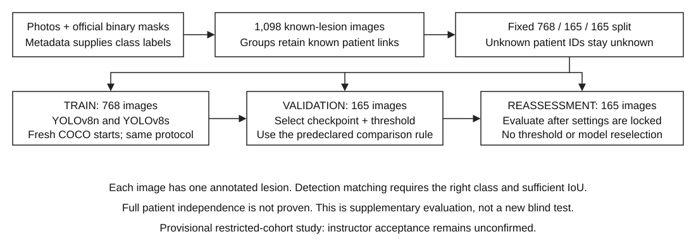

# Current execution guide - 28 October 2026

Use [REPRODUCING.md](REPRODUCING.md) for current data access, bundle verification,
original n/s training, final geometry-n training and locked prediction commands.
The tutor check-off and imported-component approach are confirmed, and the teacher
accepted the known-lesion-only cohort. README.md contains the final results.

The notes below preserve the earlier preparation and validation stages. Their
then-pending decisions and unevaluated-set statements are historical, not current.
Runnable baseline examples now point to the enabled experiment_provisional.json;
the disabled experiment.json remains an unmodified planning record. For the final
geometry run, use the study-specific two-split code specified in REPRODUCING.md.

# COMP3710 Project 3 restart: YOLOv8 lesion detection

This is a provisional restricted-cohort study, not a completed assignment submission. Both real ISIC training runs and validation comparisons are complete (school job 669143); supplementary reassessment has not been model-evaluated. The code integrates Ultralytics 8.3.221; the YOLO network, loss and training engine are third-party implementations, not my own network design. Acceptance of this packaging under the course's `modules.py` requirement is still awaiting clarification.

## Working principle

YOLOv8 is a one-stage detector: convolutional backbone features are fused across scales, then separate head branches predict box distances and class scores. The pinned loss combines box regression (CIoU and distribution focal loss) with binary-cross-entropy classification. At inference, scores are filtered and class-aware NMS removes some overlapping predictions. Labels are boxes derived from masks; the model is not trained to output segmentation masks. The confidence score and the geometric accuracy of the box are separate quantities.



## Data and evaluation boundary

The candidate study uses all 1,098 Task 1 images with recorded lesion IDs: 824 benign and 274 malignant. The other 1,496 images are excluded from every phase. The single Indeterminate image is outside this cohort; it is not relabelled benign. The new head has exactly two classes, Benign=0 and Malignant=1.

| Split | Benign | Malignant | Total |
| --- | ---: | ---: | ---: |
| Training | 576 | 192 | 768 |
| Validation | 124 | 41 | 165 |
| Supplementary reassessment | 124 | 41 | 165 |

`plan_group_splits.py` forms connected components from all recorded lesion and patient links before selecting the cohort. It then assigns whole groups, using seed 3710 and approximate 70/15/15 class and size balance. No missing medical IDs are imputed. There are no overlapping recorded lesion/patient IDs between these sets, but 708 selected images still lack patient IDs. Full patient independence is not established.

The original image-level pilot and its test results were already inspected. Repartitioning or deleting old local artifacts does not undo that exposure. The new evaluation is supplementary reassessment, not a fresh blind test. Both models must start from the original COCO weights; old fitted checkpoints cannot be transferred into this comparison. The teacher has not yet confirmed whether the restricted cohort is acceptable.

## Feasibility review (draft; check-off not verified)

**Purpose and scope**

This classroom prototype compares YOLOv8n (predeclared primary/baseline) with YOLOv8s for locating a dermoscopic lesion and classifying it as benign or malignant. The question is how much malignant detection recall can be retained while limiting benign-image alerts. Each image has one annotated lesion; this dataset does not establish performance in a multiple-lesion clinical scene. Alerts are workload proxies, not biopsy counts, and confidence scores are not cancer probabilities.

**Data and model choice**

The candidate cohort contains all 1,098 images with recorded lesion IDs from 2,594 ISIC2018 Task 1 images: 824 benign and 274 malignant. Whole groups connected by known lesion/patient IDs give train/validation/supplementary-reassessment sizes of 768/165/165. The other 1,496 images are excluded. Some 708 selected images lack patient IDs, so full patient independence is unproven. Instructor acceptance of this restricted cohort is pending. Boxes come from verified official binary masks; class labels come from matched metadata. Both detectors start from their own original COCO weights. Convolutional feature extraction, multiscale fusion, box/class losses and NMS connect the implementation to course concepts. Ultralytics supplies the network and trainer; this is integration and evaluation, not an original YOLO implementation.

**Five testable acceptance criteria**

1. Preserve the declared cohort and class counts, with zero overlapping recorded lesion/patient IDs; decode all selected images and verify dimensions and label coordinates before training.

2. Run n and s on the same split with 60 epochs, 640-pixel input, batch 16, FP32, AdamW and flips only. Retain original-weight, data, configuration and checkpoint hashes.

3. Report classwise AP, precision, recall, TP/FP/FN and localization IoU with explicit denominators. Check the course IoU target of 0.8 once its aggregation rule is clarified; do not claim it has already been met.

4. Select the threshold on validation only: maximize malignant detection recall subject to at most 12 benign alerts among 124 benign images. This 10% budget is a classroom comparison rule, not a clinical standard. If no threshold qualifies, report no feasible operating point.

5. Complete the A100 batch-16/640 preflight without nonfinite values or out-of-memory failure; record peak GPU memory, hardware, latency/FPS scope and training time. Use a planning cap of four GPU-hours for the two formal runs; the actual runtime remains unmeasured.

**Evidence, risks and next decision**

Local verification includes 40 unit tests, two one-epoch synthetic model pipelines, preprocessing equivalence checks and exact COCO initialization audits. Synthetic scores are not lesion-performance evidence. The main risks are missing grouping IDs, restricted-cohort selection bias, weak malignant classification and validation overuse. The earlier test was inspected; repartitioning cannot make the new reassessment blind. The provisional protocol was locked after real-input/GPU checks and both models have completed training and validation. Instructor acceptance remains unconfirmed. Preserve the selected operating points for one supplementary reassessment and document 3-5 failures. If the cohort is rejected, review the required grouping changes and rerun affected experiments. If resources or numerical checks fail, stop and revise both models' shared protocol before rerunning; do not silently change one model's budget.

**Course and authorship notes**

YOLOv8 is in the normal-difficulty option. Component packaging and the IoU denominator still need clarification. This draft does not certify a completed practical consultation. Codex assisted with code, audits and drafting; the student must review, correct and own the submitted explanation. Sources: supplied assessment draft, sections 2.3, 3 and 4; pinned Ultralytics 8.3.221; course Ed threads #136 and #147.

## Working code

| File | Responsibility |
| --- | --- |
| `modules.py` | Constructs the actual two-class PyTorch DetectionModel using the pinned upstream implementation; checks loaded class mapping. |
| `dataset.py` | Checks manifest hashes, labels and known groups; verifies image decoding; stages image links and label copies; supplies the loader actually called by the trainer. |
| `train.py` | Produces a plan, trains and saves models, validates, and runs locked supplementary reassessment. |
| `predict.py` | Loads the selected saved checkpoint, predicts one image and writes an overlay and JSON. |
| `evaluation.py` | Class-correct detection matching, separate image alerts, explicit IoU denominators, validation threshold selection, and consistent NMS policy. |
| `preprocessing.py` | Uses one aspect-preserving letterbox transform for validation, matching prediction, and records gain/padding for inverse box coordinates. |
| `schedule.py` | Projects the pinned learning-rate schedule and checks/records the actual AdamW groups at each optimizer-step call. |
| `checkpoints.py` | Preserves the selected epoch/score before upstream checkpoint finalization removes metadata; inspects storage precision. |
| `experiment.json` | Shared n/s experiment draft, data hashes, original-weight hashes and operating-point rules. |
| `smoke_test.py` | Small synthetic end-to-end software check for both n and s. It produces no ISIC evidence. |
| `audit_real_inputs.py` | Checks original image dimensions, full decoding, EXIF orientation, label staging and exact cross-split decoded duplicates without running a model. |
| `readiness_a100.sh` | Schedules an isolated Linux environment, input audit, tests and synthetic A100 checks; never starts formal ISIC training. |
| `preflight.py` | Two synthetic forward/backward/AdamW steps per model on an explicitly chosen device; records runtime and CUDA memory when available. |
| `transfer.py` | Builds a local transfer ZIP with required code/data references and per-file checksums; verifies archive membership or extracted files without ML dependencies. |
| `test_*.py` | Grouping, label, metric and experiment-boundary regression tests. |

The model builder and loader calls are recorded in each run's `project_model_interface.json` and `project_loader_calls.jsonl`. These show actual integration; matching required filenames alone does not establish course compliance. Model internals and upstream source locations are explained in the project-level `MODEL_COMPONENTS_zh.txt`.

## Experiment draft

YOLOv8n is the predeclared primary model and YOLOv8s the comparator. Both use their own hash-verified original COCO initialization. They share 640-pixel inputs, batch 16, FP32, seed 3710, 60 epochs and AdamW (base lr0=0.001, betas=(0.9, 0.999), weight decay=0.0005 for ordinary weights; biases and normalization weights have no decay). The linear schedule uses lrf=0.01 and warmup_epochs=3.0. Early stopping is disabled. Nominal batch size is also 16, giving one optimizer-step call per batch: 48 batches/epoch and 2,880 planned calls per model. This budget is not a claim of convergence.

The exact pinned schedule matters: its multiplier is `(1 - epoch_index / 60) * 0.99 + 0.01`, with epoch indices 0–59. The last training epoch therefore uses 0.0000265 (2.65% of lr0), not 0.00001. Warm-up interpolates through global batch index 144 inclusive, with its target following that epoch's scheduler value. All groups start at learning rate 0 under the current warmup_bias_lr setting. The first optimizer call can advance AdamW's internal state without changing trainable parameters; step counts do not prove that parameters changed on every call. The configuration's warmup_momentum does not change AdamW betas in this implementation, because the upstream warm-up branch only modifies optimizer groups with a `momentum` key. `train.py plan` reports the projected schedule. `optimizer_steps.jsonl` records actual learning rates, betas, decay and accumulation for every completed optimizer call; a schedule or budget mismatch fails the run. These checks observe the upstream optimizer rather than replacing its update rule.

The initial augmentation policy is horizontal/vertical flips with probability 0.5 each. Mosaic, MixUp, CutMix, oversampling, color changes and affine distortion are off. Optional Albumentations is removed from the runtime transform list so installing it cannot silently add blur or CLAHE. Some disabled transform objects remain present in the library's composition with zero probability/gain. This conservative policy preserves color and whole-lesion context; no performance benefit has yet been demonstrated.

Both training validation and prediction use square, aspect-preserving preprocessing and class-aware NMS at 0.7, maximum 300 detections, and a score floor of 0.001. Unlike the library's default multi-label validation, our validator retains only the highest-scoring class per candidate, matching ordinary prediction. This is an explicit new protocol choice, so the resulting AP is not directly interchangeable with old default-validation results.

The v2 draft also uses `single_letterbox_v1` for evaluation. An actual tensor comparison found differences on 3 of 4 synthetic images between the original validation loader and predictor: the loader initially resizes with `ceil`, whereas the predictor's letterbox uses `round`. The adapter removes the loader's initial evaluation resize and uses the predictor's single letterbox operation, including upscaling small images. It records the correct gain and padding for returning boxes to original-image coordinates. This is evidence of a software-path difference, not evidence that it caused the old malignant errors. Training augmentation remains unchanged. Regression tests compare actual input tensors on landscape, portrait, small and square images at 128 and 640 pixels, and check inverse box coordinates within 0.0001 pixel on those fixtures.

`best.pt` is selected by maximum validation macro mAP50:95 over the fixed budget; the pinned training validator first rounds its returned scores to five decimal places. The trainer retains the later epoch on an exact tie at that precision. That rule is the same for n and s. The final model is not selected after comparing supplementary reassessment results.

Training-time validation uses an exponential moving average (EMA) of the training model's weights. The raw training model and EMA are FP32 under this protocol, but the upstream saver serializes a copy of EMA in FP16. Finalization moves EMA into the checkpoint's `model` field, clears optimizer state, and sets its `epoch` field to -1. Loading restores FP32 tensors; it cannot restore precision already lost during FP16 storage. This is upstream behavior, not a new precision experiment. Saved-checkpoint validation scores need not equal training-time scores exactly because the execution paths include serialization and other numerical differences; an observed difference does not by itself isolate a cause.

`checkpoint_history.jsonl` records each epoch, the actual score used for selection, whether `best.pt` was replaced, EMA update count and in-memory parameter dtypes. `run.json` separately preserves the selected epoch, score and checkpoint storage properties, and the evaluation report carries that selection record. Do not infer the selected epoch from the finalized checkpoint's -1 field or assume that `last.pt` is the best model. Completed `best.pt`/`last.pt` files have no optimizer state and are not exact resume snapshots; this experiment already requires fresh starts. EMA may smooth weight fluctuations, but its performance benefit has not been established on this cohort.

The operating threshold is selected only on validation using the fixed grid in `experiment.json`. The provisional classroom budget allows malignant alerts on at most 10% of benign validation images (at most 12 of 124). It has no established clinical justification. Within that budget, select maximum malignant **detection** recall, then precision, fewer benign alerts, and finally the higher threshold. If no grid point is feasible, report that fact and do not issue a selection lock. Do not expand the grid after looking at reassessment results.

All score filtering uses `confidence > threshold`, matching the upstream NMS boundary. A detection TP additionally needs the correct class and IoU ≥ 0.5. Each GT can match at most one prediction. Wrong-class or badly located predictions can produce both an FP and an FN. Image-alert sensitivity does not require IoU and does not count actual biopsies.

AP uses the low-score sweep, not the chosen operating threshold. At the operating point, per-class IoU is reported separately for all GT with the best class-correct box (missing prediction=0), all GT ignoring class, and matched TPs only. The teacher's intended denominator for the IoU ≥ 0.8 course target remains unresolved. Confidence is not a calibrated probability of cancer.

## Running from the restart project root

The examples below assume `recognition/YOLO_s4905914/`, `data/known_lesion_v1/` and the source snapshots have been transferred together. Data and weights are ignored by Git; reproduce or separately supply the audited manifests and source snapshots. Do not commit them. The local macOS environment snapshot is recorded in `tested-environment-macos-py313.txt`. School readiness and full training have now completed; the recorded Linux/A100 environment is in `requirements-linux-a100.lock.txt`.

`TRANSFER_GUIDE_zh.txt` at the project root explains the local transfer bundle. It includes the required manifests, labels and provenance missing from a plain Git clone. It does not contain images, masks, checkpoints or the full local test logs. Its manifest checks file integrity, not scientific correctness. Building the bundle does not upload files or start training. After extraction, verify before installing ML dependencies:

```bash
python recognition/YOLO_s4905914/transfer.py verify --directory .
```

```bash
python3.13 -m venv .venv
source .venv/bin/activate
python -m pip install -r recognition/YOLO_s4905914/requirements.txt
python recognition/YOLO_s4905914/fetch_weights.py --output weights/original_coco
python -m unittest discover -s recognition/YOLO_s4905914 -p 'test_*.py' -v
python recognition/YOLO_s4905914/train.py plan \
  --config recognition/YOLO_s4905914/experiment_provisional.json --prepared data/known_lesion_v1
```

Read-only initialization audit (no images, optimizer steps or saved checkpoints):

```bash
python recognition/YOLO_s4905914/audit_initialization.py \
  --config recognition/YOLO_s4905914/experiment_provisional.json \
  --weights-dir weights/original_coco --output outputs/initialization_audit
```

The audit constructs two-class models through the project factory with identical random states, then checks every loaded tensor against the original COCO state and every unmatched tensor against fresh initialization. In this pinned setup, n transfers 319/355 state entries and s transfers 349/355. These counts include buffers, not just parameters. Both transfer all backbone, neck and box-regression state. For n, classification hidden width changes from 80 to 64, so no learnable classification-branch parameters transfer (six BatchNorm counters do). For s, hidden width stays 128 and only the final class-output weights/biases at three scales are newly initialized. This is a real initialization difference to disclose in the n/s comparison, not evidence that either model performs better. With `freeze=null`, backbone, neck and prediction branches remain trainable; only the 16 fixed DFL integral coordinates stay frozen. Pretrained initialization does not mean frozen feature extraction. The local evidence is `outputs/initialization_audit_20261017/initialization.json`.

Small CPU integration check (synthetic images only; choose an unused output path):

```bash
python recognition/YOLO_s4905914/smoke_test.py \
  --base-config recognition/YOLO_s4905914/experiment.json \
  --weights-dir weights/original_coco --output outputs/synthetic_smoke
```

Add `--warmup-epochs 3` and choose another output path to exercise the warm-up branch on the same one-epoch artificial fixture. With four batches, the upstream minimum warm-up length is 100 batch intervals, so this is an interface check of the beginning of warm-up, not a reproduction of the complete 60-epoch schedule.

The separate device preflight can run while the full-training gate remains closed. It uses no ISIC images, saves no checkpoint and does not select a model. For a small local CPU check, explicitly reduce the probe size:

```bash
python recognition/YOLO_s4905914/preflight.py \
  --config recognition/YOLO_s4905914/experiment_provisional.json \
  --weights-dir weights/original_coco --output outputs/preflight_cpu \
  --device cpu --batch 2 --imgsz 128
```

On the school host, first obtain a GPU allocation using the school's procedure, then run the default batch 16 / 640-pixel / FP32 probe on the allocated device:

```bash
python recognition/YOLO_s4905914/preflight.py \
  --config recognition/YOLO_s4905914/experiment_provisional.json \
  --weights-dir weights/original_coco --output outputs/preflight_gpu --device 0
```

An unavailable GPU is an error; the script does not silently switch to CPU or reduce the batch. `preflight.json` records the environment, device, original-weight hashes, finite loss/gradients/parameters, and CUDA peak allocation/reservation when applicable. The throwaway optimizer exercises AdamW state allocation but does not reproduce the full trainer's parameter groups, EMA, loader workers or validation. Passing this probe therefore does not guarantee that complete training fits in GPU memory. Recorded step times include verification and are not inference FPS. The school GPU probe passed as job 669120; the full n/s training and validation job 669143 also completed.

For the provisional study, the separate `experiment_provisional.json` was locked with `status="locked_before_training"` and `ready_for_full_training=true`, while `course_acceptance_confirmed=false`. The original disabled draft was not changed. Course questions remain unresolved; progress does not imply instructor approval. A different approved cohort requires new manifests, hashes, counts and a new configuration version; do not bypass the checks.

On the school host, stage the declared images and verify all files decode. The default uses the paths in the manifests. `--image-root /actual/image/directory` is available when the same source files are mounted elsewhere. Images are symlinked, never edited; labels/cache go in the new staging directory.

```bash
python recognition/YOLO_s4905914/dataset.py \
  --prepared data/known_lesion_v1 --config recognition/YOLO_s4905914/experiment_provisional.json \
  --output data/runtime_v1

python recognition/YOLO_s4905914/train.py fit \
  --config recognition/YOLO_s4905914/experiment_provisional.json --prepared data/known_lesion_v1 \
  --stage data/runtime_v1 --weights-dir weights/original_coco --model n \
  --output outputs/n_v1 --device 0
```

Run s using the same command with `--model s --output outputs/s_v1`. Use the school's approved GPU allocation procedure; these commands do not request a scheduler allocation. They refuse to overwrite an existing run directory. Training saves `best.pt`, `last.pt`, `args.yaml`, `results.csv`, `optimizer_steps.jsonl`, `checkpoint_history.jsonl`, loss/metric plots, the environment, source/config/data hashes and runtime measurements. The pinned trainer requests twice the training batch size for its internal validation loader (32 here); standalone evaluation requests 16. CUDA peak allocation is not total device memory. Library timing is not complete mobile application latency.

Validate and select the operating point:

```bash
python recognition/YOLO_s4905914/train.py evaluate \
  --config recognition/YOLO_s4905914/experiment_provisional.json --prepared data/known_lesion_v1 \
  --stage data/runtime_v1 --checkpoint outputs/n_v1/fit/weights/best.pt \
  --split val --output outputs/n_v1_validation --device 0
```

Review validation, confirm the declared comparison is complete, and only then run supplementary reassessment with the generated lock. This command cannot sweep thresholds and checks the checkpoint, configuration, membership and recorded training provenance:

```bash
python recognition/YOLO_s4905914/train.py evaluate \
  --config recognition/YOLO_s4905914/experiment_provisional.json --prepared data/known_lesion_v1 \
  --stage data/runtime_v1 --checkpoint outputs/n_v1/fit/weights/best.pt \
  --split reassessment --lock outputs/n_v1_validation/selection_lock.json \
  --output outputs/n_v1_reassessment --device 0

python recognition/YOLO_s4905914/predict.py \
  --config recognition/YOLO_s4905914/experiment_provisional.json \
  --checkpoint outputs/n_v1/fit/weights/best.pt \
  --lock outputs/n_v1_validation/selection_lock.json \
  --image /path/to/example.jpg --output outputs/example_prediction --device 0
```

## Checks completed locally

40 unit tests passed, including preprocessing, NMS, transfer integrity, the pinned scheduler, AdamW, and actual upstream checkpoint saving/stripping. A controlled four-epoch score sequence checks that a later tied best survives a worse final epoch, is saved from EMA, and retains its selected epoch in the external history after finalization. Both n and s completed a one-epoch CPU run on 8 synthetic training images, with 4 synthetic validation images and 4 synthetic reassessment images. Each run made 4 optimizer-step calls; saved/reloaded two-class checkpoints; produced a finite (1, 6, 8400) decoded output for a 640×640 input; and completed validation selection, locked reassessment and prediction overlays. The latest integration also checked warm-up, selected-epoch records, FP16 checkpoint storage and FP32 loaded parameters. The separate CPU preflight previously completed two synthetic AdamW steps per model at batch 2 / 128 pixels. These synthetic metrics are not ISIC results. `IMPLEMENTATION_VERIFICATION.json` at the restart project root records the evidence and outstanding checks. Eight installed upstream source files matched the downloaded v8.3.221 tag exactly.

All 1,098 candidate original photographs were copied unchanged from the school input directory and matched against independently computed server-side SHA-256 values. A complete local audit decoded every image, checked dimensions against the mask-box source and EXIF orientation, verified all staged labels/file hashes, and found no exact decoded-image duplicates across splits. No model was run on these real images. This establishes input integrity, not full patient independence. Evidence is recorded in `IMPLEMENTATION_VERIFICATION.json`.

## Work still required for submission

School readiness job 669120 completed successfully on a100-7: dependency checks, 40 tests, all 1,098 real input checks, n/s batch-16/640 FP32 CUDA probes, and full synthetic CPU pipelines passed. Earlier attempts 667499 and 667532 failed during temporary-directory selection, before model execution; the corrected selector uses scheduler `TMPDIR`. The GPU probe is not a full-training memory guarantee or evidence of lesion accuracy. The provisional real training/validation study completed as job 669143 (exit 0:0). Independent validation replay and two illustrated validation failures are complete. Supplementary reassessment and the final coursework report remain incomplete. A local software smoke test does not establish the feasibility check-off hurdle. Check-off status, the current deadline, component packaging, cohort acceptance and IoU aggregation still need confirmation. A GitHub PR, final README/PDF and the later review response are also outstanding.

This repository records progressive local implementation work. It has not been pushed or submitted. The final report must describe actual results and the history of exposed data; this preparation README is not a substitute.

## Artificial Intelligence Usage Disclosure

OpenAI ChatGPT/Codex assisted with experimental planning, grouping and label-audit scripts, model/training/evaluation integration, diagnostic checks, tests, reproducibility records, documentation and concept explanations. The network, losses and training engine are provided by Ultralytics; they are not student-authored components. Checks include source inspection, actual tensor comparisons, synthetic end-to-end runs, unit tests and data/provenance audits. Passing these checks does not establish diagnostic accuracy or demonstrate that the student has reviewed every line. The student remains responsible for reviewing and correcting this draft and explaining the submitted work. No other AI tool use is inferred from this conversation.

## Sources and attribution

- [Pinned Ultralytics source, v8.3.221](https://github.com/ultralytics/ultralytics/tree/v8.3.221). The network, losses, datasets, training engine and AP implementation remain upstream AGPL-3.0 components.
- [Pinned detection trainer](https://github.com/ultralytics/ultralytics/blob/v8.3.221/ultralytics/models/yolo/detect/train.py), [validator](https://github.com/ultralytics/ultralytics/blob/v8.3.221/ultralytics/models/yolo/detect/val.py), and [metrics](https://github.com/ultralytics/ultralytics/blob/v8.3.221/ultralytics/utils/metrics.py).
- [Official original-weight assets](https://github.com/ultralytics/assets/releases/tag/v8.3.0). `weights_registry.json` records the downloaded SHA-256 values; these are locally recorded checksums, not publisher signatures.
- Course assessment draft supplied by the student, pages 7 and 12–13. Local filename says v2.3; cover says Draft/Version 2.2. Latest teaching announcements take precedence.

## School readiness command

Use Python 3.13 for the pinned dependencies: SciPy 1.18.1 requires Python >=3.12. The existing school environment was inspected and has Python 3.11 / Torch 2.14.0 / torchvision 0.29.0, which is not the declared stack. Do not silently reuse it or install into it. A separate Python 3.13 interpreter is provisioned in the new school project; the readiness job installs the pinned ML stack into a private temporary directory selected from the actual compute-node paths, with at least 12 GiB free. The first school attempt failed before installation because `/cache` exists on the login node but not on a100-3. The corrected script checks `SLURM_TMPDIR`, the scheduler-provided `TMPDIR`, `/cache`, `/scratch`, then `/tmp`; job 669120 has now passed with this correction. That temporary environment is not portable or permanent. Recheck it before any later job, and rebuild from the recorded requirements if unavailable.

From the isolated school project root, with `.python313` and the hash-verified original weights present:

```bash
sbatch recognition/YOLO_s4905914/readiness_a100.sh
```

This requests one GPU, eight CPU cores and at most 40 minutes. It first installs and checks dependencies, then runs unit tests, decodes real input files, runs the synthetic GPU resource probe and the full synthetic CPU pipeline. It does not evaluate or train a model on ISIC. A missing `COMPLETED.txt` means the preparation job did not complete successfully; inspect its logs. Internet/package availability, cache headroom, CUDA compatibility and scheduler availability must all be verified by an actual run. The original draft remains gated. A separately locked provisional study may proceed after runtime checks while course acceptance remains explicitly unconfirmed; experimental progress is not instructor approval. The current teacher questions remain relevant to the final coursework submission.

## Provisional study released 17 October 2026

`experiment_provisional.json` locks the existing cohort, 60-epoch n/s budget, preprocessing, optimizer and validation-selection rules unchanged. `course_acceptance_confirmed=false` explicitly separates a runnable candidate study from instructor approval. The original `experiment.json` remains an unmodified disabled draft. The missing-ID recheck is documented in `ID_RECHECK_zh.txt`.

`provisional_a100.sh` provisions an isolated Python 3.13 environment using `requirements.txt` constrained by `requirements-linux-a100.lock.txt` (the successful Linux/A100 environment), rechecks inputs/resources, trains both original COCO starts, and evaluates validation only. It requests at most four GPU-hours. It does not run supplementary reassessment or change the threshold rule based on results. Job 669143 completed on a100-4 in 21 minutes 15 seconds, including setup, two 60-epoch training runs and both validation evaluations. Future coursework acceptance or new identity metadata may require revised experiments.

```bash
sbatch recognition/YOLO_s4905914/provisional_a100.sh
```

Do not rerun this completed comparison merely to improve a reported score. Outputs are under `outputs/provisional_20261017_669143/`; its `COMPLETED.txt` confirms that both training and validation commands succeeded.


## Completed validation comparison (job 669143)

Both models used the same 165 validation images (124 benign, 41 malignant), original COCO starts, 60 epochs and 2,880 optimizer-step calls. The predeclared primary remains n; s is a comparator. These validation results were used for checkpoint/threshold selection, so they are development evidence, not a fresh blind test.

| Validation measure | YOLOv8n | YOLOv8s |
| --- | ---: | ---: |
| mAP50 | 0.5874 | 0.5975 |
| mAP50:95 | 0.4055 | 0.3926 |
| Benign AP50 | 0.8157 | 0.7898 |
| Malignant AP50 | 0.3591 | 0.4052 |
| Malignant AP50:95 | 0.2511 | 0.2416 |
| Selected confidence | 0.50 | 0.80 |
| Malignant TP / FP / FN | 13 / 13 / 28 | 11 / 8 / 30 |
| Malignant precision | 50.00% | 57.89% |
| Malignant detection recall | 31.71% | 26.83% |
| Benign-image malignant false alerts | 11/124 (8.87%) | 7/124 (5.65%) |
| Malignant-image alerts, no IoU condition | 15/41 | 11/41 |
| Selected epoch | 32 | 42 |
| Parameters | 3,011,238 | 11,136,374 |
| Training-call elapsed time on A100 | 8.05 min | 9.55 min |
| Peak PyTorch CUDA allocation | 4.17 GiB | 6.12 GiB |

AP sweeps scores from 0.001 and is separate from the selected operating point. Each model's threshold follows the same fixed 14-point grid and at-most-12/124 benign false-alert rule. At a shared threshold of 0.50, s detects 22 malignant images but alerts on 28 benign images, exceeding the budget. At 0.70, s has 14 malignant TP and 14 benign alerts, also exceeding it. The grid was not refined after looking at these results.

n has better macro mAP50:95 and recall under the declared operating rule; s has better malignant AP50 and selected-point precision. Neither dominates all measures. At their selected thresholds, 5 malignant images are TP for both, 8 only for n, 6 only for s, and 22 for neither. The net difference of two TP on 41 malignant images and one seed is not evidence of a stable population advantage. Training-call time is not inference latency; allocated CUDA memory is not total device memory.

Among n's 28 malignant FN, 19 have a localized malignant prediction in the low-score cache that falls below the operating threshold, 7 have only localized benign candidates, and 2 have no candidate reaching IoU 0.5. For s, these counts are 21, 8 and 1. The cache is post-NMS and has already applied the 0.001 floor. These categories describe available outputs; they do not identify imbalance, augmentation, NMS or image artefacts as causal explanations. Two illustrated validation cases are in the PDF; complete paired results are in the local evidence directory.

At the selected operating points, mean malignant IoU over all 41 GT using the best correct-class prediction (missing=0) is 0.2870 for n and 0.2118 for s. Ignoring class yields 0.7236 and 0.4362; TP-only means are 0.8571 over 13 matches and 0.7895 over 11. Those denominators are not interchangeable and do not establish compliance with the unresolved course IoU target.

`compare_validation.py` independently replayed all 28 operating points with NumPy and verified GT/manifest/config/checkpoint hashes, original-weight identities, actual arguments, epoch and update histories, selected thresholds and finite logged scalars. AP is the pinned library output, not independently recomputed. All recorded n/s source hashes agree with each other; only the packaging-only `transfer.py` differs from the current local copy, outside the training/evaluation import path. The full audit is saved with the raw results and a compact tracked copy is `validation_results_669143.json`.

Reproduce the read-only comparison after restoring the raw result directory:

```bash
python recognition/YOLO_s4905914/compare_validation.py \
  --run-dir outputs/provisional_20261017_669143 \
  --output outputs/validation_comparison_20261017 \
  --image-root /path/to/unchanged/school_images
```

Omit `--image-root` to skip example figures. Reproducing the PDF additionally requires ReportLab and the generated figures; the PDF dependency is separate from the pinned training environment:

```bash
python recognition/YOLO_s4905914/build_validation_report.py
```

The plain four-page PDF is `output/pdf/COMP3710_Validation_Comparison.pdf`; the concise Chinese result summary is `VALIDATION_COMPARISON_zh.txt`. Raw checkpoints/results and generated figures are local ignored artifacts, not part of a plain Git clone or the old preparation transfer bundle. Validation has now been inspected; its results must not be described as an untouched evaluation. The supplementary set has not been model-evaluated, and its historical exposure still prevents a fresh-blind-test claim.
